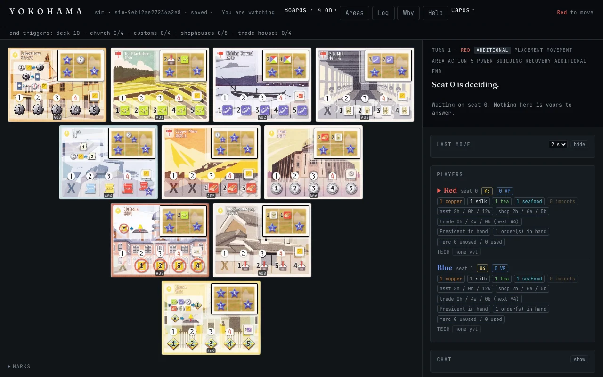

# Yokohama Assistant

A Rust engine, live-game CLI tracker, and verification stack for the board game **Yokohama**
(Hisashi Hayashi, 2016), built toward a computer player that provably plays to win.

> [!IMPORTANT]
> **Testing the CLI? Start with the [HTML CLI guide](docs/cli-guide.html).** Ready-to-run
> builds for Apple Silicon macOS, Ubuntu x86_64, and Windows x86_64 are on the
> [Releases page](https://github.com/jmoore2333/yokohama-assistant/releases). This tree builds version
> **0.6.0**, set at the M6.5c2 close; its `v0.6.0` tag and Releases entry wait on the owner's word, and the
> newest build is always the one on the Releases page. The default bot has been the sighted evaluator
> `v4-step9-draft1` since v0.5.0, and each download also includes an offline copy of the guide.

**Priority order:** 1) engine-validated move-by-move tracking of live games via CLI →
2) a computer player → 3) computer vision / AR assist (deferred; the original 2025 AR-first
vision lives in `docs/plans/2025-12-07-yokohama-assistant-design.md`).

**Contents:**
[See it running](#see-it-running) ·
[The browser client](#the-browser-client) ·
[Hosting](#hosting) ·
[Status](#status-2026-08-30) ·
[Workspace crates](#workspace-crates) ·
[Download and run](#download-and-run) ·
[Build from source](#build-from-source) ·
[Data provenance](#data-provenance-cards-boards-tokens) ·
[Where truth lives](#where-truth-lives)

## See it running

![The Yokohama CLI at 2 players against the built-in bot: the staggered pyramid board on the
left, both Presidents placed; on the right the players panel — RED (you) and GREEN marked [bot]
with its hand hidden — where each seat carries its own Orders line naming the order cards it has
filled, then the church and customs tracks with the 2-player dummy pawn, the three achievements,
and the order still in hand; along the bottom the end-trigger strip reads church 4/4 and FINAL
ROUND, and the message zone greets the reloaded save with GAME OVER — the Church track
filled](docs/images/cli-frame-b4.png)

One of the owner's own finished 2-player games, reloaded — real terminal output (v2 frontend,
200×50). The bot in this capture plays **`lookahead-v1`** over the frozen evaluator-v2 weights,
which was the production default on the day it was taken; **since v0.5.0 the wizard's default seat
is the sighted `v4-step9-draft1`** instead, and the machinery shown below explains either one
identically. It decides from the same masked view of the game a seated player gets: its Orders
line prints `0 in hand (hidden) · 2 filled (O04, O33)`, because which cards a seat has *filled*
is public and what it still holds is not. Every decision it makes can be interrogated after the
fact:

![The why command's output for one of the bot's placements: a header naming the seat, the full
contestant identity string, the event index and decision seed, and the statement that the move
was reconstructed by replay; then two labelled lines of search counters, the move it played, the
six-move line it searched, the term-by-term score table with a marker against each row that
carries a nonzero product and the zero rows dimmed, and the ranked runner-ups it rejected — here
four candidates tied at the top](docs/images/cli-why-counters-b4.png)

That is **`why 178`** asking about the bot's placement: the record is replayed to event 178 and
the bot's own decision function re-run at the same derived seed — so the account is a
*reconstruction the engine can vouch for*, not a stored note — then what the search cost
(139 root candidates, 1,401 nodes, 3,311 scored positions, and the budget and cap guards that
never bound), the move, the line it searched, the arithmetic, and what it rejected at what
margin. A `why` that cannot reproduce the recorded move refuses, naming both moves.
**`suggest`** is the same machinery pointed at *your* seat before you move; both apply nothing
and record nothing.

#### What the V4 bump bought, in one decision

That screenshot is the **previous** evaluator thinking — sixteen features, which was the entire
vocabulary it had. Here is the **shipped V4 bot** answering the same kind of question, a
three-area placement, in one of the owner's own games. Same command, same tables, no image
needed — this is the driver's real plain-text output, reproducible from the saved record:

```console
$ printf 'why 146\nquit\n' | yokohama-cli game.json
─ Why ──────────────────────────────────
Seat 1 (Blue) · v4-step9-draft1@v2{b=4,eval_impl=3,k=1,m=8,weights=6957643967275421640} · event 146
This move was reconstructed by replay under THIS build's consts — evaluator impl
3, v4-step9-draft1 impl v2 — from decision seed 0x60bd1d0c935a80a1, the key the
bot's own pump derived from the recorded stream seed and the event count.
Search cost: root_candidates 186 · nodes 1837 · handles 1837 · route_dfs_nodes
186 · forced_nodes 1630 · leaves 783 · scored 4328 · root_scored 186 · max_line
6 · free_extension_steps 0
Budget and guards: budget_binds 0 · budget_starved 0 · placement_cap_binds 0 ·
ply_cap_hits 0 · free_cap_hits 0
The move it played:
  Place 1 assistant in each of: Fishing Ground (A01), Bank (A04), Employment Agency (A09)

The line it searched, 6 move(s) to the hand-over (the move above is step 1):
  1. Place 1 assistant in each of: Fishing Ground (A01), Bank (A04), Employment Agen…
  2. Move President to Employment Agency (A09) — free
  3. Employment Agency: take 1 assistant (free)
  4. Skip the 5-Power token
  5. Skip the building
  6. End additional-action phase

Score at that point: 628   ·   stage 750000/1000000 ppm (0 = opening, 1000000 = end trigger)
  feature                        you   best opp   weight     product
▶ victory_points                  42         26       30         480
▶ country_bonus_now                2          4       35         -70
▶ tech_bonus_now                   5          0       18          90
▶ church_bonus_now                 6          0        5          30
  customs_bonus_now                0          0       15           0
  assistants_in_hand_core          2          2       23           0
▶ assistants_in_hand_excess        0          5        7         -35
▶ assistants_in_warehouse         10          9      -10         -10
▶ assistants_on_board              5          3        9          18
  shophouses_built                 2          2       18           0
  trading_houses_built             0          0       22           0
▶ five_power_tokens                2          3       12         -12
▶ imported_goods                   0          2        7         -14
  achievement_progress_sum         6          6        3           0
  mercenaries_total                0          0        3           0
▶ hand_size                        0          1       -1           1
▶ production_access                7          0       10          70
▶ track_access                     0          2        1          -2
▶ assistant_areas_distinct         4          3       -4          -4
▶ president_local_access           1          0       -1          -1
▶ bank_access                      3          2       15          15
  employment_agency_access         0          0        1           0
▶ president_reachable_areas        4          0        4          16
▶ money_stock                      6          2       16          64
  trade_goods_stock               12         12       11           0
  building_tokens_ready            0          0        0           0
  held_order_value                 0         12        0           0
▶ order_matched_goods              0          4        1          -4
  executable_orders                0          0        0           0
  flag_icon_marginal               2          4        0           0
  held_order_icons                 0          1        0           0
▶ lab_takeable                     0          4        1          -4
  port_takeable                    0          0        1           0
  matched_production_access        0          0        0           0
  TOTAL                                                          628
  19 of 34 rows carry a nonzero product — they are this move's whole story.

Runner-ups (margin against the suggestion, so 0 means tied) — 186 candidate(s) ranked:
          -5  Place 1 assistant in each of: Fishing Ground (A01), Tea Plantation (A02), Emplo…
          -6  Place 1 assistant in each of: Fishing Ground (A01), Tea Plantation (A02), Bank …
          -6  Place 1 assistant in each of: Fishing Ground (A01), Silk Mill (A07), Employment…
This is the bot's arithmetic, not advice: each row is (your value − the best
opponent's) × the weight for this stage, summed. It read ONE guess at the hidden
cards, and its weights were never tuned on human play.
```

Both are the same shape of decision — a one-assistant-in-each-of-three-areas placement, six
moves to the hand-over — which is what makes them worth putting side by side. Read that way, the
difference is legible without knowing the plan:

- **The table is 16 rows in the screenshot and 34 here** (it says so itself: *12 of 16 rows carry
  a nonzero product* there, *19 of 34* here). Those extra eighteen are the V4 "sighted" features,
  appended after the incumbent sixteen (`Feature::INCUMBENT_COUNT = 16` in `game/eval.rs`), and
  they are what the older evaluator was structurally unable to see: where assistants actually sit
  and what that reaches (`production_access`, `bank_access`, `president_reachable_areas`,
  `assistant_areas_distinct`), and what the economy affords both seats (`money_stock`,
  `order_matched_goods`, `lab_takeable`, `port_takeable`).
- **The older table ties; this one separates.** The screenshot ends with *four candidates tied at
  the top* — the search could not tell them apart, so a keyed draw picked one. Here the top
  choice beats its nearest rival by 5 with the next two at −6, out of **186** ranked candidates.
- **The new rows are carrying real weight.** Of this move's 628 points, the incumbent sixteen
  contribute 478 and the eighteen sighted features contribute **150** — with `production_access`
  alone worth +70 against an opponent sitting at 0.

What that does **not** establish is a strength claim. These are two different positions from two
different games, at different stages of the game (the screenshot is at the end trigger, this one
three-quarters in), so the weights themselves differ and no row-by-row comparison is being made —
they are here to show the *shape* of the change, not to measure it. The measurement is
the pre-registered confirmatory field in the status section below — θ̂ 0.691 against the
previously shipped evaluator — and even that is a head-to-head result, not the project's
"plays to win" bar, which stays unclaimed.

The driver is loud about the one moment a game can be lost by missing: the **end trigger**.


The banner fires once, on the transition, and states the rule rather than a Rust variant name; a
save reloaded after the fact gets the one-line notice instead (the `GAME OVER — the Church track
filled` line in the first screenshot above). And because "what does this area pay me at the
power I can bring?" is the question a new player asks most, every area's whole ladder is one
command away:


Every figure on that reference is computed from the engine's own reward functions rather than
re-derived in the display layer, so it cannot drift from what the action actually pays.

**[Full `suggest` walkthrough →](https://claude.ai/code/artifact/9dbb3a84-7994-4066-a400-7e83c049a19e)**
— a few minutes of live play against a bot seat (2026-07-27, v0.3.3), captured as the raw ANSI
stream from a 140×50 PTY, with an honest read on both sides: **what held up** (the search's
projected lines matched the played-out game move for move; it found genuine multi-step
combinations; determinism and the no-side-effect guards are real) and **what it flagged** (two
display-layer bugs in `describe.rs` — a Laboratory surcharge rendered as a reward, and production
previews that ignore the acting player's techs — plus the evaluator's structural positional
blindness, and the fact that the *playable* bot was, at that date, the 3.2 weighted-random rung).
Every finding is display-layer; the engine did the right thing in each case. Three of them have
since been retired: the Laboratory surcharge now prints as a `slot fee: 2 yen` clause instead of
reading as a reward, the weights are **evaluator v2** (frozen 2026-08-10), and since Phase A's W5
(2026-08-12) the playable bot IS the search — a wizard bot seat runs `lookahead-v1`, the same
controller `suggest` consults, and the **`why`** command replays and explains any bot move after
the fact.

That link is a hosted copy, so it opens and renders in a browser. The source of truth is
[`docs/suggest-walkthrough-2026-07-27.html`](docs/suggest-walkthrough-2026-07-27.html) in this
repo — GitHub shows `.html` as source rather than rendering it, so read that one by opening the
file locally.

## The browser client

The same engine, the same words and the same legal-move gate as the terminal, served over HTTP and
drawn in a browser. It is a *second frontend over one engine*, never a second engine: the server
routes, scopes and serializes and computes nothing about the game, so the terminal and the browser
cannot disagree about a rule. It runs three ways, described under [Hosting](#hosting): hosted
multiplayer on Cloudflare, the NAS container, and single player entirely inside the browser.

### Getting started

1. **Play at a hosted site.** Open `https://yokohama.moore.nyc` (Cloudflare) or
   `https://yokohama-nas.moore.nyc` (the NAS) and pass Cloudflare Access's login. The door offers the
   bot, friends and the games on this device. "Play with friends" opens the lobby, where a new table
   seats you, the bot or an open seat, optionally behind a password; share the table's link, each person
   keeps one of two dealt cards, and the game begins.
2. **Self-host in Docker.** [`deploy/README.md`](deploy/README.md) is the guide: build the image (its five
   build values are `--build-arg`s, and the Turnstile site key's stays blank behind Access), then run it
   with `YOKOHAMA_WEB_IDENTITY` set, `cf-access` behind Access or `open` for a home network, and a named
   volume at `/data`. `YOKOHAMA_WEB_TABLE_TTL_DAYS` with an archive directory turns on an hourly sweep of
   idle tables, and `deploy/update.sh` moves a running container to a new release tag: fetch, build, smoke,
   swap ([§9, Updating](deploy/README.md#9-updating)).
3. **Play the bot with no server.** The door's bot card runs the whole game in the browser, kept in its own
   storage and playable offline once the release is installed. A local game makes no server call until it
   ends. Any host that serves the release will do.

**Resuming.** A game that is not over opens on the web exactly when this build's own CLI resume reconstructs
the exact bot recorded in it: an update that still runs a game's bot keeps it playable, and one that no longer
does refuses it with the CLI's reason, never playing it as another bot; a finished game always opens
([`docs/web-lane.md` §6](docs/web-lane.md#6-what-a-save-file-says)).

The full walkthrough is [`docs/web-lane.md` §14](docs/web-lane.md#14-getting-started).

### What both deployments run

The settings a player notices, as cycle F's release set them (2026-10-01) and security S1's window
(2026-10-11) left them, the Worker's dev door turned off; the table of the defaults both run is
[`docs/web-lane.md` §14](docs/web-lane.md#the-defaults-both-deployments-run).

- **The door.** The NAS runs `cf-access`; the Worker runs `worker`, its dev door OFF since S1's window
  and opened only around a live tier.
- **The archive.** A finished game is filed to a directory on the NAS and to an R2 bucket on the Worker.
- **The transport.** Server-sent events on the NAS, a WebSocket on the Worker.
- **Expiry.** Both end a table idle for 90 days, or 7 days while a seat is still empty. The Worker does it
  with an alarm; the NAS with an hourly sweep that refuses to start without an archive and files what it
  ends there.
- **Chat.** On, keeping 500 messages a room and 500 characters a message, on both.
- **The build values.** `YOKOHAMA_PROJECT_URL` (the door's link to this repository),
  `YOKOHAMA_SITE_NOTICE` ("Not affiliated with Asmodee"), `YOKOHAMA_SITE_BLURB` (the door's paragraph,
  quoted in the lane document), `YOKOHAMA_RELEASE_FEED` (unset, so derived from the project link) and
  `YOKOHAMA_SITE_URL`, which names the host, so each host serves its own client build. Neither host's
  build carries a Turnstile site key: both run behind Access.

### What a public deployment gets for free

A build that is given its own address and repository carries a web presence with no extra service. Every
file is static, served with no request to anything else, and left out of the offline release.

- **For crawlers and language models.** `robots.txt` (everything allowed but `/api/`, `/enter` and
  `/cdn-cgi/`) and `llms.txt` (what the site is, in the `llmstxt.org` shape). With `YOKOHAMA_SITE_URL`
  set, also `sitemap.xml` and the `Sitemap:` line in `robots.txt`.
- **For a link's preview.** The page's description, Open Graph and Twitter-card tags and one JSON-LD block,
  with the canonical link and `og:url` when `YOKOHAMA_SITE_URL` is set. None of it claims any affiliation.
- **A notice of a newer release.** When `YOKOHAMA_PROJECT_URL` is a GitHub repository, the door and the
  lobby ask GitHub's latest-release feed from the visitor's own browser and say so when it is newer than the
  build running. While the repository is private GitHub answers 404, and the page draws nothing.
- **Updates with no click.** An installed door takes a waiting release itself and reloads once; a game in
  play shows "A new version is ready. Reload to use it" and waits for the click.
- **A 404 page.** A browser that asks for a file the release does not have gets a static page, "Nothing
  here", with a link home, in place of a blank.

Both hosts sit behind Access today, so a crawler meets Access's login: these files are what a deployment
gets the day its hostname leaves Access ([`docs/web-lane.md` §8](docs/web-lane.md#8-the-public-doors-preconditions)).

### Every variable and the API

Every environment variable is in [`docs/web-lane.md` §12](docs/web-lane.md#12-every-variable), and every
route is in [`§13`, the API map](docs/web-lane.md#13-the-api-map). They are kept there so this page
cannot drift from them.

### See it


*The door, the first screen. It asks the server for nothing.*


*The lobby: the tables you sit at, the open tables and the games being played.*



*A watcher's game screen. The player's view, the deal and the phone layouts are in
[`worker/README.md`](worker/README.md#14-what-a-player-sees).*

### How it plays

**Starting a game.** You sign in first — the server reads one identity header, and which header it
reads is a deployment's choice (see [Hosting](#hosting)). Then you fill one row per seat: this is
me, this is *someone@else*, an open seat for anyone who has the link and can pass the deployment's
door, or the bot, which is offered at two players only. A table with an open seat waits, **open**,
until the last seat is taken; a table with every seat filled opens **dealing**. Nothing is dealt
onto one screen: each person opens the table and keeps from **their own view**. You see your own two
cards on the **set table** — the areas with their site cards and tokens, the port and the tracks,
what the rulebook has on the table at the step where the two starting orders are dealt and chosen in
secret — with the built-in bot's Keep score under each of them, and nobody else's cards reach your
browser at all. The technologies and the goals go out at the two steps after that one, so they are
revealed once you have chosen, and a bot seat's own two are face down: it keeps one of them, the
record knows which, and you never see it. When the last person has kept, the game starts.

While it runs, each browser is served **its own seat**: your hand is open, every other seat is a
count. Your opponent's turn arrives on its own — pushed to each visible tab over one held
connection, server-sent events on the NAS and a WebSocket on Cloudflare — and a turn that landed
elsewhere plays back step by step across your table rather than snapping into place. Undo works as
it always has against the bot; at a table with more than one person you can take back your own
move only while your turn has not passed.


The left is a **table**: the pyramid of area tiles, each one the printed tile with any
building-site card and pieces on it (the Canal, at three and four players, carries neither), and
under the pyramid whichever boards you have switched on from the banner's `Boards` menu — the
port, the laboratory, the church and customs tracks, the goals, the building sites. The right is
a **side column** with the **answer bar pinned at its top**, so whatever the game is asking is
always on screen; under it sits the account of the turn just played — one row per event, with the
controls that walk it back out across the table — then every seat's dashboard and your hand. While a
placement picker is open the table itself becomes the input surface, and the fee your current
selection would cost is printed before you commit to it. Below 1201px the same parts stack, with
the answer bar pinned along the bottom edge instead.

**The replay track (M4).** Open the log and the whole move trail is there, each line worded as it
read when it applied — with a track above it that walks the game. Drag it, step with the arrows,
or press any line to jump to the position that move was decided in. Above 1201px the panel is a
right-hand drawer and the table redraws beside it at full size inside a green outline; below that
the panel covers the page and there is no outline. Nothing on the redrawn table is pressable,
because a past position is not answerable.
The port and the laboratory draw from that same past position; only the building sites collapse.


The track has one more stop than there are moves, because the last stop is *now* — a real
position with no move to name. It is a projection over the record the server already holds:
browsing the past applies nothing, records nothing, and changes nothing.

**It serves one seat at a time, and the replay route serves the caller's own.** Every payload —
live, historical, the card indexes, the explanations — is built for the seat the *caller* holds,
so walking every position of the replay returns your own hands and no other's and the history
cannot be harvested in a single pass. Before M6.1 that was a fence around whoever happened to be
moving; it is now a fence around a named person, resolved from the identity header on every
request. On the NAS it is still **not** a claim that the identity was verified: the server reads
the address Access sets and verifies nothing itself, and today cloudflared passes each request on
without checking Access's token, while the terminal container shares the server's network,
`cf-internal`. S2's wrap window will give cloudflared Access's own token check on both of its
ingress rules and the terminal a network of its own, so that the tunnel becomes the one path to
the port (the self-host guide's §1 recipe); `deploy/RUNBOOK.md` §3.22, written at that window, will
record it. On Cloudflare the Worker verifies Access's signed assertion before anything else reads
the request, and its dev door, which lets the live tiers' service token name a test address, is
off except while a live tier runs — see [Hosting](#hosting) below.

**Asking the bot.** `Suggest` runs the production bot on your seat and shows the move, the line
it searched, and the arithmetic term by term. `Why` does the same for a move a bot already
played, by replaying the game to that point and re-running the bot's own decision — so the
account is a reconstruction the engine can vouch for, and it refuses rather than guessing when
the reconstruction does not match the record.

There is a **Help** panel in the client itself covering all of this, with the same screenshots.

```bash
# from the repo root
cd web && npm ci && npm run build && cd ..
YOKOHAMA_WEB_IDENTITY=open cargo run --release -p yokohama-web   # http://127.0.0.1:8080
```

`YOKOHAMA_WEB_IDENTITY` has no default and the server exits without it. `open` is the mode for your
own machine: the door is the first screen, the lobby asks for a name, and you play under it. Before you put the server on a
network, read the self-host guide, [`deploy/README.md`](deploy/README.md).

## Hosting

**One table layer, three hosts, and a guide and a runbook for each server.**

- **Your own server, in Docker — [`deploy/README.md`](deploy/README.md), the self-host guide.** Set
  the Worker's two TTL variables there and an hourly sweep ends idle tables, refusing to start
  without an archive; the sweep, and the by-hand recipe for a server with no TTL, are its §8, and its §9 with
  `deploy/update.sh` moves a running container to a release tag. One image carries the server and the client.
  - The guide leads with Access: `cf-access` behind a Cloudflare Access application, this repository's
    default.
  - It gives the open door its own section and trust model, for a home network, a LAN or a VPN with no
    identity provider: anyone who can reach the server may use any name.
  - The owner's own instance is a container on a Synology NAS at `yokohama-nas.moore.nyc`, reached from
    outside the NAS only through the existing cloudflared tunnel, behind Access. It ran
    `yokohama-web:0.5.0-m6.5b2.1` from 2026-09-22 under the mode then called `claimed`, from the M6.5c2
    close (2026-09-28) it ran `yokohama-web:0.6.0-m6.5c2` under `cf-access`, from cycle D's close
    (2026-09-29) it ran `yokohama-web:0.6.0-m6.5c2d`, from cycle E's release (2026-09-30) it ran
    `yokohama-web:0.6.0-m6.5c2e`, from cycle F's release (2026-10-01) it ran
    `yokohama-web:0.6.0-m6.5c2f`, and since security S1's window (2026-10-11) it runs
    `yokohama-web:0.6.1-s1`, with server-sent events, a directory archive and the hourly sweep at the
    Worker's 90 and 7 days (`deploy/RUNBOOK.md` §3.18 to §3.21 are the last four deployments' records).
    S2's wrap window will move it to `yokohama-web:0.6.3-s2`, give cloudflared's two ingress rules
    Access's own token check and the terminal container a network of its own, and record the three as
    `deploy/RUNBOOK.md` §3.22.
    [`deploy/RUNBOOK.md`](deploy/RUNBOOK.md) is its operating record rather than a plan: §1 the static
    musl cross-compile on the workstation, §2 delivery as a context tarball the NAS fetches through
    Portainer's Docker proxy (`POST /build?remote=…`), §3 the container (network `cf-internal`, the
    named volume `yokohama-web-data` holding the game store, no port published to the LAN), §3.5 on
    every deployment with its numbers, §5 rollback (every earlier image tag is still on the NAS).
- **Cloudflare: hosted multiplayer at `yokohama.moore.nyc`, live since 2026-09-23 (M6.5c) —
  [`worker/README.md`](worker/README.md), written for readers new to Cloudflare.**
  - A stateless Worker verifies Access's signed assertion and forwards each request by name to a Durable
    Object: one per table, which keeps that table's documents in its own SQLite and runs the layer as
    its own WebAssembly instance; one for the lobby; and one per player for browser saves.
  - Moves reach the other screens over hibernatable WebSockets, finished and abandoned games are
    archived to an R2 bucket in the NAS archive's own layout, and a table idle for 90 days is saved and
    expires.
  - Start with
    [what a Durable Object is](worker/README.md#2-what-a-durable-object-is-and-what-serverless-means-here),
    [Free vs Paid](worker/README.md#3-free-vs-paid-and-how-this-was-optimized-for-free),
    [the 10 ms CPU budget](worker/README.md#4-lessons-from-the-10-ms-cpu-budget-and-how-the-core-crates-run-inside-it)
    and [what a game costs](worker/README.md#5-estimates-for-concurrent-and-ongoing-games).
  - [`worker/RUNBOOK.md`](worker/RUNBOOK.md) is how it is built, deployed and read, and
    [the two doors](worker/README.md#15-the-two-doors-access-or-an-open-door) are its identity choice:
    Access, as this repository deploys it, or an open door.
  - The cycle's record is [its close](docs/plans/2026-09-26-web-frontend-m6.5c-close.md). The cleanup
    cycles after it, M6.5c2's A to F, are recorded in
    [the lane document's list of records](docs/web-lane.md#11-the-records-of-record). Since 2026-10-11 it
    runs security S1's release, the Worker's thirty-second and thirty-third deployments
    (`worker/RUNBOOK.md` §21).
- **The browser: single player** (M6.5b, M6.5b2). The same layer, compiled to WebAssembly, runs in a Web
  Worker, so a game against the bot needs no server.
  - The game is kept in the browser's own storage, and the release installs whole for offline play.
  - A finished game is sent to the host's archive when there is one.
  - On either hostname a local game makes no server call until it ends.

The web lane's operating detail — its suites, its gates and its standing rules — is in
[`docs/web-lane.md`](docs/web-lane.md). The Modal path and its edge proxy were retired unused (`deploy/RUNBOOK.md`
§4).

What the code already does right:

- **Nothing exists only in memory.** Every applied move is persisted as its `GameRecord` and an
  absent handle is rebuilt from the store, so a container that sleeps and loses its disk cache
  loses no acknowledged move. Storage is behind a byte-shaped trait, so a mounted volume is a
  path and an object store is a second implementation rather than a refactor.
- **It drains on the way out.** `SIGTERM` and `Ctrl-C` stop new connections and let in-flight
  requests finish, so a scale-to-zero cannot kill a `POST` between applying a move and storing
  it.
- **The bind address is explicit.** `YOKOHAMA_WEB_HOST` (default `127.0.0.1`) and
  `YOKOHAMA_WEB_PORT` (default `8080`); a container needs `0.0.0.0` and that is a deployment's
  decision to make, not a default to inherit.

### The room cycles' records

Each cycle's own record is its close. The hosting move is M6.5 of
[`docs/plans/2026-09-14-web-frontend-m6-room-plan.md`](docs/plans/2026-09-14-web-frontend-m6-room-plan.md).
The mode M6.1 called `claimed` has been named `open` since M6.5c2 (R-6.5c2.3), and the NAS is ruled
`cf-access` (R-6.5c2.5).

- [M6.1, identity and seats](docs/plans/2026-09-15-web-frontend-m6.1-close.md)
- [M6.2, the lobby](docs/plans/2026-09-16-web-frontend-m6.2-close.md)
- [M6.3, transport and spectating](docs/plans/2026-09-16-web-frontend-m6.3-close.md)
- [M6.4, chat](docs/plans/2026-09-19-web-frontend-m6.4-close.md)
- [M6.5a, the seam](docs/plans/2026-09-20-web-frontend-m6.5a-close.md)
- [M6.5b, single player in the browser](docs/plans/2026-09-21-web-frontend-m6.5b-close.md)
- [M6.5b2, the front door, installable and offline](docs/plans/2026-09-22-web-frontend-m6.5b2-close.md)
- [M6.5c, the objects](docs/plans/2026-09-26-web-frontend-m6.5c-close.md)
- [M6.5c2 cycle C, the hosts and the close](docs/plans/2026-09-28-web-frontend-m6.5c2c-close.md)
- [M6.5c2 cycle D, the code](docs/plans/2026-09-29-web-frontend-m6.5c2d-close.md)
- [M6.5c2 cycle E, the finish](docs/plans/2026-09-30-web-frontend-m6.5c2e-close.md)
- Cycle F, the clean finish: its record of record is its close,
  `docs/plans/2026-10-01-web-frontend-m6.5c2f-close.md`, written at the cycle's end; the other rows of
  [the lane document's list](docs/web-lane.md#11-the-records-of-record) lead to its plan and spec. The merge of
  the cycles' branches and the `v0.6.0` tag are the owner's word and are not claimed here.

## Status (2026-08-30)

The engine plays complete, rules-correct games at 2–4 players and has been verified
**differentially**: an independently-authored rules oracle — written from the rulebook and
knowledge base only, never from engine code — agrees with the engine on every legal-move set
(240/240 games after fixes), every president-route label (7,272 decision points plus
adversarial worst-case batteries), and every final score including the official tie-break
(540 games). The campaign (Phase 2.9) found and fixed four engine bugs and one oracle bug that
self-play fuzzing structurally could not see, hardened every raw apply arm against ill-formed
payloads, mutation-proved the invariant suite, and closed all four rules ambiguities it
surfaced with owner rulings. Full report:
[`docs/plans/2026-07-20-phase-2.9-final-report.md`](docs/plans/2026-07-20-phase-2.9-final-report.md).

**The computer player ladder (Phase 3) is deep into its final sub-phase**, governed by the
accepted map [`docs/plans/2026-07-25-phase3-map.md`](docs/plans/2026-07-25-phase3-map.md).
Sub-phases 3.0–3.4 (all merged to master, `SEMANTICS_REV` unmoved by any of them):

- **3.0 — honest observation** (PRs #6–#7): a seat-relative `PlayerView` masking the five-member
  hidden set, plus a conservation-consistent belief sampler — a bot takes a view, never a raw
  `GameState`.
- **3.1a/b — the bot-facing action interface** (PRs #8–#9): factored lazy move families (the
  442,368-move retreat worst case served one candidate at a time in ~5 allocations), an exact
  allocation-free route enumerator, and cheap single-candidate legality.
- **3.2 — the arena** (PR #12): the permanent strength court — paired seat-swapped cells, honest
  bootstrap intervals with a typed zero-width refusal, the family-weighted rollout policy (also
  the fuzzer's), and the self-play training corpus with full per-seat provenance.
- **3.3 — the first purposeful bot** (PR #13, merged 2026-07-27): **evaluator v1** (sixteen
  view-measurable features, transparent stage-interpolated weights, exact-sum explanations),
  the **Greedy-v1** and **Lookahead-v1** rungs (turn-boundary depth semantics, settled by a
  pre-registered experiment), scenario suite v1, and CLI `suggest my move`. **The map's gate was
  declared met on both binding arms**: Lookahead-v1 swept all 200 paired units against the
  family-weighted rung on the committed regression master AND on a freshly drawn OS-entropy
  master (rule-of-three bounds 0.985, VP margins +67/+68). Close report:
  [`docs/plans/2026-07-27-phase3.3-close-report.md`](docs/plans/2026-07-27-phase3.3-close-report.md).
- **3.4 — the discriminating experiment** (branch `phase3.4-search-arch`, 2026-08-05): a UCT
  contestant (`mcts-v1`) and a shared **scored-successor budget** that caps either architecture on
  one currency, then a **pre-registered** matched-budget experiment — the decision rule committed
  before any cell ran. Seven cells, 2,400 games, one attempt: **MCTS-v1 is NOT adopted; the 3.3
  turn-boundary shallow search is retained, on the merits.** Both node-matched arms landed entirely
  below the null (θ̂ 0.045 and 0.050, the second on a freshly drawn master) and so did the
  wall-matched cell against the shipped rung (θ̂ 0.070 at a 1.033 wall ratio) — the map's
  "strength-per-node and strength-per-wallclock can rank differently" was tested and here they
  agreed. MCTS-v1 stays as a labelled diagnostic under release gate #14. Decision record:
  [`docs/plans/2026-08-04-phase3.4-architecture-decision.md`](docs/plans/2026-08-04-phase3.4-architecture-decision.md);
  close report:
  [`docs/plans/2026-08-05-phase3.4-close-report.md`](docs/plans/2026-08-05-phase3.4-close-report.md).

**3.5a — the CLI redesign** (PR #16, merged 2026-08-07) rebuilt the driver into the v2 frontend:
a 200×50 raised-floor frame with a persistent dashboard, full words, a visual card index as the
canonical identification mechanism, guided pickers and menus everywhere, readline editing, and
full-screen views — with the piped protocol byte-identical and the engine crates untouched.

**3.5b — the BGA→CLI bridge** (PR #17, merged 2026-08-09): a read-only dev-mode Chrome extension
+ localhost relay + importer that turns the owner's own BoardGameArena games into
engine-validated records — cards identified by their unique requirement/reward vectors, hidden
information kept hidden, every unrecognized shape a typed refusal rather than a guess. **The
re-scoped Phase-2 live-tracking gate is CLAIMED on real table 896157897**: 145/145 BGA moves
replay engine-legal from move 1, 103 counter checkpoints green, both final scores matching BGA
exactly (62 == 62, 115 == 115). Along the way the bridged games surfaced five rules questions,
each closed by an owner ruling sourced from the physical rulebook and BGA's observed behaviour
(**rules-parity revs 6 and 7**, PRs #18/#19 — `SEMANTICS_REV` now 7, with two deliberate,
recorded BGA-parity divergences).

**3.5c — the strength lane — is where the work now lives.** So far, all merged:

- **Evaluator v2 frozen and shipped** (PR #20, 2026-08-11): three pre-registered iteration
  rounds over measured self-play corpora produced thirty-two re-priced weights;
  the pre-registered close criterion held — `lookahead-v1@V2` vs `@V1`, 2P, N=200 units,
  θ̂ 0.6775, bootstrap [0.6275, 0.7250] entirely above the null — and the owner signed it off
  under a deliberately **narrow claim**: a materially stronger successor for the retained 2P
  turn-boundary controller at shipped knobs. **V2 shipped ≠ the bar.**
- **The 3.5c scoping amendment ratified** (2026-08-12,
  [`docs/plans/2026-08-11-phase3.5c-scoping-amendment.md`](docs/plans/2026-08-11-phase3.5c-scoping-amendment.md))
  — eleven owner rulings that fix the route from V2 to the bar: development-field tuning →
  a frozen production identity → ONE confirmatory five-rung experiment, with a two-layer
  strength-reality checkpoint in between and hard attempt-accounting rules throughout.
- **Phase A of that route is complete** (PRs #21/#22, 2026-08-12): CLI bot seats are typed to
  `Contestant` and the wizard's default bot **plays the production-intent `lookahead-v1`**;
  the new **`why` / `why <n>`** command replays any bot move to its exact decision point and
  prints the same explained account `suggest` gives — refusing honestly whenever the
  reconstruction cannot vouch for the recorded move; and the BGA importer learned the Tram
  vocabulary (evidence-first, from the captured payloads), regenerating the comparison corpus
  at rev 7.
- **Phase B is complete** (PR #23, 2026-08-18): a driven-fixture harness that re-runs any
  recorded decision through the search at chosen knobs, a re-derived triage of the owner's two
  diagnostic games, a counters baseline for V2 play, and a readout on the four strategic
  families. Its measured result is the useful one. The bot's tie-mass defect turned out to be
  **two** mechanisms rather than one — one exemplar root still ties with the beam widened to 8
  and 16 (a *representation* gap: the evaluator cannot see the difference) while another resolves
  into a single best line at beam 8 (a *horizon* gap) — and three positions the owner had flagged
  as bad play measured as genuinely dead, no candidate winning in any replication, where
  indifference is the correct answer rather than a defect.

**Phase C followed** (PR #24, 2026-08-18): the four driven strategic families frozen, run, and
routed. Two evaluator cycles have since run on top of that harness:

- **The V3 mini-cycle closed NULL** (PR #27, 2026-08-19). Both ruled candidates washed at their
  pre-registered gates — terminal-margin at L2, `achievement_race_proximity` at L3. The probe
  instruments and the evidence merged; **no behaviour changed.** A cycle that measures its two
  candidates and ships neither is the process working rather than failing.
- **V4 — the sighted-evaluator milestone — PASSED AND SHIPPED** (PR #30, merged 2026-08-30;
  record of record
  [`docs/plans/2026-08-30-phase3.5c-v4-close.md`](docs/plans/2026-08-30-phase3.5c-v4-close.md)).
  The candidate `v4-step9-draft1` is an evaluator whose leaf can finally *see* — spatial/action
  affordance and order/economic opportunity, computed for both seats — where its predecessor
  scored positionally blind. In the one pre-registered confirmatory field, on the one attempt the
  freeze allowed, it cleared **jointly**: θ̂ **0.691** [0.667, 0.715] against `v2-padded` (the
  shipped behaviour) and **0.885** [0.867, 0.902] against `v2-refit-padded` (the refit control),
  with a healthy self-null (0.498 over 647 read units). The escrowed driven-family blocks were
  then re-read as a **regression guard an arena win cannot overrule** — GREEN: three non-blocking
  VOIDs, zero failed admitted roots, one clean 0/20 exhibit per guard. The fifteen-gate release
  roster ran as one uninterrupted sequence, 15/15. It ships **as itself**: `Contestant::PRODUCTION`
  *is* the confirmed named identity — the CLI's default bot seat and `suggest`'s advisor — with
  `lookahead-v1` and `greedy-v1` grandfathered byte-identically at the V2 table, so every figure
  ever recorded against those names stays comparable. **The bar is not claimed.**

**Where the work stands right now — the owner gate.** The milestone's close puts two decisions
side by side, and as of 2026-08-30 **both are deliberately on HOLD**, waiting on one cheap thing:
the owed `why`-scribed diagnostic game against the new default bot at the merge head, played by
the owner and deliberately revisiting placement-heavy and end-timing positions. That scribe log
then informs both rulings at once — the cadence's whole point being that watching the shipped
player actually play costs less than either wrong turn.

- **D3 — the opponent-reply depth re-ask.** Whether to open the bounded cross-handoff diagnostic
  inside the shallow search. It was deliberately sequenced *after* the representation work,
  because a negative measured over a still-blind leaf would have been confounded rather than
  clearance. The leaf can now see, so the answer will finally be interpretable either way.
- **W6 — the knob-screening GO/WAIT.** Capability-conditioned by owner ruling (2026-08-20):
  screening waits for a version with a reasonable chance of playing to win. An identity that
  beats the previously shipped bot at θ̂ 0.691 is the kind of version that ruling was waiting
  for — but it is the owner's call, **never an automatic arrow**.

Until those are ruled, the **exact bounded-tree adjudicator** is the one dispatchable lane. Two
further items are carried in the open rather than buried: **OD-6's roster-target restatement** is
ripe — the roster read 492.17s on the M5, its first crossing of the stated ≤420s target,
dominated by `evaluator_gate` at 268.3s (wall figures are per-machine and stay tagged beside
their own baselines) — and a **V5 shelf item**, a produce-and-hoard self-play trait that now
carries three printed mechanical exhibits instead of an inference.

The CLI is tester-ready; start with the linked HTML guide and report any table/CLI mismatch.

Releases track completed phases (**v0.5.0** ↔ the V4 close, whose default bot is the sighted
evaluator, is the newest tagged release until the next tag; **v0.3.3** ↔ Phase 3.3 was the previous
full cut). The workspace is at 0.6.0 since M6.5c2 (R-6.5c2.19); the `v0.6.0` tag is cut after the
stack's merge, on the owner's word. Saves
and self-play records are compatibility-keyed to the game-semantics revision (`SEMANTICS_REV`,
currently 7), not the release version (PR #14), so they survive release cuts — though a save stops
resuming across a semantics bump by design, and rev-6-and-earlier saves no longer resume.

## Workspace crates

| Crate | What it is |
|---|---|
| `yokohama-core` | The engine: serde-serializable `GameState` (history-free, cheap to clone for search), pure `get_legal_moves` / checked `apply_move`, seeded setup, `GameRecord` save/replay stamped with `rules_hash`, `semantics_rev`, and a terminal-state digest verified by `replay_strict` — plus the Phase-3 player stack: the honest observation boundary (`PlayerView`/`observe`/`BeliefSampler`), the factored action families (`DecisionHandle`), the arena (contestants, paired cells, corpus emission), evaluator v1 (`game/eval.rs`), and the Greedy/Lookahead search rungs |
| `yokohama-cli` | The game driver: setup wizard → REPL; simulated games and live-table tracking (reconciliation, desync tripwire), save/load/undo, TTY-colored board, a persistent dashboard whose per-seat **Orders line** names the cards each seat has filled, an **`areas`** reference printing every area's payout ladder from the engine's own reward functions, a bordered **end-trigger banner** that fires once on the transition and states the two-phase end rule, the BGA `import`/`--follow` pipeline, and **human-vs-bot play** in sim mode (any seat mix with ≥1 human; a bot seat is a `Contestant` — the wizard default plays the confirmed production identity `v4-step9-draft1`, honest by construction: the agent sees only its seat's view) plus the explanation pair: **`suggest`** — the same search analyzes YOUR seat's view and explains its recommended move term by term — and **`why` / `why <n>`** — any bot move replayed to its exact decision point and accounted for with the same tables, refusing (never guessing) when the reconstruction does not match the record |
| `yokohama-oracle` | The independent referee: legal-move enumeration, final scoring + tie-break, and a prune-free route reference, authored from the rules sources under an audited independence rule (types-only dependency on the engine) |
| `yokohama-difftest` | The harness comparing engine vs oracle: per-decision-point sweeps under two policies, terminal scoring comparison, three-way route-pruning check, self-contained divergence artifacts + `repro` tool |
| `yokohama-bridge` | The BGA capture relay (Phase 3.5b): a localhost-only HTTP sink that appends what the read-only browser extension in `bridge/` observes to `bridge-captures/<table>.ndjson`, plus the feed pre-processor (typed NDJSON reader, payload-identity dedupe, structural supersession collapse for takebacks). Depends on NO engine crate and knows no rules — translating captures into engine moves is `yokohama-cli`'s `import`, deliberately on the other side of that boundary |
| `yokohama-web` | **Merged 2026-09-11** — the HTTP surface over the engine, with its browser client in `web/`. It routes, scopes and serializes and computes nothing about the game: every model is `screen_model`'s, every word is `describe`'s, every move goes through the same `Session` legal-list gate the terminal uses, so the two frontends cannot disagree about a rule. Read-only projections for the reference panels and the replay track, the two explanation routes that run a real search (`suggest`, `why`), and no payload anywhere carries the setup seed. Since M6.1 it reads one identity header per configured mode and builds every payload for the caller's own seat |
| `yokohama-wasm` | The browser host (M6.5b): the same table layer compiled to WebAssembly and run in a Web Worker by `web/src/local/`, so a single-player game needs no server |
| `yokohama-worker` | The Cloudflare host (M6.5c): the same table layer compiled to WebAssembly, one instance per Durable Object, under the TypeScript shell in `worker/`; [`worker/README.md`](worker/README.md) explains it |
| `gen-data` | YAML → Rust generator for the verified card/site data (never hand-edit `game/data.rs`) |

## Download and run

Download the archive for your system from
[GitHub Releases](https://github.com/jmoore2333/yokohama-assistant/releases) — the release this tree
builds is **v0.6.0**, and the Releases page carries the newest build:

- `macos-apple-silicon` is optimized for Apple Silicon Macs (M1 or newer).
- `ubuntu-x86_64` is a static binary for 64-bit Ubuntu Linux.
- `windows-x86_64` is a 64-bit Windows build.

Extract the archive, open a terminal in the extracted directory, and run:

```bash
./yokohama-cli
```

or on Windows (PowerShell):

```powershell
.\yokohama-cli.exe
```

The macOS build is ad-hoc signed rather than notarized. If macOS quarantines it, approve it in
**System Settings → Privacy & Security**, or run
`xattr -d com.apple.quarantine ./yokohama-cli` before launching it. On Windows, use
**Windows Terminal** for color output — classic conhost may show raw escape codes — or set
`NO_COLOR=1` to force plain text on any platform.

For the full walkthrough, setup instructions, commands, and troubleshooting, use the
**[HTML CLI guide](docs/cli-guide.html)**. The same guide is included as `CLI-GUIDE.html` in each
release archive.

## Build from source

```bash
# prerequisites: Rust via rustup, then from the repo root:
cargo test -p yokohama-core            # engine suite
cargo run  -p yokohama-cli             # setup wizard → play a game
cargo run  -p yokohama-cli -- save.json  # resume a save (autosaves every move)
```

Fastest playable game: answer the wizard `sim`, `2`, `red`, `blue`, `0`, Enter twice, `0`, `0`,
`confirm`. At the prompt: type an option number, or use the direct grammars — placement
`a 3 7 9` / `b 5`, assistant moves `m 4 7`, retreats `r 3:2 5:1`. Views: `board`, `areas`,
`sites`, `goals`, `tracks`, `labs`, `log`, `help`; plus `suggest` (the bot's explained
recommendation for your seat), `why` / `why <n>` (a bot move, replayed and accounted for),
`undo`, `save`, `q`.
Full tester guide: **[HTML](docs/cli-guide.html)** or [Markdown](docs/cli-guide.md).

**Gates.** Per-edit (debug): the six crate suites (`yokohama-core`, its `eval_probe` example
target, `yokohama-cli`, `yokohama-oracle`, `yokohama-difftest`, `yokohama-bridge`) + the four
`bridge/tests/*.js` node suites (the BGA bridge's browser half has no cargo coverage and would
otherwise never run) + `cargo clippy --workspace --all-targets -- -D warnings`, all zero-warning.
The web lane's own per-edit commands — the layer, both WebAssembly hosts, the client's npm commands
and the Worker's — and their counts are in [`docs/web-lane.md` §2](docs/web-lane.md#2-the-suites-and-the-gates).
Pre-merge: all **fifteen** release gates below, measured as ONE uninterrupted sequence at every
close — a sum of per-command times from separate sessions is not a measured total. **Wall
figures are per-machine since 2026-08-11** (two workstations whose profiles INVERT by gate
shape; baselines live side by side and are never compared to each other): **Apple M5 —
382.86s** at the v2 freeze close, under the ≤420s target, which is an M5 reading; **Debian 13
WSL2 (Ultra 7 265K) — 508.9s** at the PR #20 merge head, then **498.5s** (W5 close) and
**511.7s** (W2 close, two gate walls carrying rebuild overhead) — 15/15 rc=0 in every run. The
fifteenth gate is the Phase-3.3 recovery falsifier, DEMOTED 2026-08-09 by owner ruling from the
per-edit tier it had outgrown (it buys ~90–100s off every per-edit core run for ~7s of roster);
the fourteenth is Phase 3.4's architecture gate, whose addition restated the roster target
≤360s → ≤420s. This table is the binding list — if it and CLAUDE.md's two-tier policy ever
disagree, they are both wrong until reconciled.

| Gate | Command | Proves |
|---|---|---|
| Fuzz | `cargo test --release -p yokohama-core --test fuzz_full_games -- --ignored` | 1,500 self-play games, per-move invariants |
| Choice census | `cargo test --release -p yokohama-core --test choice_encoding -- --ignored` | every choice variant fires organically |
| Observation honesty | `cargo test --release -p yokohama-core --test observation_honesty -- --ignored` | the view masks the hidden set, the sampler conserves, no leakage (Phase 3.0) |
| Action-source equivalence | `cargo test --release -p yokohama-core --test action_source_equivalence -- --ignored` | the factored action families reconstruct `get_legal_moves` exactly — as a multiset AND in ORDER, elementwise — at seeds 0..20 × 2/3/4P, plus the dense adversarial route cells (Phase 3.1a + 3.1b) |
| Action-source worst case | `cargo test --release -p yokohama-core --test action_source_worstcase -- --ignored` | pays both exhaustive ceilings once to record the gaps the factored source avoids: the 442,369-move retreat ceiling and the frozen route reference's 1,687,537 allocations at the dense cell (Phase 3.1a + 3.1b; both hard bounds — retreat serve-one `< 64`, routes `≤ 2·labels + 32` — are per-edit) |
| Differential | `cargo test --release -p yokohama-difftest --test differential -- --ignored` | engine ≡ oracle on every legal-move set |
| Routes3 | `cargo test --release -p yokohama-difftest --test routes3_differential -- --ignored` | route pruning ≡ prune-free reference |
| Scoring | `cargo test --release -p yokohama-difftest --test scoring_differential -- --ignored` | final scores + tie-break ≡ oracle |
| Worst-case routes | `cargo test --release -p yokohama-difftest --test routes3_worstcase -- --ignored` | maximal 17-area interior-Canal K6 battery (bound 519 — that harness's RECORDED observation, never a ceiling; ledger L9) + route-label key purity |
| Arena | `cargo test --release -p yokohama-core --test arena_gate -- --ignored --test-threads=1` | the arena ranks seat policies with HONEST intervals: a same-policy null cell containing its null with nonzero SE, a non-degenerate edge cell plus a guaranteed edge from two shipped knob settings, the zero-width refusal exercised on the real blowout (never a printed ±0.000), byte-identical re-runs at both unit shapes, interval-machinery validation against known truth (R=2,000 synthetic) AND against real clustered games (R=100 replicates), honest-play counters, and freshly emitted records that all `replay_strict`-clean (Phase 3.2) |
| Policy diversity | `cargo test --release -p yokohama-core --test policy_diversity -- --ignored` | the fuzzer runs the SHIPPED family-weighted policy at 2/3/4P (N=500/count, per-move invariants, raw-state driver): 4P trigger diversity recovers against a frozen held-out uniform ceiling (ChurchTrackFull Wilson95 lower bound 1.83% > 0.72%), applied-move coverage clears floors measured before they were set, and per-phase option-count tails are RECORDED — never bounded, since no bound is known (Phase 3.2) |
| Evaluator | `cargo test --release -p yokohama-core --test evaluator_gate -- --ignored --test-threads=1` | the evaluator bots beat family-weighted random with honest intervals (Phase 3.3; every cell's contestants run `WeightTable::V2` since the 2026-08-10 freeze, all figures re-recorded then), five 2P cells on one committed diagnostic master: the PROMOTION cell (Lookahead-v1 vs family-weighted, N=200 pair units) is the repo's ONE direction-asserting cell — passing on either a bootstrap interval entirely above 0.5 or the all-won refusal's rule-of-three bound 0.985 > 0.5, both pre-committed before the run (measured: θ̂ 1.000000, 400/400 games, the refusal arm) — with §0.3(b)'s explanation identity riding it (74,331 moves played, 74,331 explained); plus two RECORDED lattice cells (Greedy-v1 vs family-weighted θ̂ 0.6300 [0.5775, 0.6800]; Lookahead-v1 vs Greedy-v1 θ̂ 1.0000 at 100 units), a Keep-homogeneous NULL self-test asserting containment (θ̂ 0.5475 [0.5000, 0.5975] — the lower bound sits AT 0.5 exactly on the current capture, a standing flake risk with an in-source disposition, never an excuse to widen), and byte-identical determinism at N=12 (2,129 report bytes). Arm 2 — the close-time OS-entropy confirmation — is deliberately not in the roster |
| Architecture | `cargo test --release -p yokohama-core --test architecture_gate -- --ignored --test-threads=1` | the Phase-3.4 MCTS-v1 contestant and the shared scored-successor budget are registered honestly, three 2P cells on one committed diagnostic master and **no cell asserts a direction** (the architecture question is the pre-registered experiment's, not a roster test's): DETERMINISM on the node-matched C2 shape (`mcts-v1@750` vs `lookahead-v1:b=4,cap=750`, N=12 run twice — 2,336 byte-identical bytes, with a flipped-master anti-vacuity control backed by a play-derived figure); HONEST COUNTERS on the same shape at N=8 (`x_explanations == x_applied_moves`, 3,108 of 3,108, and the x/y budget meters on both sides at `0 < root < scored`, `binds > 0`, `starved <= binds`, with MCTS-v1's `(Some, None)` cap-counter shape); and the MCTS SELF-NULL at N=24 asserting nonzero SE and non-degenerate unit shares — the only detector a new contestant has for a CRN/keying collapse, which reproduces byte-identically — with containment of 0.5 printed, never asserted at that N (Phase 3.4) |
| Piped dogfood | `cargo test --release -p yokohama-cli --test piped_dogfood -- --ignored` | the shipped binary plays a full 2P game over pipes to a winner, zero ESC bytes |
| Recovery falsifier | `cargo test --release -p yokohama-core --lib -- --ignored` | under the SHIPPED weight table (`WeightTable::V2` since the freeze; both the table and the floor moved with it, deliberately — a floor left at the V1 value would have been half a share the shipped table no longer produces), a retreat that RECOVERS something is still sometimes the greedy argmax — the executable falsifier for L6's eval-v0 pathology, measured over the freeze corpus's first 312 seeded 2P games against a measured-then-halved floor: **7 picks in 175,782 applied moves, share 0.000040 vs floor 0.000020** at `SEMANTICS_REV` 7. Per-edit until 2026-08-09, demoted by owner ruling (OD-6 arm 1) once the rev-7 sample re-size took it to ~113s of debug wall; **runs EXACTLY 1 test** — it is the only `#[ignore]`d test in the core lib, which is why the command is `--lib` and why that count is stated here. Deliberately no small-N per-edit smoke: at ~4 events per ~176,000 applied moves the power IS the sample size (`policy_diversity`'s frozen-floor precedent); the per-edit ordering pin and one-ply cells keep guarding the assistant triple (Phase 3.3, demoted in Phase 3.5c) |

## Data provenance (cards, boards, tokens)

All static game data is **verified, three ways** (program of 2026-07-16/17, artifacts in
`docs/plans/2026-07-16-card-verification/`): blind per-cell re-transcription of the TTS sprite
sheets, diffed against the YAML sources, with counts anchored to the rulebook's printed
component list ("Contents of the Game": 36 order cards — corner indices 1–36 verified present
exactly once; 30 technology cards — per-title copy counts summing to the rulebook's 30; 24
building sites re-modeled to their positional space rewards). Jeremy's physical box check
(2026-07-18) closed every flagged exception — including the full 5-Power token pool, board
layouts, and canal geometry — and every owner ruling since is recorded in
[`guidingpath.md`](guidingpath.md)'s decision log. The engine's registries are generated from
the YAML by `gen-data`; a `rules_hash` stamps every saved game with the data that produced it.

The code in this repository is Apache-2.0 (`LICENSE`, `NOTICE`), but the game's own material is
not the owner's to relicense: [`ASSETS.md`](ASSETS.md) names the four excluded paths —
`tts-assets/`, `crates/yokohama-web/assets/art/`, `web/public/help/`, and the rulebook PDF — and
says what a fork has to do about them.

## Where truth lives

- [`guidingpath.md`](guidingpath.md) — **authoritative** status, roadmap, and every rules
  ruling (decision log)
- [`CLAUDE.md`](CLAUDE.md) — working conventions (TDD, gates, the oracle independence rule,
  the `SEMANTICS_REV` bump contract), and the web lane's suites and standing rules
- [`deploy/README.md`](deploy/README.md) / [`worker/README.md`](worker/README.md) — the two server
  hosts' guides: the self-host image, led by Access with the open door beside it, and the Cloudflare
  host
- [`deploy/RUNBOOK.md`](deploy/RUNBOOK.md) / [`worker/RUNBOOK.md`](worker/RUNBOOK.md) — their
  operating records: the NAS's recipe and every deployment's readings, and the Worker's
- [`docs/cli-guide.md`](docs/cli-guide.md) / [`.html`](docs/cli-guide.html) — tester-facing
  CLI guide (kept word-identical, enforced by the `guide_sync` test)
- [`docs/suggest-walkthrough-2026-07-27.html`](docs/suggest-walkthrough-2026-07-27.html) — a
  hands-on review of `suggest` at v0.3.3 in real terminal output: what held up, and the
  display-layer defects it surfaced (a dated snapshot, not a maintained doc). Also
  [hosted, for a link that renders](https://claude.ai/code/artifact/9dbb3a84-7994-4066-a400-7e83c049a19e)
  — a copy, so edit the file above and re-publish rather than treating the page as the original
- [`docs/plans/`](docs/plans/) — dated designs, plans, and reports;
  [`2026-07-20-phase-2.9-ruling-list.md`](docs/plans/2026-07-20-phase-2.9-ruling-list.md) is
  the rules-ambiguity register (fully ruled)
