# `worker/` — the Cloudflare host

This directory is the hosted-multiplayer deployment of the Yokohama browser client. It runs on
Cloudflare: a **Worker** named `yokohama-web` (a small program Cloudflare runs on demand), three
classes of **Durable Object** (named instances that each keep their own storage, here SQLite), and
an **R2** bucket (Cloudflare's object storage). It serves `https://yokohama.moore.nyc` behind
**Cloudflare Access**, a login gate in front of the whole hostname. It was built in the M6.5c
cycle, "the objects", and has been live since its first deployment on 2026-09-23.

It is written for engineers and would-be contributors who know web systems but not Cloudflare, and
not this repository. If a Cloudflare word is new, [the terms section](#the-cloudflare-terms-this-readme-uses)
defines each one in a few lines. §2 to §5 then explain the platform, its free plan, the CPU budget
that shaped the design, and what a game costs; the rest explains **why** the host has the shape it
has and **how** each part works. Every mechanism is described as the code does it at the M6.5c
close, and a sentence M6.5c2 made false is corrected where it stands, with a dated note. Every
figure is either a reading, named with where it was taken, or, in §5, an estimate derived from
readings and labelled as one. The readings are this cycle's own measurements, and
Cloudflare's documentation as fetched on 2026-09-26. A behaviour that was designed but never
observed live says so.

It is a map, not an authority. The authority is the spec,
[`docs/plans/2026-09-22-web-frontend-m6.5c-objects-spec.md`](../docs/plans/2026-09-22-web-frontend-m6.5c-objects-spec.md),
read with the corrections execution recorded in the close,
[`docs/plans/2026-09-26-web-frontend-m6.5c-close.md`](../docs/plans/2026-09-26-web-frontend-m6.5c-close.md).
The operating manual is [`RUNBOOK.md`](RUNBOOK.md), beside this file; in this README, "RUNBOOK" is
that file, and the NAS host's is [`deploy/RUNBOOK.md`](../deploy/RUNBOOK.md). Where this file and the
code disagree, the code is right and this file has a bug.

**Contents.** Start with [the Cloudflare terms](#the-cloudflare-terms-this-readme-uses) if the
platform is new to you.

1. [What it is, and where it runs](#1-what-it-is-and-where-it-runs)
2. [What a Durable Object is, and what serverless means here](#2-what-a-durable-object-is-and-what-serverless-means-here)
3. [Free vs Paid, and how this was optimized for Free](#3-free-vs-paid-and-how-this-was-optimized-for-free)
4. [Lessons from the 10 ms CPU budget, and how the core crates run inside it](#4-lessons-from-the-10-ms-cpu-budget-and-how-the-core-crates-run-inside-it)
5. [Estimates for concurrent and ongoing games](#5-estimates-for-concurrent-and-ongoing-games)
6. [Why Workers, Durable Objects and R2](#6-why-workers-durable-objects-and-r2)
7. [The parts](#7-the-parts)
8. [The transport](#8-the-transport)
9. [Testing, building and deploying](#9-testing-building-and-deploying)
10. [Operating it](#10-operating-it)
11. [What it does not do](#11-what-it-does-not-do)
12. [Where to read next](#12-where-to-read-next)

---

## The Cloudflare terms this README uses

In the order they matter here. Where a sentence states a fact about the platform, its source is
Cloudflare's documentation as read on 2026-09-26; §3.1 lists the pages.

- **The edge.** Cloudflare's own network of data centres. Code that runs "at the edge" runs in
  whichever data centre received the request, not on a server this project owns.
- **A Worker.** A program, here TypeScript, that Cloudflare runs when a request arrives. A Worker
  is stateless: nothing it holds in memory is promised to survive to the next request, which may
  run in another data centre. On the Workers Free plan a request gets 10 ms of CPU time. This
  host's Worker is `src/index.ts`.
- **An isolate.** The sandbox a Worker runs in: a V8 isolate, from the JavaScript engine in Chrome,
  which Cloudflare calls "a sandbox for your function to run in". It is not a container or a virtual
  machine, and "a single instance of the runtime can run hundreds or thousands of isolates" (*How
  Workers works*). One isolate can also run many Durable Objects (*Durable Objects pricing*).
- **Static assets.** Files uploaded with a Worker, here the web client, its service worker and the
  card art, which Cloudflare serves directly without running the Worker. Requests for them are
  free and unlimited.
- **A Durable Object.** A named, single-threaded instance of a JavaScript class, with storage only
  it can reach. §2 explains it in full. This host has three classes: `Table`, `House` and
  `Archive`.
- **SQLite-backed storage.** Each Durable Object can own a SQLite database, which its code queries
  synchronously. The Workers Free plan allows only this kind of Durable Object.
- **Hibernation, and hibernatable WebSockets.** An idle Durable Object is removed from memory and
  rebuilt from its storage on its next event, when its constructor runs again (*Lifecycle of a
  Durable Object*). A WebSocket accepted through Cloudflare's Hibernation API stays connected
  meanwhile, and a small attachment the object wrote to it persists (*Durable Objects:
  WebSockets*). An auto-response the object registers answers a fixed message, here `ping` with
  `pong`, "without waking WebSockets in hibernation and incurring billable duration charges"
  (*Durable Object state*).
- **An alarm.** A time a Durable Object sets for itself, one per object. When it comes, the platform
  runs the object's `alarm()` handler, waking it if it was hibernated.
- **A binding, and RPC.** A binding is how code reaches a resource: `env.TABLE` is the namespace of
  table objects, `env.ARCHIVE` the bucket, `env.ASSETS` the static assets, each declared in
  `wrangler.jsonc`. RPC is calling a public method of another object's class through a stub; here a
  table object calls the house object's `apply`.
- **R2.** Cloudflare's object storage, compatible with Amazon S3's API: a bucket of keys, each
  holding a body. This host archives finished and abandoned games to the bucket `yokohama-archive`.
- **Cloudflare Access.** Cloudflare's login gate, part of its Zero Trust products. An Access
  *application* covers a hostname: nobody reaches it without signing in, and every request Access
  lets through carries a signed JSON Web Token (a JWT) that names who signed in.
- **A service token.** A credential for a machine rather than a person: a client id and a secret,
  sent as two request headers, which Access admits in place of a login. Access calls this Service
  Auth. This host's test harnesses use one, named `yokohama-worker`.
- **WARP.** Cloudflare's device client. A computer enrolled in the team's Zero Trust organization is
  recognized by Access as its signed-in user, which is how the owner's own shell reaches the
  operator routes with plain `curl`.
- **wrangler.** Cloudflare's command-line tool. It deploys a Worker with its assets and bindings
  (`npx wrangler deploy`), streams its live log (`npx wrangler tail`), and manages its secrets and
  buckets.
- **A secret.** A Worker variable set with `wrangler secret put`. Its value is never shown again,
  and a deploy leaves it in place.
- **Bot Fight Mode.** A setting of the Cloudflare zone (the domain `moore.nyc`) that challenges
  requests that look automated. A plain `curl` from outside WARP meets its challenge before it
  reaches Access.

---

## 1. What it is, and where it runs

### 1.1 One layer, three hosts

The game has ONE table layer, the crate `crates/yokohama-web`. Everything a player can ask of a
hosted game is a typed route behind one front door: create a table, join it, keep a starting card,
make a move, chat, watch, undo, or ask the bot to explain a move. The front door is

```rust
api::dispatch(games: &Games, host: &Host, identity: Identity, req: &ApiRequest) -> ApiResponse
```

`Games` is the layer's state. It holds a store of documents, a signal, a clock and an archive, and
each of those four is a trait: a seam a host fills in. The layer routes, scopes and serializes, and
it computes nothing about the game itself. Every legal move comes from the engine
(`crates/yokohama-core`) and every word from the terminal client's own model
(`crates/yokohama-cli`), so the terminal and the browser cannot disagree about a rule.

A game is stored as three JSON documents:

- **the record** (`GameRecord`): the seed and every applied event. The engine rebuilds the game by
  replaying it, so the record IS the game. It carries no clock, so the same moves write the same
  bytes at any hour;
- **the table document** (`TableDoc`): who sits where, who created the table, its status, its
  optional password (`Lock { salt, hash }`), each seat's kept starting card, and the setup seed;
- **the chat document**, one per table, and one more for the lobby's "house" chat.

That one layer is compiled three ways, and each compilation is a **host**: the code that fills the
seams and speaks one platform.

| Host | Code | What it serves | Identity | How a change reaches a browser | Where finished games go |
|---|---|---|---|---|---|
| **The NAS container** | `crates/yokohama-web` with its `server` feature (axum and tokio) | hosted multiplayer at `yokohama-nas.moore.nyc`, and the self-host path | `cf-access` behind Access (the repository's default), or `open` for a self-host with no identity provider ([`deploy/README.md`](../deploy/README.md)) | server-sent events | a directory |
| **The browser** | `crates/yokohama-wasm`, run in a Web Worker by `web/src/local/` | single player, with no server | a fixed local identity | nothing to signal | IndexedDB, then an upload by the client's outbox |
| **Cloudflare** (this directory) | `crates/yokohama-worker`, one instance per Durable Object, under the TypeScript shell in `worker/src/` | hosted multiplayer at `yokohama.moore.nyc` | `worker`: Access's assertion, verified (shown as `cf-access`), or `open` (§1.5) | hibernatable WebSockets | the R2 bucket `yokohama-archive` |

The client is ONE static release, `web/dist`, with its service worker. The NAS serves it from its
own binary, and Cloudflare serves it from its asset layer. Single player runs from that release on
either hostname and makes no server call until a game ends.

The table's fifth column is how a game's changes reach a screen. **A new release reaches a browser the same
way from every host**, because the client is the same code (`docs/web-lane.md` §4 and §15). The page asks for
`/sw.js` on every navigation, when a tab comes back into view and every 15 minutes, and a new release installs
in the background from `/shell.bin` beside the previous cache. Since cycle F the door applies a waiting
release itself and reloads once, with no click, and a lobby or a game screen draws "A new version is ready.
Reload to use it" and waits for the click, so nothing reloads while someone plays. At the no-Access door that
install can fail until the visitor is cleared again (the window's W-3, `docs/web-lane.md` §15).

In one picture, with the crates each host is built from:

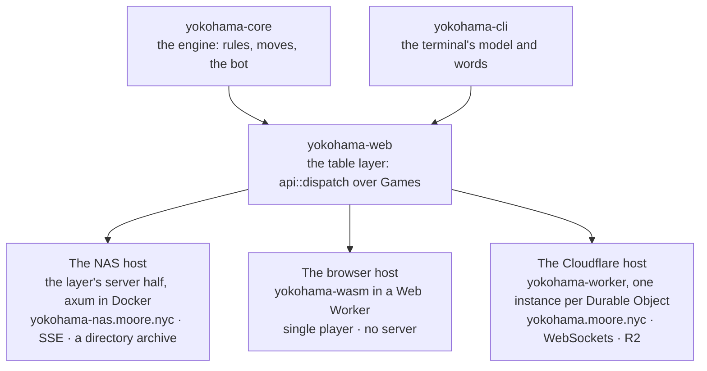

### 1.2 What this host may change, and what it may not

The cycle ran under one rule, R-6.5c.4: a Cloudflare-specific problem gets its solution inside
`crates/yokohama-worker` and `worker/`, and the layer changes only for a named architectural reason.
Two layer changes were made, each for a reason no host code could supply:

- **`Games::archive_over_retry(id)`** (`crates/yokohama-web/src/games.rs`). On this host a game-over
  save is uploaded after the move has been answered (§7.5), so the stamp that records "this game is
  archived" runs later, as a retry. That stamp must be the layer's own code.
- **`tables::check_shape` became `pub`** (`crates/yokohama-web/src/tables.rs`). The house refuses,
  loudly, a table copy that the layer's own listing would drop without a word (§7.4). It had to,
  because the layer's diagnostics were then `eprintln!`, and `eprintln!` prints nothing on
  `wasm32-unknown-unknown`. *(Corrected 2026-09-28: since M6.5c2 the layer's log lines reach this
  host's log through the log seam, under their own names, §10.2.)*

Nothing else in the layer moved. The engine and the other fenced crates, the CLI and the browser
host's crate (`crates/yokohama-wasm`) are byte-identical to the cycle's base, and `SEMANTICS_REV`,
the version that keys every saved record, is still 7. Outside the crates, the client gained the
socket arm of §8 and one branch in its outbox, and the corpus emitter gained two request scripts.

That restraint buys the central property of this host: **every payload a player reads is the
layer's own bytes.** The repository commits a wire corpus: every payload shape the client reads,
frozen from the real router by `crates/yokohama-web/tests/wire_fixtures.rs` under `web/src/wire/`.
The corpus was replayed through the Durable Objects in the test pool at every task from the
cycle's Task 12 on. It was also replayed through the live Worker, twice, at the eighteenth
deployment. Both agreed byte for byte, except for the fields this host is meant to answer
differently: `/api/health` reports `identity: "cf-access"`, `signal: "ws"` and the archive's
switch, `/api/me` reports `mode: "cf-access"`, and `/api/art` is compared by value.

### 1.3 One move, end to end

A move, from the player's browser to the table's object, and on to the lobby and the bucket:

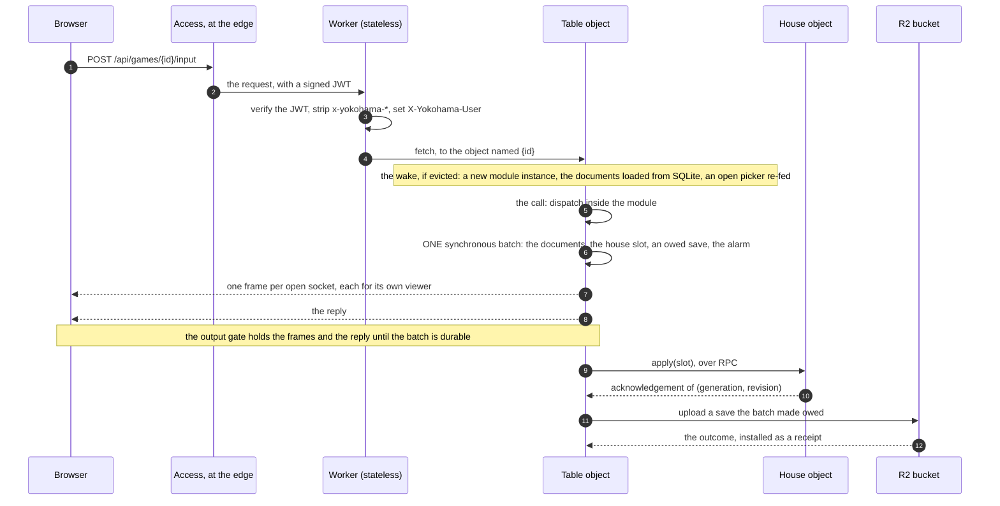

Two properties hold along the whole path. Between reading a request's body and committing its one
batch, the table object awaits nothing, so no other request can interleave with a move. And every
side channel after the batch (the frames, the house push, the upload) is keyed, so a late or
repeated delivery cannot undo a newer one, and the alarm set in the batch finishes any delivery
that cannot finish at once. §7 takes each part in turn.

### 1.4 What a player sees

These screenshots were recaptured in cycle E of M6.5c2 (2026-09-30) from the release that cycle
built, after the cleanup redesigned the door, the lobby and the forms, with three test identities. Alice
(`alice@readme.test`) opens a table named "Friday game" with a password, Ben (`ben@readme.test`)
joins it, and Carol (`carol@readme.test`) watches. The client is the same program on every host;
only where its answers come from differs.


*The door, the first screen, which asks the server for nothing. It carries the title, the project's
one-paragraph blurb and the repository link, and a small pyramid of ten area tiles at the top right. Three
cards follow: "You against the bot" (2 players, V4, a New game button), "Play with friends" (2 to 4
players, a Go to the lobby button) and "On this device" (no game yet, the storage note, Back up and
Restore). The footer reads "Not affiliated with Asmodee".*

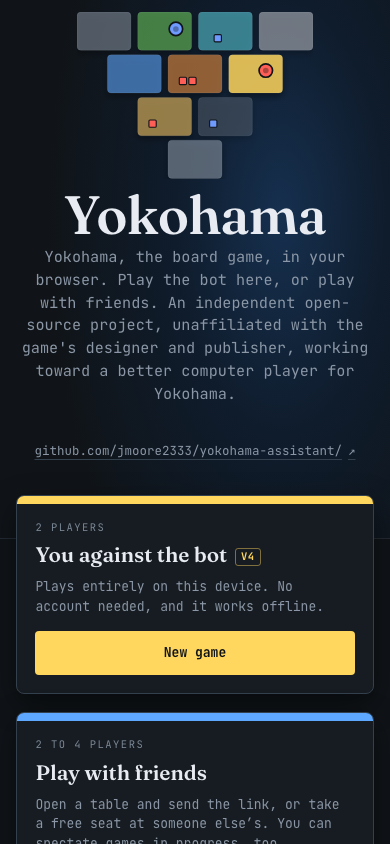

*The door at 390 px, a phone's width: the tiles above the title, then the blurb, the repository link
and the cards stacked in one column.*

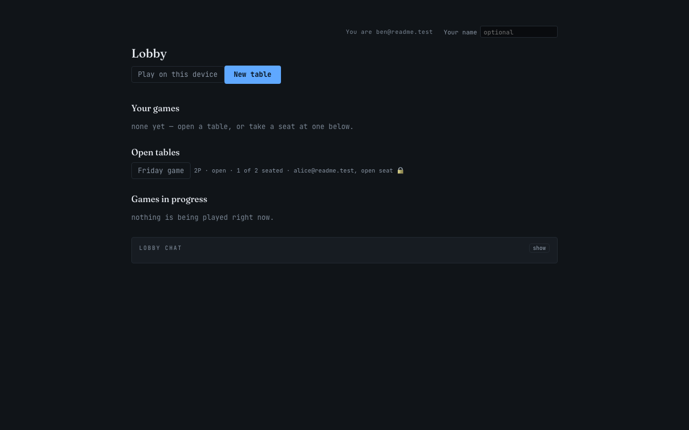

*The lobby, which the house object answers from its scrubbed copies of every table (§7.4), as Ben
sees it: "Playing as" his address in the top corner. "Your tables" is empty; under "Open tables",
"Friday game" is listed with its password badge, an "invited" chip, an open seat and a Take a seat
button; "Being played" is empty and the lobby chat is folded. No finished game is shown, because the
house that served this picture held none.*

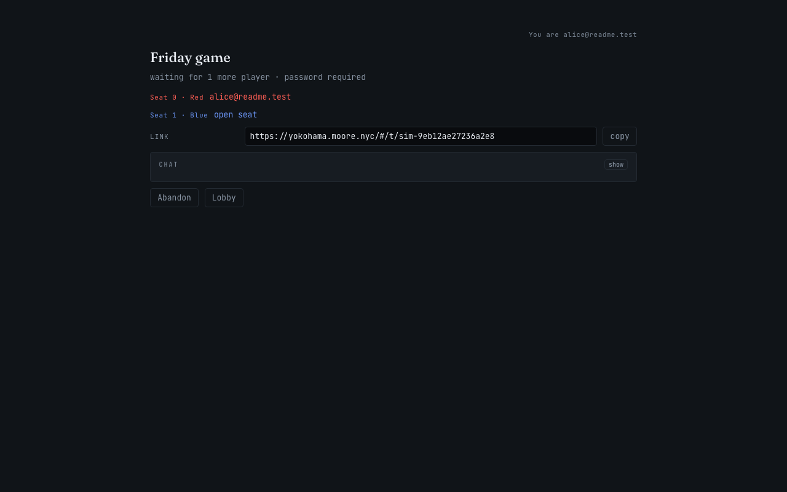

*The creator's view of the open table: "Waiting for 1 more player", the Red seat as "You" and the Blue
seat open, the invitation link with a Copy link button, a folded chat, and Abandon and Lobby.*

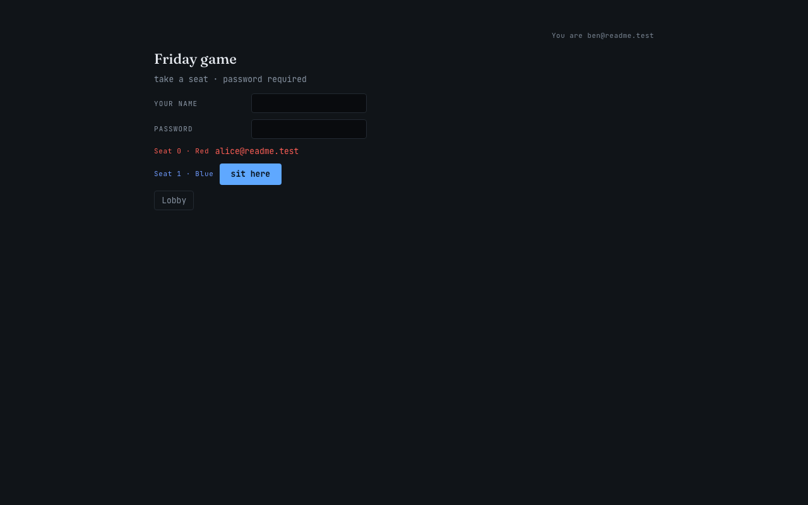

*A stranger at the locked table: the password field, the Red seat as "invited" and the Blue seat open,
and a Join as Blue button. The table document keeps only a salted hash of the password, and the
lobby's copy keeps not even that (§7.4).*


*The deal. Alice, at Red, is shown her own two cards with their Keep scores (019 Dutch, 60; 022
American, 48), which are what the built-in bot would prefer, and no one else's; Blue reads "waiting".
The technologies and the goals are withheld until she has chosen.*

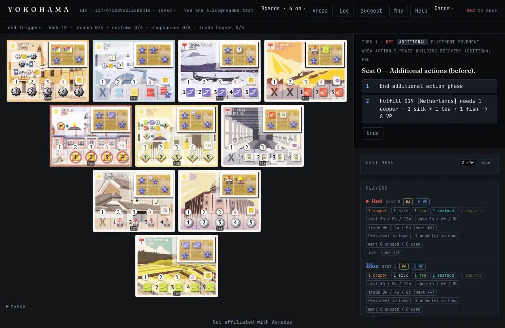

*A player's turn: the phase ladder for turn 1, the prompt "Seat 0 — Additional actions (before)." with
two numbered moves, and an Undo button. The move goes to the table object as a POST, and the other
screens learn of it over their sockets (§8).*

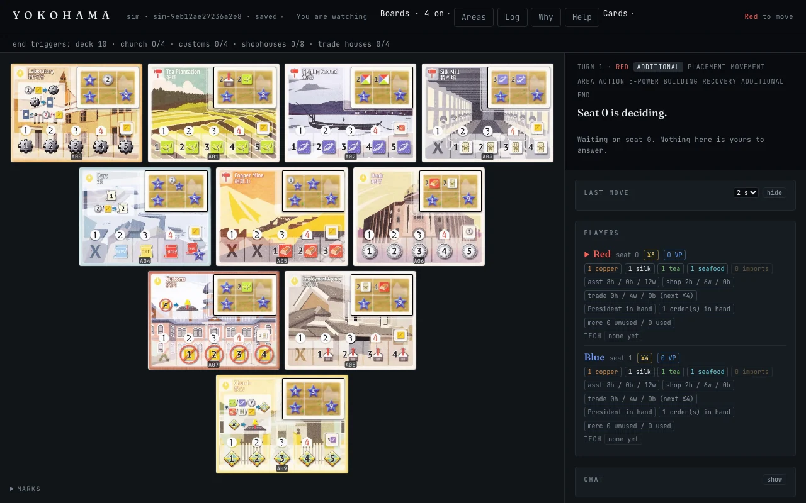

*The watcher's view: the banner reads "You are spectating", there is no Suggest button, and the side
column reads "Seat 0 is deciding" and "Nothing here is yours to answer". Every hand is a count, and
nothing a watcher's socket sends can reach the game (§7.3).*

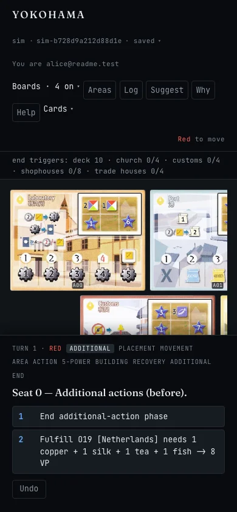

*The game at 390 px: the banner wraps onto several lines, the board's tiles scroll sideways, and the
prompt with its numbered moves sits below the board.*

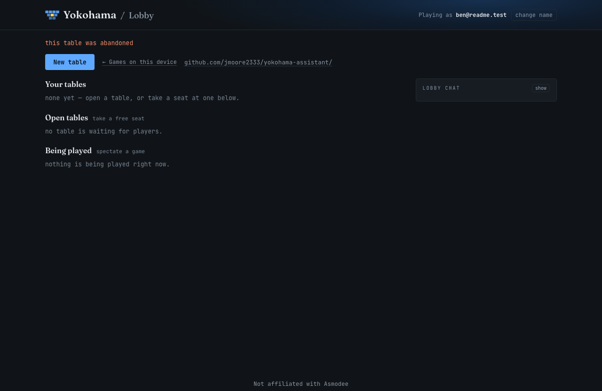

*After Alice abandoned a second table, a scratch one opened before Friday game and with no move made,
Ben's lobby shows the marker's line, "this table was abandoned", above a lobby that no longer lists
it (§7.7).*

### 1.5 The two doors: Access, or an open door

`YOKOHAMA_WEB_IDENTITY` names this host's door, and it has **no default** (M6.5c2, R-6.5c2.5). A
deployment that names none answers its API with a 500 naming the variable, as it answers any bad
value, while the static release is still served; the deploy guard refuses to deploy a configuration
that names none, and prints the door it deploys. The value is trimmed and then matched exactly, as the
layer reads the same variable on the NAS, so `Open` is refused by name. There are two doors, and the
first has three sources.

**The `worker` door has three identity sources, one per deployment** (the auth cycle; design §4.1).
`YOKOHAMA_IDENTITY_SOURCE` names who vouches for an address under it — `access`, `oidc` or `workos` —
with no default and refused beside `open`; the layer's door stays `worker` and the wire never learns the
source (`/api/me` reads `cf-access` under all three). `access` is the section below, today's shape.
`oidc` signs a player in against ANY issuer that publishes a discovery document (Auth0, Keycloak,
Authentik, Google and the like): the shell runs the code flow once, at the callback on `/enter`,
verifies the ID token, and mints its own session cookie — `YOKOHAMA_OIDC_ISSUER`, `YOKOHAMA_OIDC_CLIENT_ID`,
the secret `YOKOHAMA_SESSION_SECRET` and, optionally, the secret `YOKOHAMA_OIDC_CLIENT_SECRET`. It accepts
**`client_secret_post` or PKCE only** (an issuer that accepts only `client_secret_basic` is out of scope,
R-20), and the issuer and the four endpoints of its discovery document must be `https` — `http` is accepted
on a loopback host (`localhost`, `127.0.0.1`, `[::1]`), for development (R-24). `workos` is WorkOS AuthKit's
first-party API, two `fetch` calls and no SDK, with the API key as `YOKOHAMA_OIDC_CLIENT_SECRET`; the public
deployment runs it after the window of `RUNBOOK.md` §23 (production has read `workos` since the window's stage 1, 2026-10-19). **The session cookie is the Worker's own, stateless and `__Host-`prefixed**
(`__Host-yokohama_session`, `HttpOnly; Secure; SameSite=Lax; Path=/`), so a browser keeps it only over `https`
or on `localhost` — a deployed Worker is always the first and `wrangler dev` the second. It lives 30 days by default
(`YOKOHAMA_SESSION_DAYS`), is renewed on use, and ends at an absolute cap of 90 days from its first issue
(`YOKOHAMA_SESSION_MAX_DAYS`, 2026-10-19) however much it is used; **rotating `YOKOHAMA_SESSION_SECRET` ends every
session at once**, and **`YOKOHAMA_DENIED` — a secret naming addresses and `@domains` — ends one player's: their
session is nobody and their sign-in is refused (the red button, `RUNBOOK.md` §24)**.
Both halves of the sign-in are on `/enter`, and sign-out is `POST /api/leave`. **A post to the archive with
no caller files anonymously** under `anon-<device id or the game's own id>@anon.invalid`, limited by IP, and
**offers no integrity guarantee: a device id is a self-declared label, not a credential** — so a finished
game is kept whoever played it, and nothing about it is trustworthy beyond the replay that verified it. A
deployment declares one source, and its file says which: `wrangler.jsonc` is the public deployment
(`yokohama-web`, source `workos` since the window's stage 1, 2026-10-19; `RUNBOOK.md` §23), and
`wrangler.private.jsonc` is the LATER private deployment (`yokohama-web-private`, its own bucket, objects and
rate-limit namespaces, source `access`; the custom domain `yokohama-test.moore.nyc`, beside production's
`yokohama.moore.nyc`, a destination of the same Access application; `npm run deploy:private`). Cloudflare
Access may stay in front of a provider-signed Worker, which then ignores the assertion.

**Access — `worker`, this repository's configuration** (`wrangler.jsonc`).
- A Cloudflare Access application covers the hostname. The Worker verifies Access's signed assertion
  on every request before anything reads it (§7.6), and the objects' layer runs its `worker` mode,
  trusting only the `X-Yokohama-User` header the Worker sets.
- `/api/me` and `/api/health` name this door `cf-access`, the door a player's browser is behind.
- `workers_dev` must be `false`, because a `workers.dev` URL would go around the hostname-wide
  application, and both Access values must be set; the guard refuses either lack.
- **The dev door** (§7.6) is this repository's test instrument under this door: the `yokohama-worker`
  Service Auth credential with `YOKOHAMA_DEV_DOOR=on`, naming its caller in
  `X-Yokohama-Claimed-User`. The live Playwright tier and the live replay play as several people
  through it. It names a `.test` address only, and it is OFF in production since security S2b
  (finding B6): `wrangler.jsonc` sets `YOKOHAMA_DEV_DOOR` to `off`, and `wrangler.dev.jsonc`,
  production with that one variable `on`, opens it around a live tier (`npm run deploy:dev`,
  reverted by the plain `npm run deploy`; `RUNBOOK.md` §7).
- The dev door's client id, `DEV_DOOR_CLIENT_ID`, is a Worker SECRET since M6.5c2, put at that
  cycle's close (the twenty-first deployment, 2026-09-28; `RUNBOOK.md` §15), and the guard refuses
  it in `vars`. The dev door goes off before any public door: it is one of the public door's
  preconditions, which the M6.5c2 cycle C close records
  (`docs/plans/2026-09-28-web-frontend-m6.5c2c-close.md` §6).

**The open door — `open`, for a deployment with no identity provider.**
- Players choose a name on the first screen, and the name is who they are. `/api/me` names this door
  `open`, and the layer keys a name exactly as the NAS's open door does
  ([`deploy/README.md`](../deploy/README.md#2-the-open-door-a-home-network-a-lan-or-a-vpn)).
- **A name, never an address** (security S2b, finding C1): a claim with the email shape is refused —
  by the layer's 401 `under the open door a name is a name — an address is not accepted here: choose
  a plain name`, here and on the NAS alike, and by the client's name step before any request — so an
  `@` always means a verified address, on every other door. A deployment that holds tables or saves
  never changes its door, and a public deployment starts empty: the rule is `RUNBOOK.md` §3's.
- The Worker reads no Access assertion. It still removes every client `x-yokohama-*` header, and it
  forwards the caller's name as `X-Yokohama-Claimed-User`, the one header the objects read at this
  door. The name rides ONE carrier per request:
  - on a `fetch`, the `X-Yokohama-Claimed-User` header the client sends;
  - on a WebSocket upgrade, a `claimed=` query parameter, because a browser cannot put a header on
    an upgrade. The client adds it under this door only.
- The Worker holds a name only to what a header can carry: visible ASCII, a tab or a space, judged
  before anything is trimmed or lowercased. A name outside that is no one, never a platform error.
  Every other rule a name meets is the layer's key grammar, in the objects. The Worker collapses
  each run of spaces to one, the grammar's own typed form, so every spelling of a name is ONE
  Archive object (security S2b).
- The Origin check on upgrades stays.
- **The trust model:** anyone who can reach the Worker may use any name. A name is a label and a key,
  never a credential, and tables stay with the name you sat down as.
- **The quota is the deployer's, and the Worker bounds what one caller spends** (security S2b,
  finding C2). On Workers Free, anyone who can reach an open Worker can spend its 100,000 requests a
  day (§3.1). The Worker's own two Rate Limiting bindings answer 429 before any object: creates
  counted by the connecting IP, 10 a minute, and writes by the IP and the name, 120 per 10 s
  (`src/limits.ts`). A name is free, so the write limit is per name and no IP ceiling; the zone's
  rate-limiting and edge rules stay the deployer's tools for that.
- **The operator surface is refused.** A claimed name is never an operator's rights, so under `open`,
  `/api/admin/…` answers the layer's 404 — as if no operator were configured — whatever name is
  claimed. An open deployment is operated through `wrangler` and the dashboard.
- **A contradiction is refused at run time.** `YOKOHAMA_WEB_ADMINS`, or `YOKOHAMA_DEV_DOOR=on`,
  beside `open` makes the API answer a 500 naming both variables (`src/config.ts`). The guard cannot
  see the first, which is a secret.
- **What the guard allows under `open`:**
  - a `workers.dev` URL, since there is no door to go around; *(Corrected 2026-10-11, security S2a,
    finding C3: the guard refuses it under `open` too, where it would go around the edge rule, the
    rate limit and Bot Fight Mode — §9.3, check 3.)*
  - never `preview_urls`, because a preview version is not the deployed code, whatever the door;
  - never `YOKOHAMA_DEV_DOOR=on` in `vars`.
- **Saves:** a plain name never files its saves under the bucket's `test/` root. That root takes
  only an address ending `.test`, which no claim under `open` can be since security S2b, so an open
  deployment's saves file at its bucket's top root; R-6.5c2.12's lifecycle rule
  `expire-test-after-30-days`, set at the M6.5c2 close (2026-09-28, `RUNBOOK.md` §15), expires the
  `test/` root's objects after 30 days.
- **One refusal costs an object the NAS does not make** (ruling R-C10): a claim the layer's grammar
  refuses, such as `..`, sent to `POST /api/archive`, names an Archive object before the layer can
  judge it; that object's `init` refuses the caller, and it answers the layer's own 401, as the NAS
  does. *(Corrected 2026-10-12: this said the object answered a 500 where the NAS answers its 401 —
  so it did until M6.5c2 cycle D, whose `callerRefused` answers the layer's 401.)* Its `init-refused`
  log line names the refused claim by its digest (S2b's after review, `4814c999`; the echo's cut and
  escaped forms since security S2c, `291b9e35`), and keeps a configuration refusal's value as it is.
  The client's name step never sends such a claim.

**The open door is deployed for a window and never left live** (R-6.5c2.39; the window's record is
`RUNBOOK.md` §19). **Since security S2b a window on THIS Worker is one of the review's known exercises, and after the security
process the door stays steady** (the owner's clarification of 2026-10-12; C1; `RUNBOOK.md` §3). The open deployment is `wrangler.open.jsonc`, which is `wrangler.jsonc` with the
open door and no Access values or dev door. The recipe: delete the two Worker secrets first
(`YOKOHAMA_WEB_ADMINS` and `DEV_DOOR_CLIENT_ID`), since the shell refuses `open` beside an operator
list; run `npm run deploy:open`, which runs the guard over that file (`node scripts/deploy-guard.mjs
--config wrangler.open.jsonc`, holding it to production's blocks and refusing the dev door on), then
the secrets guard over the same file (`node scripts/secrets-guard.mjs --config wrangler.open.jsonc`,
§9.3), and then `wrangler deploy --config wrangler.open.jsonc`; a visitor then reaches the first
screen and the lobby with no login and a name of their own choosing, and the operator surface
answers 404. The revert is the plain `npm run deploy` and the two secrets put back. The Access application's destinations for
the state in between come from `node scripts/access-paths.mjs`, derived from the routers: ELEVEN lines
since the auth cycle, `/api/leave` (sign-out) the eleventh, so a deployment that keeps a path-scoped
application in front adds it at its next deploy.
Since security S2b production itself is Access alone, with the dev door shut — the shape a self-hoster
behind their own application copies — and `wrangler.dev.jsonc` is production with the dev door open
(`npm run deploy:dev`), deployed around a live tier and reverted by the plain `npm run deploy`. The
open door is also proven in the test pool's second project (`wrangler.open.test.jsonc`, whose cells
are `test/open/`), where the shell runs in workerd with real sockets.

**The doors do not share one client build.** `cd web && npm run build` reads five build values when
they are set (R-6.5c2.40, cycle F; `web/scripts/build-values.mjs` checks them and a bad one fails the
build naming it): `YOKOHAMA_PROJECT_URL` (a link to the repository, on the first screen and the lobby; at
most 200 characters), `YOKOHAMA_SITE_BLURB` (a paragraph under the first screen's title; at most 400),
`YOKOHAMA_SITE_NOTICE` (one line at the foot of every screen; at most 200), `YOKOHAMA_SITE_URL` (the
host's own address, an `https://` origin, for the sitemap, the canonical link and `og:url`; at most 200)
and `YOKOHAMA_RELEASE_FEED` (where the door and the lobby look for the latest release: unset derives it
from a GitHub project link, a URL is that feed, `off` is none; at most 300). Unset or empty draws nothing,
the feed's derivation apart. A sixth, `YOKOHAMA_TURNSTILE_SITEKEY` (the public Turnstile site key; at most
100), belongs with the open door and with a provider-signed worker door (source `oidc` or `workos`), where the
Turnstile is the bot defence: the Access build is made WITHOUT it and the deploy guard's check 12 refuses a
keyed build beside `worker` at source `access`, while the open window's build carries it beside
`YOKOHAMA_TURNSTILE` `on`, and the public deployment's will after the window of `RUNBOOK.md` §23, at its
stage 2 (RUNBOOK §3). The client does not read the key as the door: it reads
the server's facts, and holds a nameless visitor's game for a name only where they say `open`. A seventh,
`YOKOHAMA_SIGNIN_NOTICE` (the transparency notice under every sign-in link; at most 300), is the Worker's
builds alone. Since `YOKOHAMA_SITE_URL`
names the host, each host serves its own client build. All of them are baked into the release, not read at
run time, because the release is precached under a digest of its own bytes.

---

## 2. What a Durable Object is, and what serverless means here

**Serverless, as Cloudflare means it.** There is no machine to rent, patch or keep running. You
upload code, Cloudflare runs it in whichever of its data centres receives a request, and the bill
counts requests and CPU time rather than servers (*Workers pricing*). The catch is that an ordinary
Worker is stateless and short-lived: it answers a request and keeps nothing, and the next request
may run somewhere else. A Worker alone cannot hold a game.

**A Durable Object is Cloudflare's answer for state.** Cloudflare calls it "a special kind of
Cloudflare Worker which uniquely combines compute with storage" (*What are Durable Objects?*). It
is an instance of a JavaScript class (here `Table`, `House` or `Archive`, in `src/`), and four
properties make it useful:

- **It has a name, and one instance in the world.** Each object has "a globally-unique name, which
  allows you to send requests to a specific object from anywhere in the world" (*What are Durable
  Objects?*). Here `env.TABLE.idFromName("sim-9eb12ae27236a2e8")` names one table's object, and
  every request for that table, from any player anywhere, reaches that one instance.
- **It runs one event at a time.** Durable Objects "are single-threaded and cooperatively
  multi-tasked, just like code running in a web browser" (the same page).
- **It owns its storage.** Its SQLite database is "accessible only within that object" (the same
  page). Nothing outside can query it; the only way in is a request to the object, whose own code
  decides what to read.
- **It lives only while it is used.** An object is created on its first request. Once idle for 10
  seconds with nothing pending, it is hibernated, "removed from memory" with its WebSocket clients
  still connected, and its constructor runs again on the next event (*Lifecycle of a Durable
  Object*). While hibernated it is not billed for time (*Durable Objects pricing*).

So **one object per table is the lock, the store and the signal at once.** It is the lock because
it runs one request at a time; the store, because the table's documents live in its SQLite; the
signal, because it holds the sockets of everyone watching the table. The hosting umbrella chose it
for exactly that: hosted multiplayer runs on Workers and Durable Objects (R-6.5.1), and "a table's
documents live in its Durable Object's SQLite … Keeping a database beside the objects would
re-introduce the cross-process conflict machinery the actor model removes" (R-6.5.2, in
[`docs/plans/2026-09-19-web-frontend-m6.5-hosting-spec.md`](../docs/plans/2026-09-19-web-frontend-m6.5-hosting-spec.md)).

**What it is not.**

- **Not a database server.** There is no connection string and no query language across objects.
  The lobby, which needs every table, reads copies the tables push to one object of its own (§7.4).
- **Not a container or a virtual machine.** There is no process to log into and no filesystem. It
  runs JavaScript and WebAssembly in an isolate, within 128 MB of memory (*Workers limits*).
- **Not always on.** It exists while it has work. A hibernated table with open sockets costs
  nothing but its stored rows.

**What it costs to reach.** Every request to an object is a Durable Object request, of which the
Free plan allows 100,000 a day (§3). A request to a hibernated object also pays for its wake: here
that is building a module instance and replaying the table's record, which cost 6 to 9 ms of CPU
at the exit's 40-move table (§8).

**Why the game fits.** A table has one writer at a time by the game's own rules: players take turns,
and the engine applies each move to the record in order. Tables never touch each other; only the
lobby reads across them, and it reads copies. And a turn-based game is idle almost all the time,
which is exactly when an object costs nothing.

---

## 3. Free vs Paid, and how this was optimized for Free

The account this host runs on is on the **Workers Free plan** (ruling R-6.5b.16, which amended the
umbrella's R-6.5.12 from Paid to Free). Its daily quotas are the account's, shared with every other
Worker on it: in the week before the cycle those used 17,000 to 33,000 of the 100,000 Worker
requests a day (spec §0.5).

### 3.1 The ceilings that matter here

Every figure is Cloudflare's, read on 2026-09-26 from the pages listed under the table, each with
the date the page says it was last updated. "Paid" is the Workers Paid plan, whose minimum charge
is $5 a month.

| What | Workers Free | Workers Paid | Page |
|---|---|---|---|
| Worker requests | 100,000 a day | 10 million a month included, then $0.30 a million | Workers pricing |
| Requests for static assets | free and unlimited | free and unlimited | Workers pricing |
| Worker CPU time per request | 10 ms | 30 s by default, up to 5 minutes; 30 million CPU-ms a month included, then $0.02 a million | Workers limits, Workers pricing |
| Worker memory | 128 MB | 128 MB | Workers limits |
| Durable Object requests (HTTP, RPC and alarms; incoming WebSocket messages counted 20 to one) | 100,000 a day | 1 million a month included, then $0.15 a million | Durable Objects pricing |
| Durable Object duration: wall time while running, or idle but not hibernatable, billed at 128 MB | 13,000 GB-s a day | 400,000 GB-s a month included, then $12.50 a million GB-s | Durable Objects pricing |
| Durable Object CPU time per request | see the note below | 30 s by default, configurable to 5 minutes | Durable Objects limits |
| SQLite rows read | 5 million a day | 25 billion a month included, then $0.001 a million | Durable Objects pricing |
| SQLite rows written (each `setAlarm` counts as a row, and so does each delete) | 100,000 a day | 50 million a month included, then $1.00 a million | Durable Objects pricing |
| SQLite storage | 5 GB in total, 1 GB per object | 5 GB-month included, then $0.20 a GB-month; 10 GB per object | Durable Objects pricing and limits |
| R2 storage (Standard class) | 10 GB-month free each month | $0.015 a GB-month beyond that | R2 pricing |
| R2 Class A operations (those that change state, such as a put) | 1 million free each month | $4.50 a million beyond that | R2 pricing |
| R2 Class B operations (those that read, such as a get) | 10 million free each month | $0.36 a million beyond that | R2 pricing |

The pages: *Workers pricing*, <https://developers.cloudflare.com/workers/platform/pricing/>
(updated 2026-08-28); *Workers limits*, <https://developers.cloudflare.com/workers/platform/limits/>
(2026-09-05); *Durable Objects pricing*,
<https://developers.cloudflare.com/durable-objects/platform/pricing/> (2026-08-25); *Durable Objects
limits*, <https://developers.cloudflare.com/durable-objects/platform/limits/> (2026-06-01); *R2
pricing*, <https://developers.cloudflare.com/r2/pricing/> (2026-08-07); *Static assets: billing and
limitations*, <https://developers.cloudflare.com/workers/static-assets/billing-and-limitations/>
(2026-04-23); *What are Durable Objects?*,
<https://developers.cloudflare.com/durable-objects/concepts/what-are-durable-objects/> (2026-07-15);
*Lifecycle of a Durable Object*,
<https://developers.cloudflare.com/durable-objects/concepts/durable-object-lifecycle/> (2026-07-03);
*Durable Objects: WebSockets*,
<https://developers.cloudflare.com/durable-objects/best-practices/websockets/> (2026-06-19);
*Durable Object state*, <https://developers.cloudflare.com/durable-objects/api/state/>
(2026-08-26); and *How Workers works*,
<https://developers.cloudflare.com/workers/reference/how-workers-works/> (2026-09-18).
Cloudflare changes these pages; check them before relying on a figure.

**What happens when a Free quota runs out.** Cloudflare's words for the Free plan are: "If you
exceed any one of the free tier limits, further operations of that type will fail with an error."
The daily limits "reset at 00:00 UTC" (*Durable Objects pricing*). For the Worker, a request that
matches `run_worker_first` (here every `/api/*` path, and `/enter`) then gets a 429 "instead of
falling back to static asset serving" (*Static assets: billing and limitations*), while requests for
real files go on being served. So on a day that runs out, multiplayer stops until midnight UTC, and
single player in the browser keeps working.

**The note on an object's CPU on Free.** Cloudflare's pages disagree. The Durable Objects limits
table gives "30 seconds (default)" per request, while the same page's answers to common questions
say objects "have the same per invocation CPU limits as any Workers do", which on Free is 10 ms. The
owner ruled to build on 30 s and let the logs say otherwise (R-6.5c.5). The spike's one heavy
invocation, 376 ms of CPU, completed on Free (spec §0.3), and nothing measured since has come near
10 ms per move (§4).

### 3.2 How the design follows from Free

R-6.5b.16 set the rule before any of this host was written: "on Free the routing Worker has a 10 ms
CPU budget per request and a SQLite-backed object 30 s, so gameplay, replay, `suggest`, `why` and
the archive's strict replay run INSIDE objects …, static assets are served without the Worker, and
the daily Free quotas … are BUDGETED before the first deploy and MEASURED in the live setup"
([`docs/plans/2026-09-20-web-frontend-m6.5b-single-player-spec.md`](../docs/plans/2026-09-20-web-frontend-m6.5b-single-player-spec.md)).
What that became:

- **All the computation runs inside the objects**, whose CPU allowance is the long one: the
  engine, the production bot (about 1.5 ms a decision natively, the figure the M6.5b free-tier
  review worked from), a cold replay of a record, `suggest`, `why`, and the strict replay that
  checks a browser's uploaded save.
- **The Worker does only routing, the Access JWT check and header hygiene.** It never loads the
  WebAssembly module (§7.1). Measured at the first deployment: 0 to 2 ms of CPU a request, 1 ms
  typical, the JWT's signature check included.
- **Static assets are served without invoking the Worker.** The client, its service worker and
  the card art cost no request at all: the first deployment's tail read zero Worker invocations for
  every real file, and exactly one for a missing one. A game against the bot in the browser costs
  nothing per move, and at most two requests when it ends (a health read and the save's upload).
- **Idle tables cost nothing.** A table hibernates between moves, its sockets held by the platform,
  and the client's keep-alive is answered by the object's auto-response, which Cloudflare says
  incurs no wall-clock time (*Durable Objects pricing*).
- **Writes are kept few.** A table's last activity costs no row of its own (it is the newest
  `written_at` of its documents, §7.3); a move that leaves the table document alone sends the lobby
  nothing (§7.4); `setAlarm` replaces a pending alarm rather than adding one (§7.8); and the wake
  counter, which would cost a row on almost every move, is off except in a measuring window
  (§9.5).
- **The instruments are cheap.** The live corpus replay costs about 2,300 requests a run, and every
  deployment reading is a handful of `curl` calls.
- **The quota guard is standing practice**: read the day's figures before and after any live run,
  and hold a run that could cross the line (§10.3).

---

## 4. Lessons from the 10 ms CPU budget, and how the core crates run inside it

**The budget.** On Free, a Worker request gets 10 ms of CPU time, and "waiting on network requests
… does **not** count toward CPU time" (*Workers limits*). For scale, the same page says "the average
Worker uses approximately 2.2 ms per request". A game is heavier than that by nature: to answer
anything about a table, the engine rebuilds the game by applying every recorded move again.

**How the core crates run inside it.** The engine (`crates/yokohama-core`), the terminal's model
(`crates/yokohama-cli`) and the table layer (`crates/yokohama-web`) are compiled together with this
host's glue (`crates/yokohama-worker`) into one WebAssembly module, built for size: `opt-level =
"z"`, fat link-time optimization, one codegen unit, then `wasm-opt -Oz`. Its size is read in ONE
place, the root `Cargo.toml`'s `release-wasm` comment, by `scripts/module-figures.mjs`, and re-read at
each release; the RUNBOOK's deployment records keep the size each deployment shipped. *(Corrected
2026-09-28, M6.5c2: this sentence stated one size as current.)* Each object owns its own instance of
it (§6.3), so the Rust runs where the long CPU allowance is, and the Worker never loads it.

**What the spike measured** (spec §0.3, on the real account, before the design was written):

- the module then (the browser host's, reused): 1,783,435 B before `wasm-opt` and 1,175,167 B
  after; the Worker's upload 1,172.84 KiB, 453.90 KiB gzipped; a startup of 1 to 3 ms;
- the cold path of a finished 595-event game in an object (a fresh instance, the record and table
  loaded from SQLite, the game rebuilt, a frame computed): 19, 27, 22 and 28 ms in four readings;
- `why`, which replays the game to a bot's move and runs its decision again: about 50 ms per bot
  move. One object invocation doing a cold replay of 595 events and seven `why` reconstructions took
  376 ms of CPU, and completed on Free;
- a table's create inside an object, drawing its random id and setup seed: 20 ms of CPU;
- the spike's routing Worker, which decoded the Access token without verifying it: 0 to 1 ms.

Natively, the production bot takes about 1.5 ms a decision, the figure the M6.5b free-tier review
worked from. Nothing in this cycle timed one bot decision inside an object on its own.

**What the deployments and the exit measured:**

- the Worker, verifying the JWT's RS256 signature: 0 to 2 ms of CPU a request, 1 ms typical, and 10
  to 19 ms of wall time (the first deployment);
- a table object per move, over the exit game's 40 moves: a median of 2 ms of CPU, the most 15 ms;
- a wake after each 60 s pause at that 40-move table: 6 to 9 ms of CPU, 16 to 60 ms of wall time;
- the Worker's own half of an exit move: 2 ms.

**What stays unmeasured:**

- a strict replay of a very large record, which is what a browser's save of a long game costs its
  Archive object, and the heaviest call an object makes;
- a wake on a record of thousands of events. The live two-browser game's record reached 2,180
  events, and the CPU of its wakes was not read; the spike's 19 to 28 ms at 595 events says only
  that the cost grows with the record;
- the objects' duration against the Free plan's 13,000 GB-s a day, which no reading of this cycle
  took.

**The lessons:**

- **Keep the Worker to about a millisecond.** It routes, verifies one signature, removes headers
  and forwards. It parses one kind of request body, a create's, for its `id`; a browser's save of up
  to 2 MiB passes through unparsed to the caller's own Archive object.
- **Let the object pay for the game.** Everything that touches a record (a move, a replay, a bot's
  decision, `suggest`, `why`, a strict replay) runs in an object, where the measured cost is a
  couple of milliseconds a move and the allowance is far larger.
- **Waiting costs no CPU.** The table object's R2 upload between an abandon's two dispatches costs
  it wall time, which counts as duration, but not CPU time (*Workers limits*).
- **The wake is the price of hibernation.** An object that sleeps between turns rebuilds the game
  on its next move. At the exit that cost 6 to 9 ms, and it grows with the record: the unmeasured
  wake on a long record is where the design's bet (a few milliseconds per wake, for nothing while
  idle) would first show strain.

---

## 5. Estimates for concurrent and ongoing games

**Every number in this section after the first list is an ESTIMATE**, derived by arithmetic from
this cycle's readings and Cloudflare's ceilings (§3.1). The assumptions are stated where they are
used.

### 5.1 What was measured

The account's analytics were read before and after each live run (RUNBOOK §7, and the close's
quota readings). The unit is an **input**: one line the Playwright harness sent to the table, a move or one
step of a multi-step move.

| What was played | Worker requests | Durable Object requests | Rows written | Rows read |
|---|---|---|---|---|
| the two-browser game: 2,862 inputs, two players and a watcher on three live pages, plus the join spec and the cleanups | about 38,350, **13.4 an input** | about 39,100, **13.7 an input** (the day's object requests rose from 129 to 39,234 across the run) | about 7,000, **2.5 an input** | about 1.34 million, **470 an input** |
| the same spec again: 2,510 inputs | about 32,000, **12.8 an input** | — | — | — |
| the exit's game: 40 paced inputs, chat both ways, a watcher | about 1,400, **about 35 an input** | — | — | — |
| the corpus replay, one run | about 2,300 | — | — | — |

The harness costs more than play would. Each of its three pages refetches on every frame, and the
harness itself asks the server once per input. The exit's figure is high for another reason: its
40 inputs came with 22 chat messages and a watcher, spread over long pauses. **A plain two-person
game, without the harness, was not measured.** The live game's record held 2,180 events for its
2,862 inputs.

### 5.2 Which ceiling binds first

At the harness's rates, 1,000 inputs use this share of each Free daily ceiling:

| Ceiling (a day) | 1,000 inputs use | So one day allows about |
|---|---|---|
| 100,000 Worker requests | 13,400, 13.4 % | 7,460 inputs; 5,000 to 6,200 after the account's other Workers |
| 100,000 Durable Object requests | 13,700, 13.7 % | 7,300 inputs |
| 5 million rows read | 470,000, 9.4 % at M6.5c; **56,000, 1.1 % since M6.5c2** (read live at the cycle C close, `RUNBOOK.md` §16) | 10,600 inputs at M6.5c; **about 89,000 since M6.5c2** |
| 100,000 rows written | 2,500, 2.5 % | 40,000 inputs |

**The request quotas bind first, not rows read.** The Worker requests go soonest, because the
account's other Workers use 17,000 to 33,000 of them a day (spec §0.5), which leaves this host
67,000 to 83,000 (spec §2.8). The Durable Object requests come next; the account's other objects
use only 300 to 1,800 a day (spec §0.5). Rows read was the cost M6.5c did not reduce (its requests
re-read the table's three documents up to three times, the whole-branch review's F-4); since M6.5c2 a
warm request reads them once and a cold one twice (§11), and the live three-page game at the cycle C
close read **about 56 rows per input** (101,236 rows over a 1,795-input game, `RUNBOOK.md` §16) against
M6.5c's 470 — so rows read now binds LAST, after rows written, and the Worker requests still bind
first (that game read 13.8 requests an input, M6.5c's figure). *(Corrected 2026-09-28, M6.5c2: first
the reads, then this arithmetic, re-read at the cycle C close.)*

### 5.3 Games per day

A game's size is the assumption that matters most, and no human game was measured on this host.
Two sizes bracket it: **900 inputs**, the spec's estimate for a two-person game of 400 to 600 events
(spec §2.8; the committed browser-played game has 595 events), and **250 inputs**, the round figure
the cycle's own estimate used after the first live run.

| Assumed game | At the harness's 13.4 requests an input | At the exit's 35 requests an input |
|---|---|---|
| 900 inputs | about 12,100 requests: 8 games on 100,000 requests, 5 to 6 after the account's other Workers | about 31,500 requests: 3 games, 2 after the other Workers |
| 250 inputs | about 3,350 requests: 29 games, 20 to 24 after the other Workers | about 8,750 requests: 11 games, 7 to 9 after the other Workers |

So a Free day holds somewhere between two and thirty games, depending on the game's length and how
much its players chat; plain play costs less than the harness, by an amount not measured. The
cycle's round figure after the first live run, 30 to 40 games of about 250 moves, is this table's
250-input cell at the harness's rate before the account's other Workers are deducted; its upper end
came from rows read, which do not bind first.

### 5.4 What "simultaneous" means on a daily budget

The Free quotas are daily totals, not limits on how many games run at once. A day's budget can be
spent by games one after another, or by several at the same time; nothing refuses the second game
because the first is running. Each table is its own object, and the only per-moment limit that
applies is Cloudflare's soft limit of about 1,000 requests a second for one object (*Durable Objects
limits*). The one object every table shares is the house, which sees each lobby read and each
delivered copy, far below that at human pace.

So a simultaneous-games figure is an average rate, the daily total spread over the hours people
play. For example, if a game takes an hour (an assumption, not a reading), twenty games a day is
nearly one game at a time on average across the whole day, or five at once for four evening hours.
Bursts are fine until the day's total is spent. Then every API request fails (a 429 from the
Worker, an error from the objects) until 00:00 UTC, while single player goes on working (§3.1).

### 5.5 What Paid changes

On Paid there is no daily wall: usage beyond each included monthly amount is billed, rounded up to
the next billing unit, a million requests for example (*Durable Objects pricing*). At the harness's
rates:

- **Included each month:** 10 million Worker requests is about 746,000 inputs; 1 million Durable
  Object requests about 73,000 inputs, the first allowance a busy month would pass; 50 million rows
  written about 20 million inputs; 25 billion rows read about 53 million inputs.
- **Beyond them**, 1,000 inputs cost about $0.009: $0.0040 of Worker requests, $0.0021 of object
  requests, $0.0025 of rows written and $0.0005 of rows read. That is under a cent for a 900-input
  game, on top of the $5 monthly minimum. The objects' duration, which this cycle did not read, is
  not in that figure.
- **The Worker's CPU limit** rises from 10 ms to 30 s by default. This design needs none of it: the
  Worker's work was measured at about 1 ms.

---

## 6. Why Workers, Durable Objects and R2

### 6.1 The platform properties the design rests on

§2 explained why one object per table is the right unit: it is the table's lock, store and signal.
The NAS gets the same one-writer guarantee from a lock per table inside one process, and a
compare-and-swap on the record's digest; here it is the platform's addressing rather than code this
host has to get right. Five platform properties carry the rest of the design:

- **Synchronous storage.** A SQLite-backed object's `ctx.storage.sql.exec` and
  `ctx.storage.transactionSync` do not return promises. The table object reads its documents, runs
  the move and writes the result in one synchronous turn, and because nothing in that stretch is
  awaited, no other request can interleave with it.
- **The output gate.** The platform holds "any new outgoing network messages … until the write has
  completed", so "it is impossible for anything else in the world to observe a premature
  confirmation" (Cloudflare, *Durable Objects: Easy, Fast, Correct — Choose three*). The shell
  writes, then replies and sends frames at once, and never answers a move that is not yet durable.
  The spec relies on this sentence for WebSocket sends as well, which the platform's page does not
  name.
- **Hibernatable WebSockets.** A socket accepted with `ctx.acceptWebSocket` stays connected while
  the object is evicted from memory. The socket's attachment (`serializeAttachment`) survives the
  eviction, and `setWebSocketAutoResponse` answers the client's keep-alive at the edge without
  waking the object. A turn-based game is idle most of the time, and the design assumes the object
  is evicted between turns (R-6.5c.7), so a table nobody is moving at costs nothing.
- **Alarms.** Each object has one alarm, which runs `alarm()` at a set time. Retries, expiry and a
  deleted table's cleanup all hang off it (§7.8).
- **Probing is free.** An object that has never been written leaves nothing behind. The constructor
  writes nothing, so a request for an id nobody created answers the layer's 404 and costs no
  storage (a pool cell reads `sqlite_master` to prove it).

**R2 holds the archive** because it is S3-compatible object storage. The keys are the NAS directory
archive's layout, produced by the layer's one layout function, so a copy of the bucket made by any
S3 client is a directory the CLI loads. At the exit the bucket was copied down with an S3 client
and a read-only key; the CLI loaded a finished two-person record of 2,180 events from it, and its
`why` command reconstructed a bot's move from a second record.

### 6.2 Why a TypeScript shell over a wasm-bindgen module, and not workers-rs

The umbrella hosting spec named workers-rs, the Rust SDK for Workers. This cycle's spec reversed
that (R-6.5c.2) on evidence read from workers-rs 0.8.6's own tree:

- hibernatable WebSockets were exercised by one echo test and one test that sets and reads back the
  auto-response pair, with no hibernate-and-wake test and no README section;
- a Rust panic "will terminate the isolate" unless the crate is built with `--panic-unwind`, which
  needs a NIGHTLY compiler and a rebuilt `std`, while this repository pins stable 1.97.1;
- RPC between objects was marked experimental.

So the platform code is TypeScript, written against Cloudflare's documented APIs, and the Rust
stays a plain library: `crates/yokohama-worker`, compiled by the pinned toolchain for
`wasm32-unknown-unknown` and wrapped by `wasm-bindgen`, exactly as the browser host is built.

### 6.3 Why one module instance per object

`wasm-bindgen`'s `--target web` glue keeps its state at module scope (`let wasm`), and its
`initSync` returns early once that is set. A Workers isolate evaluates a JavaScript module once and
may run many Durable Objects inside it. With the stock glue every object in an isolate would share
ONE WebAssembly instance, and so one global `Games`, and a trapped instance could never be replaced.

The spike measured the second half: `debug_trap` surfaced as `RuntimeError: unreachable`, caught at
the JavaScript boundary, and only a fresh instance recovered. So `scripts/factory-glue.mjs` rewrites
the glue into `export function createModule(compiled)`, which wraps the WHOLE glue body so that
every call builds its own `WebAssembly.Instance` over its own copy of that state. It refuses to
build if the glue's shape changes under it (an `export` it did not expect, a function it expected
and did not find, a top-level `import`), so a `wasm-bindgen` upgrade fails the build instead of
shipping a shared instance.

**Each object owns one instance, and each instance owns one `Games`.** A trap costs one instance of
one object: the shell discards it and the next request builds a new one from what SQLite holds.
Another table never notices. The price is memory: a new instance starts with its own linear memory
— read in ONE place, the root `Cargo.toml`'s `release-wasm` comment — and the spike read
1,441,792 B after a 595-event replay.

### 6.4 What the spike measured before the design was written

The owner authorized a throwaway Worker on the real account on 2026-09-22, deployed once at the
real hostname and torn down, so the design would rest on readings rather than documentation (spec
§0.3). The first real deployment re-read every row with the real code (RUNBOOK §8).

| Question | The spike's reading | Re-read on the real deployments |
|---|---|---|
| Protection | from an unenrolled vantage, every path went to the Access login; a WebSocket upgrade with no credential was 403; the `workers.dev` URL was 404 | the same in substance; curl-shaped requests met the zone's Bot Fight Mode challenge (403) before Access, on the NAS host as well |
| Identity on an upgrade | Access's assertion arrived on HTTP requests AND on the 101 of a WebSocket upgrade, including a socket opened by page JavaScript | the same: a person over WARP 101, the Service Auth credential with a claimed user 101, the credential alone 401 |
| Size and startup | 1,172.84 KiB uploaded (gzip 453.90 KiB); startup 1–3 ms | 1,260.83 KiB (gzip 484.78 KiB) at the first deployment, the shell included; startup 1–2 ms at every deployment |
| Randomness in an object | the layer's `create` drew its id and seed through `crypto.getRandomValues`: 20 ms of CPU | the same: a locked table's salt was drawn inside the object |
| A trap | caught at the JavaScript boundary; the next request re-instantiated, reloaded from SQLite and replayed correctly | never provoked live (every tail read `trap` 0); the pool's cells are the evidence |
| CPU on Workers Free | one object invocation, a cold replay of 595 events plus seven bot-move explanations, took 376 ms of CPU and completed; the cold path for a finished 595-event game was 19–28 ms | the Worker, JWT verification included, 0–2 ms; an object, 2 ms per move (median of 40, maximum 15 ms) and 6–9 ms per wake |
| Hibernation | after 35 s idle the next message found the object evicted and rebuilt, its socket still open and its attachment intact | at the exit, the object woke on the first move after each of four 60 s pauses |
| Static assets | the platform's defaults redirected `/index.html` (which the service worker's install refuses) and answered HTML for a missing script | the configuration of §7.1 below: every real file served with no Worker invocation, one invocation for a missing file, the service worker installed whole |
| The edge | the zone's JavaScript detections inject a script into page navigations, but not into the service worker's own fetch | the same, 3,325 B served against the 2,387 B built |

---

## 7. The parts

### 7.1 The static release, and the stateless Worker (`src/index.ts`, `src/route.ts`, `src/config.ts`)

**The static release is not the Worker's.** `wrangler.jsonc` points the platform's asset layer at
`worker/assets/`, which `npm run build:assets` assembles from `web/dist`, the card art in
`crates/yokohama-web/assets/art/` (under `/art/`, since the art is not part of `web/dist`) and the
two committed files in `worker/static/`. Every one of the spike's findings is in the configuration:

- `"html_handling": "none"`. The default redirects `/index.html` to `/`, and the service worker's
  install fetches `/index.html` with `redirect: "error"`, so under the default the install fails.
- `"not_found_handling": "404-page"` *(cycle F, R-F5; spec §2.5. It was `none` from M6.5c until
  cycle F.)* The asset layer answers a miss with the static `404.html` instead of a blank. **Read on
  2026-10-01, in cycle F's public window (RUNBOOK §20):** under the array form of `run_worker_first`
  below, a miss under a prefix the edge rule allows (`/assets/<miss>`, `/art/<miss>`) is answered by the
  asset layer's cached 404 page in EVERY request shape, bare, navigation and no-cors, with zero Worker
  invocations in each of two bursts of 200 requests. A miss outside the allowed set is the
  zone's edge rule's to refuse (`scripts/edge-rule.mjs`, RUNBOOK §3). **Without the rule** it is routed
  by the same array, and the design's expectation, from Cloudflare's routing page, that a request that
  is not a navigation then invokes the Worker is EXPECTED, not read: cycle F counted neither shape, and
  a navigation-shaped `/wp-login.php` read the 404 page at the deploy, under Access. So the page is
  never the fence against a scanner; the edge rule is. The single-page-application fallback stays
  refused: it answered `index.html` with a 200 for a missing script, which a precache would store as
  the script.
- `worker/static/_redirects` holds one line, `/ /index.html 200`, which serves the root as
  `index.html` without a redirect.
- `worker/static/_headers` restates the NAS's cache policy: hashed bundles immutable for a year,
  `sw.js` never cached, the art for an hour.
- `"run_worker_first": ["/api/*", "/enter"]`. Only those paths, and a path the asset layer has no
  file for, invoke the Worker. The Worker answers that last kind 404 with an empty body, never
  `index.html`.

The first real deployment read the result off the tail: zero Worker invocations for any precache
path, `/sw.js`, `/index.html`, the art, the help pictures or the fonts, and exactly one for the
missing file it asked for.

**The Worker is stateless, computes nothing about the game, and never loads the WebAssembly
module.** Free gives a request 10 ms of CPU, and instantiating a 1.2 MB module is not a request's
work. So `/api/health`, `/api/me` and `/api/labels` are answered by the house object rather than the
Worker (spec §0.6), and the Worker does only this, in this order (`handle` in `src/index.ts`):

1. **Route** (`src/route.ts`), by method and path alone:

   | Request | Goes to |
   |---|---|
   | a path with no file, outside `/api/` and `/enter` | 404, empty body |
   | `GET` or `HEAD /enter` | 302 to `/#/lobby` (the Access turnstile) |
   | `GET` or `HEAD /api/art` | the Worker itself (step 4) |
   | any other method on `/enter` or `/api/art` | 405, empty body |
   | `POST /api/games` | the `Table` the body names, or a drawn name (step 7) |
   | `/api/games/{id}` and below, `…/events` and a `…/stream` upgrade among them | the `Table` named `{id}`, the segment taken raw, exactly as the layer binds it |
   | `POST /api/archive` | the caller's own `Archive` object |
   | `/api/admin` and below | the operator gate (§7.7) |
   | every other `/api/*` path | the `House` |

   A segment the store's id grammar refuses goes to the house instead, whose `dispatch` answers the
   layer's own refusal: since security S2b the route holds a name to `isSafeId`, the store's
   `is_safe_id` restated (not empty, at most 64 bytes, a letter or digit first, then letters, digits,
   `.`, `_` and `-`, and no `.table` or `.chat` suffix) and held both ways to
   `web/src/wire/id_cases.json`, and a create's named `id` and an operator's `{id}` the same. So no
   request makes a table object for a name the store would never keep. *(Corrected 2026-10-12: until
   S2b any segment of at most 64 bytes named a table object.)*
2. **Refuse a foreign WebSocket.** An upgrade whose `Origin` header is present and is not the
   site's own origin is answered 403 `this socket is for the site's own pages`. A WebSocket is
   outside CORS, and without this check a hostile page in a signed-in player's browser could open an
   authenticated socket and read a table's frames. A request with no `Origin`, such as curl's,
   passes. **And refuse another site's write** (security S2b, finding B5): any method but GET or
   HEAD with an `Origin` present and not the site's own, `null` included, or a `Sec-Fetch-Site` of
   `cross-site` or `same-site`, is answered 403 `this request is for the site's own pages`. A
   request with neither header, curl's or the live replay's, passes. Both checks come before the
   caller is read, so a refused sender's assertion is never verified.
3. **Read the configuration** (`shellConfig` in `src/config.ts`). A variable it refuses answers
   every remaining request 500, naming the variable: the Worker's form of the NAS refusing to start.
   Every variable must be a string or absent, so a `wrangler.jsonc` value written without quotes is
   refused rather than misread.
4. **Bound the body.** The body is read once, as a stream, and refused past 2 MiB with 400 `the body
   could not be read: length limit exceeded`. That is the NAS's own bound and its own sentence, read
   off the live NAS on 2026-09-23: 2,097,153 bytes were refused and 2,097,152 passed. What is
   forwarded is exactly the bytes that were bounded.
5. **Answer `/api/art`**: the static art manifest, projected onto the nine maps the layer's
   `ArtManifest` declares, because the file carries two generator keys the NAS's typed route drops.
6. **Resolve the caller** by verifying Access's assertion (§7.6). Then **the rate limit** (security
   S2b, finding C2; `src/limits.ts`): any method but GET or HEAD spends a Rate Limiting binding —
   `CREATE_LIMIT`, 10 per 60 s, on `POST /api/games`, and `WRITE_LIMIT`, 120 per 10 s, on every
   other — keyed by the caller's digest, or by the connecting IP for a request with no caller. Past
   it the answer is 429 `too many requests from you just now — wait a moment and try again`, with
   `Retry-After` the refused kind's own window, `60` or `10`, and no object is reached; a limiter
   that throws is logged `limiter-failed`, and the request proceeds.
7. **Strip and forward.** A fresh set of headers is built without ANY client header whose name
   starts `x-yokohama-`, and `X-Yokohama-User` is set when there is a caller. Those names are the
   ones the objects trust, and only the Worker can reach the objects, so no client can speak for
   anyone. The request goes to its object by NAME (`idFromName`), never by any other id, so every
   object knows its own name as `ctx.id.name`:
   - a create goes to the `Table` its body names, when the body is a JSON object whose `id` is a
     string, or else to a name drawn here: `sim-` and 16 hex digits from `crypto.getRandomValues`.
     The name travels to the object percent-encoded in `X-Yokohama-Table-Id`, since a header carries
     only Latin-1 and a body may name anything;
   - `POST /api/archive` goes to the `Archive` named `archive:<the caller's address>`, one object
     per caller. With no caller it goes to the house, which answers the layer's 401;
   - an object whose `fetch` rejects, on a throw that is not a trap, answers 500 `the server could
     not answer — try again` in the API's JSON shape, and the Worker logs `object-failed`.

   Steps 6 and 7 are the `worker` door's. Under `open` (§1.5) the Worker verifies no assertion: step
   6 reads the claimed name, from the `X-Yokohama-Claimed-User` header on a fetch and from the
   `claimed=` parameter on an upgrade, and step 7 forwards it as `X-Yokohama-Claimed-User`, which
   also names the caller's Archive object, each run of its spaces collapsed to one (security S2b),
   and drops the parameter from the URL it hands the object (since the S2 stack review);
   there the rate limit keys a create by the connecting IP and a write by the IP and the claim's
   digest. *(Added 2026-09-28, M6.5c2.)*

The deployment readings put the Worker's own CPU, JWT verification included, at 0–2 ms a request
(1 ms typical), inside Free's 10 ms.

### 7.2 The module (`crates/yokohama-worker`)

The Rust half is a `cdylib` over `yokohama-web` with `default-features = false`, so axum, tokio and
the NAS's server half never enter its graph. It is `crates/yokohama-wasm`'s shape (the browser's
host), and for that crate's reason: each is a host, and the layer is what they share. Each instance
holds:

- **ONE `Games`** over an in-memory store (`MemStore`). The shell loads each document the object
  has stored with `load(doc, id, text)`, and reads back what the layer wrote with `read(doc, id)`.
  The crate also keeps its own handle on that store, which is how the house replaces and removes
  its copies (§7.4). SQLite is the shell's; the module only ever sees strings.
- **A recording signal** (`src/signal.rs`). The layer calls its signal whenever it writes: `bump`
  (the table and the lobby moved), `bump_table` (the table moved), `bump_house_chat` (the lobby chat
  moved) and `end` (the table is gone). On the NAS those calls wake a server-sent-events channel.
  Here they are only RECORDED, and returned with the reply, because the write they announce has so
  far reached nothing but the module's memory. Sending is the shell's, after its batch has
  committed.
- **The archive the switch names**: `NoArchive`, or the receipt archive of §7.5.
- **A settable clock.** Live, it is `Date.now()` in whole seconds. The shell PINS it before every
  call that can reach the layer's clock, through `set_clock`, which returns the setting it replaced
  so a caller can restore it.

It reports the host's facts as `Host { identity_name: "cf-access", signal_kind: "ws", serves_games:
true, multiplayer_offered: true }`. It reads the caller from `X-Yokohama-User` through the layer's
own `identity::resolve` in its `worker` mode, so the literal `anonymous`, like an absent header, is
no caller. *(Since M6.5c2 both follow the door `init` is given: under `open`, `identity_name` is
`open` and the caller is read from `X-Yokohama-Claimed-User` in the layer's `open` mode, §1.5.)*

**The exports**, eighteen in the release build (`src/lib.rs`): `init`, `dispatch`, `create`,
`events`, `identity`, `load`, `read`, `set_clock`, `house_copy`, `put_copy`, `remove_copy`,
`house_frame`, `restore_picker`, `receipt`, `share_prefix`, `set_share`, `stamp_archive` and
`expire`, plus `debug_trap` in the test pool's debug build. *(Corrected 2026-10-12, security S2b:
sixteen until `share_prefix` and `set_share`, which count a browser save's share, §7.5.)* All but
`set_clock` and `debug_trap` are thin wrappers over plain Rust functions (`dispatch_inner` and so
on), which is where the logic lives, so `cargo test -p yokohama-worker` reaches all of it natively.
The calls that reach the layer answer a `Reply`: the layer's `status` and `body`; the `bumps`, every
signal call made during the call, in order, as JSON
(`{"bump": id}`, `{"bump_table": id}`, `{"bump_house_chat": null}`, `{"end": id}`); an `archive`
plan when a put was deferred (§7.5); the `picker` row, or a `dropped` one, when it changed
(§7.3); and `logs`, the lines the layer logged during the call (§10.2). *(Corrected 2026-09-28:
`logs` is the field M6.5c2's log seam added.)*

**Two routes are this host's, not the layer's**, because on the NAS they belong to axum's router
rather than to `dispatch`:

- **`create`** (`src/create.rs`). The Worker names the table's object before the layer runs, so
  every 201 must name the object that holds the table. The layer's own parser decides: a body it
  refuses is dispatched UNCHANGED, for the layer's own 400, and a body with no `id` gets
  `,"id":"<name>"` inserted as TEXT before its final `}`. Two host-written refusals cover the rest:
  `"id": null`, which the layer would replace with an id of its own (400 `a game id, when given,
  must be a string`); and an `id` that is not the object's name, which routing makes unreachable
  (500). *(Corrected 2026-09-28: a third, a positional JSON array, which the layer's derive used to
  accept, is the layer's own 400 since M6.5c2, `the request body must be a JSON object` —
  `api::NOT_AN_OBJECT`.)* Nothing is re-serialized: a round trip through a JSON value was measured
  turning a duplicate-key 400 into a 201.
- **`events`** (`src/events.rs`), `GET /api/games/{id}/events`, restates axum's handler in its
  order: the caller, the query through the layer's own parser, then a `wait` above 25 s refused with
  the handler's own sentence. Then it answers AT ONCE: `after` and `wait` are parsed and ignored, as
  axum's handler does too since M6.5c2 cycle D retired the held arm on every host (R-D5). A held
  request would keep an object invocation open for nothing. The keys stay for an older precached
  release, whose socket arm's one probe (§8) sends `wait=25`; the current client's probe sends no
  query. *(Corrected 2026-09-29: until then the probe of every release sent `wait=25`.)*

A refusal the module writes itself is built by the layer's own `api::error_body`, which the layer
exports since M6.5c2; the lobby socket's 401 (`identity_inner`) still writes its `{"error": …}` by
hand, and a cell pins it byte-equal to the layer's. *(Corrected 2026-09-28: until M6.5c2 the module
restated the body, because the layer's builder was private to its crate.)* The crate's platform
scan, `this_host_makes_no_platform_call_but_the_clock`, holds its sources to one platform call, the
clock, beside the bindgen glue.

### 7.3 The table object (`src/table.ts`, `src/storage.ts`, `src/module.ts`, `src/frames.ts`)

One `Table` object per table, named by the table's id. It answers every `/api/games/{id}` route and
the create that names it, holds the table's documents in its own SQLite, and owns the table's
sockets, its house delivery, its archive saves and its expiry.

**Storage** (`src/storage.ts`) is two SQL tables, created by the object's first write batch and
never by its constructor, so an id that was only probed leaves `sqlite_master` empty:

- `docs(kind, json, written_at)` holds `record`, `table` and `chat`, each as the exact text the
  module's `read` answered, and the host's own `picker` row. `written_at` is the platform's
  `Date.now()` at the write, so a table's last activity is the newest `written_at` of its three
  documents and costs no row of its own.
- `meta(k, v)` holds the object's own facts: `generation`, `revision`, `slot` and `acked` (the house
  delivery, §7.4); `copy_owed` (a house copy whose computation trapped); `archive_owed` (§7.5);
  `marker`, `held` and `expiry_failed` (§7.7); `load_traps` and `poison` (the traps, below); and
  `wakes`, counted only in the exit's measuring window (§9.5). It holds no id: the object's name is
  the id.

**The strings rule.** The shell never parses a record or a table document. A record carries its
setup seed as a 64-bit integer, and a JavaScript number rounds anything above 2^53, so documents go
into the module, into SQLite and into R2 as the exact strings the module wrote, and are only ever
compared as strings. The shell parses only JSON that carries no seed: the house's scrubbed copy, an
`events` payload, an error body, the house chat's counter.

**Two clocks, deliberately** (the plan's ruling P-2; the orchestrator's rulings I-43 and I-44). What
the LAYER stamps — a table's `created_at`, a save's `archived_at` — comes from the module's clock,
in seconds, and the shell pins that clock to one reading before every call that can reach it
(`nextReading` in `src/clock.ts`: the wall clock, or a test configuration's frozen or ticking one).
One reading per call is what lets an archive plan be dispatched twice and stamp the same second
(§7.5). Every time the SHELL keeps for itself — `written_at`, every alarm deadline, a marker's date,
a generation's time — is `Date.now()` in milliseconds.

**The wake.** A request that finds no module builds one. That is every request after the object was
evicted (hibernation, a deploy, a restart) or after its module was discarded for a trap. The shell
calls `createModule` and `init`, `load`s each stored document, and, where a record is stored, calls
`restore_picker` once (below), which first rebuilds the game by replaying its record through the
engine. So the wake's cost grows with the game: the spike measured the cold path of a finished
595-event game at 19–28 ms. At the exit, each of four wakes on a 40-move table cost the object
6–9 ms of CPU, against a median of 2 ms over all 40 moves. The page saw the move after each 60 s
pause answered in 67–75 ms, against a median of 58 ms for the other 36.

**The request path** (`answer`), in one synchronous turn once the body has been read:

1. the poison check and the configuration (`ready`);
2. the wake, when the module is new;
3. the call (`call`): the pinned reading, then `create`, `dispatch` or `events`, then the layer's
   three documents read back out of the module;
4. **the ONE batch** (`commit`): each document the module now holds differently is upserted with
   its `written_at`, or deleted if the module no longer holds it; the picker row; the wake's count;
   and anything the change makes due — the house slot (§7.4), an owed save (§7.5), a marker (§7.7) —
   with the alarm set beside them. The SQL runs inside one `ctx.storage.transactionSync`, and the
   `setAlarm` is issued in the same synchronous turn before any `await`: the platform documents
   writes issued without an intervening `await` as submitted atomically, though it does not name a
   transaction and an alarm together (§11). A request that changes nothing writes nothing;
5. the reply, and then the side channels (`finish`): the frames, and — under `ctx.waitUntil`, so
   they outlive the reply — the slot's push and an owed save's upload.

Every request commits after its call, whatever its method, because even a GET can write: a handle
rebuilt at a table where a bot is to move plays the bot's owed move and persists it. A DELETE runs
the same path whole under `ctx.blockConcurrencyWhile`, because an abandon must upload its save
between two dispatches and nothing else may reach the table meanwhile (§7.5).

**The frames** (`sendFrames`, `src/frames.ts`). After a reply whose bumps name this table, every
open socket gets ONE frame, however many bumps the reply carried. A finalizing keep carries two, and
two identical frames would each wake a screen. The frame is computed for that socket's own viewer:
the object calls `events(id, <the socket's user>, "")`, the same reading the NAS's stream sends, so
a player's `your_turn` is their own. A 200 is sent as a `signal` frame. A 403 or 404 means the
viewer lost their admission, as a stranger watching an open table does when its last seat fills: it
is sent the stream's own `end {"reason":"gone"}`, then closed with 4403 or 4404 and the layer's
sentence as the close reason, cut at a character boundary to 123 UTF-8 bytes, because the platform
throws on a longer one. Any other answer sends nothing. A delete sends every socket
`end {"reason":"deleted"}` and closes it 4404. Nothing a client sends on a socket reaches the layer:
`webSocketMessage` ignores it, so a spectator's socket can carry no move.

**Traps** (`Instance` in `src/module.ts`). Every call into the module is guarded, and a
`WebAssembly.RuntimeError` discards the instance.

- A trap in the request's own call answers 500 `the table's engine stopped — try again` and
  persists nothing, so the move it was making was never acknowledged.
- A trap in a side channel (a socket's frame, the house copy, an archive stamp) happens after the
  batch and the reply, so nothing acknowledged is lost. It is logged; the next request builds a
  fresh module, a house copy still owed is recomputed, and a stamp is retried by the alarm.
- A trap while LOADING a stored document is counted in `meta.load_traps`. At two in a row the table
  is POISONED: it is not loaded again, every request answers 500 `this table's stored <kind> cannot
  be loaded`, it never expires on its own, and the operator's force (§7.7) is its way out. Any
  successful load resets the count.
- The house copy is computed on a second, throwaway instance that holds only the table document
  (`copyOf`), so a trap there can never empty the instance the frames read: an emptied module would
  read the table as absent and end every live socket.

**The picker across hibernation** (R-6.5c.7; `crates/yokohama-worker/src/picker.rs`). Some moves
take several inputs: a placement picker, for instance, asks for an area, then for the assistants,
then for confirmation. The layer drives every input through the CLI's own `Repl`, which keeps an
OPEN picker only in memory (`repl.sub`) and never in the record. On the NAS the process stays
resident between clicks; here the object is evicted between them. Serializing the picker was
declined: its type has no derives, so storing it would change the CLI and store a format coupled to
an internal type. So the module keeps the input LINES instead:

- after a 200 `POST …/input` that left the record's bytes unchanged, an open picker appends the
  line, as `(user, line, expect)`, to the table's list, and a closed one clears it;
- a change to the record clears the list: a move, an undo, a finalize, a bot's pumped move, a
  delete. A chat post, an unlock, a keep and a watcher arriving leave it, so talking during a turn
  never costs the player their half-built move;
- the 65th line clears the list, so nothing partial is ever re-fed;
- the list rides out in `Reply.picker`, and the batch stores it as the `picker` row;
- on a wake, `restore_picker` re-feeds each line through the layer's own `api::input` as its user,
  discarding the replies. A line that fails, closes the picker or changes the record clears the
  list, and the picker starts empty, as it does after a NAS restart.

**A row is re-fed only at the exact record and under the exact code it was built at.** It carries
the record's SHA-256, and a digest of the engine's, the CLI's and the layer's sources computed by
the crate's `build.rs` (the orchestrator's rulings I-85 and I-91). Many lines are option NUMBERS,
numbered in the engine's order of legal moves, and that order can change without any version bump,
since a reorder replays every record to the same state; the CLI's grammars and the layer's input
fence give a line its meaning too. So a row built under other code, or under none (rows written
before the stamp existed), is cleared with nothing re-fed, and logged `picker-dropped` once the
request's batch commits. The player's next click on the stale picker is a 409, and they open it
again. Every deploy that changes those sources therefore drops every open picker: the safe loss,
where before the stamp such a deploy could have applied a move nobody clicked.

**A create at an ended id** is refused 409 `this name was used recently — try another` while the
object holds a marker or a removal the house has not acknowledged (§7.7), so a new table's first
copy can never overwrite a removal the lobby has not received.

### 7.4 The house and the slot (`src/house.ts`, `src/slot.ts`, `crates/yokohama-worker/src/house.rs`)

The lobby lists every table, and asking every table object on every lobby read would cost one
request per table. So the house is a PROJECTION: ONE object, named `house`, whose module is a second
layer instance holding the lobby chat and a scrubbed copy of each table's document, as that table
last delivered it. `GET /api/games?scope=…` is `dispatch` over those copies, which runs the layer's
own `Games::list` and `TableDoc::view`, the code the NAS runs over the originals. So a lobby page is
byte-identical to the NAS's by construction. `/api/health`, `/api/me`, `/api/labels`, `/api/chat`
and every `/api/*` path nothing else routes are `dispatch` on the house too, whose answer to an
unknown path is the layer's own 404 or 405.

**The scrub** (`house_copy`) replaces the table document's three secrets with placeholders the
listing reads exactly as it reads the originals:

- the setup `seed` becomes 0, since no lobby row reads it;
- a `lock` becomes a lock of zeroed hex of the stored lengths, so the row still reads `locked`;
- each seat's kept card becomes `1` if the seat has kept and nothing if not, because a row reads
  only whether a seat has chosen. It is `1` rather than `0` because `check_shape` accepts a keep
  only as 1 or 2, and a `0` was measured taking a kept table off the lobby.

`check_shape` runs on the stored original before the scrub and on the copy after it, and a refusal
is logged with its reason (`copy-refused`) rather than delivered. The layer's own listing would drop
such a document, and on this host it would drop it without a word. A pool cell proves that the
copies list exactly as the originals for every kind of viewer, at every status and lock state, and a
value pin that no copy carries the seed, the password, the salt, the hash or a keep other than `1`.

**The durable slot** (R-6.5c.8) is how a copy reaches the house, and it is built so that a late,
repeated or reordered delivery can never undo a newer one. Each table holds a **generation**, drawn
by its first batch as `(at, rand)`: the shell's `Date.now()` in milliseconds and 64 random bits. It
also holds a **revision** counter.

1. When a change makes the table's scrubbed copy differ from the last one it put in motion (the
   waiting slot's, else the acknowledged copy's digest), the table raises its revision and writes
   `slot = {id, generation, revision, copy, last_active, bytes, attempt}`, with its alarm, in the
   request's own batch. A deleted table's slot carries `copy: null`, a REMOVAL.
2. After the reply, the table pushes the slot to the house over RPC, `House.apply(slot)`.
3. The house decides (`decide` in `src/slot.ts`) against what it holds for that id: the current
   `(generation, revision)`, and every generation it has RETIRED. It applies a push whose generation
   is the current one and whose revision is higher. With nothing listed for the id, it applies a
   push whose generation is not retired and orders after every retired one. A removal deletes the
   row and retires its generation, and retired generations are pruned after 90 days. So a late push
   of a removed table is ignored in either order, before or after a re-created table's first push.
4. The house ACKNOWLEDGES every push, applied or ignored, with the pushed pair.
5. The table clears its slot only if the slot still holds that exact pair, since a newer copy or a
   removal written meanwhile must wait for its own delivery. It records the pair as `acked` only if
   the pair is newer than the `acked` it holds, since acknowledgements can arrive out of order, and
   a regressed `acked` would make a later change back to an older copy, such as an undo, look
   already delivered. The clear, the `acked` and the alarm's re-arm are one batch.
6. A push that fails is retried by the alarm: 30 s, then 2 min, then 10 min, then hourly.

The same rules, played out on one table: a delayed push, a removal, and a re-created table.

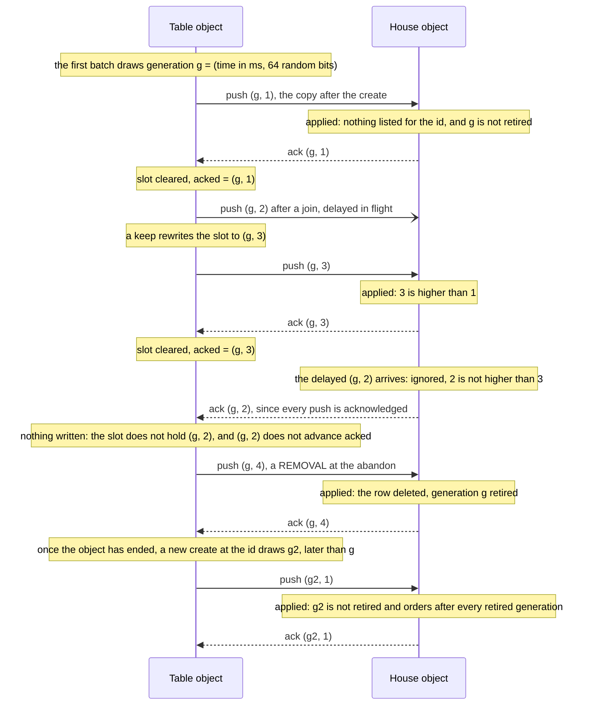

The copy is the TABLE document, so most moves deliver nothing: the turn passing, a join, a keep,
game over and the archive stamp change it, and a move within a turn does not. A table's create, its
final move and its removal need no later activity to reach the lobby: the push after the reply
delivers each, and the alarm written with the slot delivers it if that push fails. The
generation's time is in milliseconds so that a force and a re-create of one id cannot tie (§11).

**The lobby socket**, `GET /api/stream`, is the house's. It is admitted by the module's `identity`
export, whose 401 is answered unupgraded, and accepted under the tag `lobby`. Like the NAS's lobby
stream, it is sent nothing on connect. On every applied copy or removal, and on every lobby chat
post, every lobby socket is sent `{"event":"house","data":{"seq":N,"chat":M}}`: `seq` is the house's
own in-memory counter, and `chat` the lobby chat's newest message number. The client refetches the
lobby on any frame. At the fifteenth deployment a lobby socket received exactly
`{"event":"house","data":{"seq":2,"chat":0}}` when a second player joined a table.

**The lobby chat** is one `docs` row. Two load traps in a row DROP it (`house-chat-dropped`) instead
of poisoning the house, so the lobby never stays down over its chat.

**What the house costs.** A copy is about 600 B, and a new house instance loads every copy: a
thousand tables is about 600 KB (spec §2.5). Expiry bounds the copies, and the 90-day pruning the
retired sets.

### 7.5 The archive on R2 (`src/archive.ts`, `src/r2.ts`, `crates/yokohama-worker/src/receipt.rs`)

**The switch** is `YOKOHAMA_WEB_ARCHIVE`: `r2` or `off`, and absent means off (R-6.5c.14). `r2`
needs the bucket bound as `ARCHIVE`, and without it the API answers 500, naming the variable. With
the switch off the module runs the layer's `NoArchive`, and every path takes the layer's existing
off-branch: `/api/health` reports `archive: "off"`, a finished game saves nothing, an abandon
deletes without a save, and `POST /api/archive` answers the layer's 404 `this server keeps no
archive`. The client's outbox reads that 404 as "the archive is off" and forgets the game it was
trying to send, rather than filing it as offline and retrying it at every reconnect.

**Why a receipt.** The layer calls its archive's `put` synchronously, inside a request, and acts on
the answer before it returns. An R2 upload is asynchronous, and the module cannot wait for one. So
the module's archive under `r2`, the `ReceiptArchive`, never uploads anything. Its `put` looks for a
RECEIPT, the outcome of an upload the shell has already made for this exact plan, and answers with
it. With no receipt, it records the PLAN and answers `Failed("deferred to the host")`, and the plan
rides out in `Reply.archive`. A plan is its two keys and the SHA-256 of its two bodies, and its
`key` is a SHA-256 over those four, so a receipt answers only the put it was made for.

**The shell carries a plan out in the directory archive's own order** (`executePlan` in
`src/r2.ts`, restating the layer's `DirArchive::put`):

1. GET the record's key. These very bytes answer `identical`, other bytes `conflict`, and either
   way nothing is written. Absent, go on.
2. PUT the table's key unconditionally. Overwriting a half pair's table is the repair.
3. PUT the record's key only if absent, with `onlyIf: new Headers({"If-None-Match": "*"})`, the form
   production R2 accepted at the sixteenth deployment. If the precondition fails, a concurrent
   writer got there first: read the record again and answer `identical` or `conflict`.
4. Anything else is `failed`, with R2's message.

The record's key is the once-marker and the table goes first, so an upload that stops half way
leaves a table with no record, which the next put repairs, and never a record without its table.

**One clock reading per plan.** At the server's two sites the layer stamps `archived_at` inside the
table body it puts, so a second dispatch a second later would make a different plan and never meet
its receipt. The shell records the reading beside the plan, and pins the module's clock to it for
every call that drives that plan.

The loop for one plan, with the clock pinned to one reading throughout:

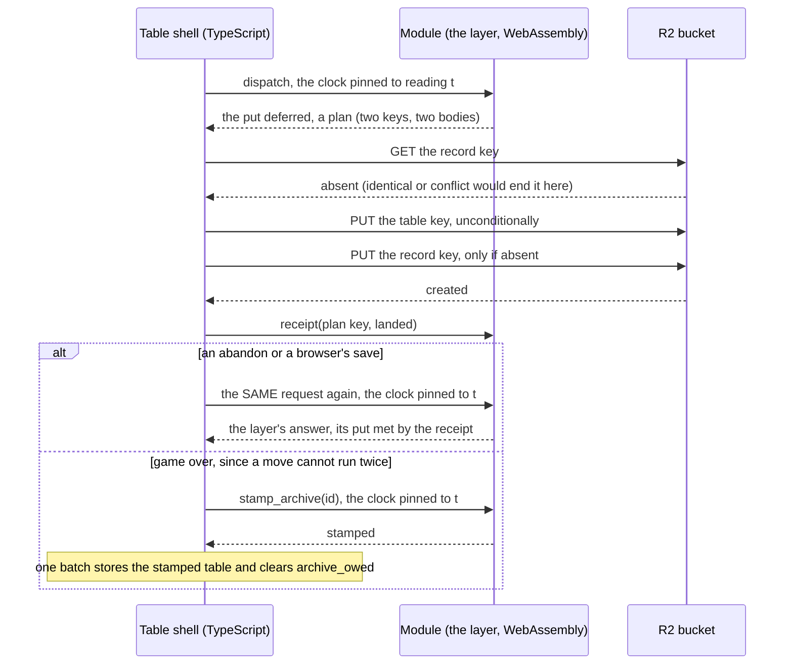

**The three sites:**

- **An abandon**, the creator's `DELETE`, runs whole under `blockConcurrencyWhile`. Its first
  dispatch deletes nothing, because the layer refuses to delete a game until its save is made, and
  so it defers the plan. The shell uploads it, installs the outcome as the receipt, and dispatches
  the SAME request again at the SAME reading, and the layer answers: the delete proceeds with its
  204, or it refuses in its own sentence with R2's reason inside. A failed save refuses the abandon,
  so no game with moves is lost while the archive is on. A delete that owes no save (a table still
  open or dealing, no move made, a game already stamped, or the archive off) completes in its first
  dispatch.
- **A browser's save**, `POST /api/archive`, goes to the caller's own `Archive` object, through
  the same two-dispatch loop under `blockConcurrencyWhile`, and the layer answers a 201, a 200
  `identical` or a 409. One object per caller serializes that caller's saves, and it confines the
  strict replay of an untrusted record to that caller's object, behind Access and the 2 MiB bound:
  a hostile record can at worst trap one instance of it. The object writes nothing to its own
  storage. **Before its first dispatch it counts the caller's share** (security S2b, B12's Worker
  half; decision D-5) — the receipt loop's step 0: the module's `share_prefix` names the share,
  `browser/<the caller's segment>/`, under `test/` for a `.test` address and nothing for an object
  with no caller; the object lists it in R2 (`list({ prefix, limit: 1000 })`, one Class A
  operation) and hands the listing — `truncated` and every object's key and size — to the module's
  `set_share`. The put's quota arm then counts records and bytes over the listing less its own two
  keys, as the NAS's `DirArchive::usage` does, and applies `Quota::PRODUCTION`, the NAS's 256
  records and 128 MiB and its 507 sentence, before any plan is deferred, so a full share uploads
  nothing; a truncated listing is full by construction, and a server game's own save (the empty
  prefix) is never counted. A listing that fails is logged `archive-count-failed` and not handed
  over, and the put refuses the save uncounted, `the caller's share was not counted before this
  save`, inside the layer's 500, which the outbox retries; every save begins with no count, since
  `share_prefix` clears whatever an earlier request left. One object per caller serializes the
  count and the write, so the check-then-write race the NAS needed a lock for cannot open: an
  address is canonical under `worker`, and under `open` the shell collapses a claim's space runs,
  so one name is one object.
- **Game over** cannot be dispatched twice, because a move is not idempotent. The move is answered
  200 as on the NAS. The layer's game-over save meets a deferred put and leaves `archived_at` unset,
  so the shell writes `archive_owed` (the plan and its reading) with the alarm, in the move's batch.
  After the reply it uploads, and on `landed` or `identical` it installs the receipt and calls
  `stamp_archive(id)`: the layer's new `Games::archive_over_retry`, run at the recorded reading, so
  the stamp and its retry on a version conflict are the layer's own code. The stamped table and the
  cleared `archive_owed` are one batch. A stamp can answer "not over any more", after an undo at a
  one-person table, in which case nothing is owed. A failed upload is retried by the alarm on the
  backoff.

**A `conflict` is final at every site, with one exception since M6.5c2** (R-6.5c2.11): at game over
the upload hands the record it met at the key to the module, and the layer stamps the table when that
record is an earlier completion of this same game, so the archive keeps the first ending and the
table is not stranded. Every other conflict is final: game over logs it and stops, an abandon is
refused with it, and an expiry marks the table `held` (§7.7). A stamp the layer refuses with a
non-200 is logged `stamp-refused` and never thrown: the save is retried after a `landed` or
`identical` upload, and is final after a conflict. *(Corrected 2026-09-28.)*

**The keys** are the layer's `archive::paths`, so a copy of the bucket is a directory the CLI loads:
`rev7/over/<id>.json` and `rev7/abandoned/<id>.json`, each beside its `<id>.table.json`, and a
browser's save under `browser/<the caller's segment>/`. **A plan whose game belongs to a `.test`
address goes under `test/` instead.** That is the table creator's address for a server game, and the
full sender's address for a browser save, never its segment, whose readable half is cut at 48
characters (security S1c). *(Since M6.5c2 the rule asks for an ADDRESS, one with an `@`: a plain name at the open door never takes the `test/`
root, even one ending `.test`.)* Every test
identity uses the reserved `.test` domain, so the live test tiers never write into the owner's
training data. A reply's `path` is relative to that root, as a NAS reply's is relative to its
archive directory.

**The switch turned off after being on** keeps a game-over save that is still owed, and uploads
nothing while off; the alarm logs `archive-owed-kept` if it runs. Turned back on, the table's next
request or alarm resumes the save. A delete while the switch is off takes such a save with the
table, logged `archive-owed-dropped`.

### 7.6 Identity (`src/identity.ts`)

This section is the `worker` door's, this repository's; the open door's reading of a claimed name is
§1.5. *(Added 2026-09-28, M6.5c2.)*

*(Added 2026-10-19, the auth cycle: this section is the identity source `access`'s. Under `oidc` and `workos`
the caller is the Worker's own session cookie, minted at the callback on `/enter` (`src/session.ts`,
`src/signin.ts`; §1.5), no assertion is read, and the dev door is inert; the rest of this section — the
raw judgement of an address, the strip rule, `X-Yokohama-User` as the one header the objects trust — holds
at every source.)*

**Access is the door.** The `yokohama` Access application covers the whole hostname, so no request,
not even for a static file, reaches this host without passing it. Access forwards its verdict as a
signed JWT in `Cf-Access-Jwt-Assertion`. It also sends a convenience header naming the email
address, which this host ignores: Cloudflare's guidance is that the header alone does not prevent
spoofing, and that the JWT's signature must be verified at the origin.

**The Worker verifies the assertion; it does not merely decode it** (R-6.5c.3). An RS256 signature
against the team's keys, a `kid` naming one of those keys, an `aud` that includes the application's
audience (`ACCESS_AUD`), an `iss` of `https://<ACCESS_TEAM_DOMAIN>`, an `exp` in the future and an
`nbf` no more than a minute ahead. So a path Access was not configured to cover, a forged token,
another application's token and an expired one all fail CLOSED: the request carries no caller, and
the layer answers its own 401. The keys come from
`https://<ACCESS_TEAM_DOMAIN>/cdn-cgi/access/certs` and are cached per isolate. An assertion naming
a `kid` the cache lacks may trigger at most one refetch a minute, whoever sends it, and a key set
that cannot be fetched means no caller at all.

**Who the caller is, in order:**

1. **A person.** An assertion with an `email` claim names the caller. Every client `x-yokohama-*`
   header is ignored (and stripped before forwarding anyway).
2. **The dev door.** An assertion naming ONLY the Service Auth credential `yokohama-worker` (no
   `email`, and a `common_name` equal to `DEV_DOOR_CLIENT_ID`), while `YOKOHAMA_DEV_DOOR` is `on`,
   may name its caller in `X-Yokohama-Claimed-User`, on requests and WebSocket upgrades alike. The
   claimed value must be an address by the layer's own rule: one `@` with something on each side,
   no spaces or control characters, at most 254 bytes. Since security S2b it must be a `.test` one
   too (`isTestAddress`: an `@` and the suffix `.test`, the receipt archive's own rule for the
   `test/` root), so the credential reaches no real seat and no training root (finding B6).
3. **No one**, in every other case.

An address is judged RAW before anything is done to it: only a tab, a space and visible ASCII may
appear, the bytes a header can carry and the layer will read. Only then is it trimmed and lowercased
in ASCII, as the layer's `User::parse` reads it. JavaScript's own `trim()` and `toLowerCase()` would
first turn a no-break space or a Kelvin sign (U+212A) into something else, and so into another
user's address. Such an address is no one here, as it is on the NAS.

The objects never read the assertion, although it is forwarded with the other headers. They read the
caller from `X-Yokohama-User`, the one header the layer's `worker` identity mode trusts, and only
the Worker can set it, because only the Worker can reach the objects. `/api/health` and `/api/me`
report the mode as `cf-access`, the door the client is behind.

**The dev door is a development door: off in production; `wrangler.dev.jsonc` opens it** (security
S2b, finding B6), deployed by `npm run deploy:dev` around a live tier and closed by the plain
`npm run deploy` after it (RUNBOOK §7). A holder of the credential can claim any `.test` identity at
any table, and no other address. That is the trust the open door gives every caller (§1.5), narrowed
to one secret and to test identities, and it never grants an operator's rights
(§7.7). It exists for the test harnesses, and it must be switched off when the site goes public
(R-6.5c.3). Two facts about the credential matter in practice:

- **Service Auth outranks WARP.** A request that presents the credential IS the credential, even
  from the owner's WARP-enrolled workstation. To act as the owner, as the operator must, send no
  credential.
- **The cookie, for browsers under test** (the orchestrator's ruling I-75). The live Playwright tier
  presents the credential ONCE, from Node's own `fetch`, and seeds each browser context with the
  `CF_Authorization` cookie Access answers with, so the secret never reaches a browser, a trace or
  another origin. The claimed address goes context-wide, since Playwright's routing cannot reach a
  page's own WebSocket upgrade. That custom header forces a CORS preflight on the zone's
  cross-origin analytics beacon, and the live walk forgives exactly the two console lines it costs;
  a real browser sends no such header and logs nothing.

### 7.7 How a table ends: delete, expiry, the marker, the operator (`src/marker.ts`, `src/admin.ts`)

**Every way a table ends through the layer ends the same way** (R-6.5c.8, R-6.5c.15):

1. **The layer deletes, as the creator.** An abandon is the creator's own `DELETE
   /api/games/{id}`. An expiry, and the operator's plain expire, dispatch that SAME request as the
   stored table's `created_by`, through the module's host-local `expire(id)`. The layer always keeps
   the creator seated, so all three pass the layer's checks and get its archive rule. It runs under
   `blockConcurrencyWhile`, through the receipt loop when a save is owed (§7.5).
2. **One batch** removes the documents; writes the MARKER, `{at, reason, ttl_days?, kept}`; puts a
   REMOVAL in the house slot; clears any owed save; and sets the alarm.
3. Every socket is sent `end {"reason":"deleted"}` and closed 4404.
4. The slot's push, or the alarm, delivers the removal to the house.
5. **For 90 days the marker answers EVERY request 404** with a sentence made of a head and a tail.
   The heads are `this table was abandoned on <date>`, `this table expired on <date> after 90 days
   without activity`, `this table waited 7 days to start and was closed on <date>` (R-6.5c2.42)
   and `this table was removed by an operator on <date>`, the date in UTC. The
   tails come from `kept`: `— its game is in the archive`, `— no move had been made, so there was
   nothing to keep`, and `— this server keeps no archive, so its game was not kept`. It is a 404
   rather than a 410 because the client already ends a source on a 404 and shows the server's
   sentence. An upgrade meets it too, answered unupgraded, so the socket arm's probe reads it.
6. **After the 90 days**, and once the house has acknowledged the removal, the object calls
   `deleteAll()`, which at this compatibility date deletes the alarm as well, and ceases to exist. A
   returning player then reads the layer's own `no game named …`.

Live, a table abandoned with no move answered `this table was abandoned on 2026-09-24 — no move
had been made, so there was nothing to keep`, and the exit's 40-move game, once abandoned, `… — its
game is in the archive`.

**Expiry** (R-6.5c.15) is `YOKOHAMA_WEB_TABLE_TTL_DAYS`, 90 in production; absent, no table ever
expires. A table's last activity is the newest `written_at` of its record, table and chat. When the
alarm finds `last activity + TTL` has passed, the table expires as its creator: saved first while
the archive is on, then deleted, behind its marker. Finished games expire on the same clock, their
save made at game over. Open and dealing tables expire with nothing to save.

**A table that has not started** (M6.5c2 cycle E, R-6.5c2.42; from 0.7.2, security S3, D9) — open,
or dealing with a keep outstanding: its status `open` or `dealing` — is closed sooner, after
`YOKOHAMA_WEB_OPEN_TABLE_TTL_DAYS`, 7 in production and by default, behind the marker
`this table waited 7 days to start …`. A batch cannot read a table's status (the strings rule),
so every table's alarm is ARMED at its last activity plus the shorter TTL, and DECIDED at the alarm
by the status its house copy reads — `factsOf`, the parse `copyFacts` makes, over a copy made on a
scratch module. An `open` or `dealing` table is closed; any other is re-armed to its last activity
plus the TTL. The status is read as the stored document says it, never repaired first, so a table
finalized but never flipped to `playing` that nobody opened for the whole 7 days is closed too, a
game with no move (design D-16; the NAS's sweep repairs it first and keeps it).
`/api/health` reports both, `table_ttl_days` and `open_table_ttl_days`, `null` while no table
expires.

- A save that fails leaves the table in place, and the alarm retries it on the backoff, logged
  `expiry-failed`. So no game with moves is lost to expiry while the archive is on.
- A `conflict`, where the record's key already holds another game, can never clear. The table is
  marked `held`, is never expired again, and waits for the operator.
- A poisoned table does not expire on its own either.
- With the archive off, an unfinished game is gone at its expiry, and its marker says so.

**The operator surface** (R-6.5c.16; `src/admin.ts`) is two routes and a curl playbook, no UI. The
list of operators is the Worker SECRET `YOKOHAMA_WEB_ADMINS`, comma-separated addresses; with it
absent, the routes are unrouted `/api/*` and answer the layer's ordinary 404. The gate admits a
PERSON on the list, and nobody else: a dev-door identity never counts, even when it claims a listed
address, and anyone else is 403 `this address is not an operator here`. Past the gate the Worker
sets `X-Yokohama-Operator`, which, like every `x-yokohama-*` header, no client can send.

- **`GET /api/admin/tables`** is the house's listing from its copies: each table's `id`, `name`,
  `status`, `players`, `created_at` (the layer's seconds), `last_active` (seconds, the shell's
  milliseconds cut where the row is built), `bytes` (the table object's SQLite size), `over`,
  `winner` and `archived_at`: every time in it is unix seconds. *(Corrected 2026-09-28:
  `last_active` was the shell's milliseconds until M6.5c2.)*
  `last_active` and `bytes` are as of the table's last delivery, so a chat post or a move within a
  turn does not refresh them.
- **`POST /api/admin/tables/{id}/expire`** ends the table NOW by the path above, with reason
  `operator`, its save made first.
- **`…/expire?force`** ends the object whatever it holds (a live table, a poisoned one, a `held`
  one, or a marker), with no layer and no save, and leaves NO marker. The house is sent the removal
  and the object deletes itself once the house acknowledges: 204. When the house cannot confirm the
  removal it answers 503 `the lobby has not confirmed the removal — the alarm will finish it`, and a
  create at the id is 409 meanwhile. `?force` takes no value: `?force=false` is a 400 naming the
  switch (ruling I-72), because a value that forced would drop a save the operator meant to keep.
  The force is also what makes the live corpus replay repeatable (§10.4).
- **Both POSTs need `Content-Type: application/json`** (security S2b, finding B5): without it the
  Worker answers the layer's own 400, `` Expected request with `Content-Type: application/json` ``,
  after the gate, so a page's form or text POST, sent with no preflight under a signed-in
  operator's cookie, never reaches an expire; and another site's page is refused before the gate
  (§7.1, step 2).

### 7.8 The alarm (`src/alarm.ts`, and the alarm paths of `src/table.ts`)

A table object has ONE alarm, set to the earliest of what is due: the slot's retry, an owed save's
retry, an owed house copy's retry, the expiry deadline (unless the table is `held` or poisoned), and
a marker's end. Three rules decide who sets it:

1. **A write that makes a delivery due sets it**, to that delivery's first retry 30 s out, in its
   own batch. `setAlarm` replaces the earlier setting, so a table played every few seconds holds one
   pending alarm, not one per move.
2. **The success that discharges a delivery re-arms it** to the next deadline, in the success's own
   batch, so a delivery that already happened does not wake the object for nothing.
3. **Nothing else touches it.** A write that makes nothing due, such as a move that leaves the copy
   alone or a chat post, leaves the alarm where it is. The expiry deadline only ever moves later, so
   an alarm that fires before `last activity + TTL` re-reads the activity and re-arms itself.

Retries back off at 30 s, 2 min, 10 min, then hourly, and a success resets the ladder. When the
alarm runs (`onAlarm`), a standing marker takes it: a removal still waiting is pushed, or the object
ends at the marker's end. Otherwise it recomputes an owed house copy from the stored table document,
delivers the slot and any owed save, and then checks the expiry.

**Why the alarm is armed in the same batch as the write.** A deploy stops every object at once,
possibly between a batch and its side channels, and the alarm the batch set finishes what it made
due. A pool cell holds the house's `apply` pending, stops every object with
`abortAllDurableObjects()`, and runs the table's alarm, which delivers the slot. No alarm is known
to have fired live, since every live push was acknowledged at once and no table has yet idled 90
days, so the pool is this path's evidence.

---

## 8. The transport

**Why WebSockets.** The NAS pushes changes over server-sent events: one long HTTP response per
screen, held open by one resident process. On Durable Objects a held response keeps the object
awake, and its invocation open, for the whole game. A hibernatable WebSocket keeps the connection
while the object sleeps. So the transport here is **signal plus fetch over hibernatable WebSockets**
(R-6.5c.6): the socket carries the SSE stream's own frames, and the client fetches exactly as it
does over SSE.

**The framing.** Every message an object sends is `{"event": <name>, "data": <the SSE frame's
data>}`, with the name one of the stream's own three, `signal`, `house` or `end`, and the data
embedded byte for byte, never re-serialized (`frame` in `src/frames.ts`). A `signal` frame is a
wake-up, not a board: it is the `events` payload, a handful of fields saying how many events the
game has, whose turn it is, whether it is yours, and how much chat there is. The client fetches a
board only when that moved (ruling R-P9).

**The client's socket arm** (`web/src/ws.ts`, `web/src/signal.ts`) unwraps each message into the
same `(event, data)` pair its SSE reader produces, and hands both to ONE handler, so nothing
downstream knows which transport a frame came over.

- It opens a WebSocket on the source's own stream URL, `wss:` under `https:`. The screen reads
  "live" when the socket opens.
- An `end` frame ends the source, and the close that follows it is ignored whatever its code,
  since this host always sends `end` before its 4403 or 4404 close.
- Every 30 s an OPEN socket sends `ping`. The object's auto-response answers `pong` at the edge
  without waking the object, which keeps the connection inside the edge's 100 s idle cut (M6.3
  measured a stream with no heartbeat cut at 125 s). It asks the server nothing, so it is not a
  poll.
- **A close the arm did not make, with no `end` before it, or an open that fails, is followed by
  ONE probe**: the source's own plain fetch. A browser hides why an upgrade was refused ("user
  agents must not convey any failure information to scripts", WHATWG), so without the probe an
  expired Access session would read "reconnecting…" forever. The probe is classified as the SSE arm
  classifies a failure (an expired session ends the source with the `/enter` remedy, a 403 or 404
  with the server's sentence), and an answer is a free resync before the reconnect ladder.
- **A close the arm made itself asks nothing.** That is a teardown, or a hidden tab: nothing is read
  from a hidden tab (ruling R-P8), so the arm closes the socket when the tab hides and reopens it
  when the tab returns, and the object's first frame is the resync.
- **Nothing opens before the transport is known** (rulings I-81 and I-86). A page learns its arm
  from `/api/health`'s `signal` field, and until that answer the default is SSE, which this host
  refuses with a 426. So the arm waits for the health read, for at most 5 s, and the screen reads
  "connecting…" meanwhile. *(Corrected 2026-09-28: since M6.5c2 a signal that has never connected
  reads "connecting…", and "reconnecting…" only once a connection is lost; this read
  "reconnecting…" before.)*

**Measured live.** In the two-browser re-run of 2,510 inputs, the watcher opened its socket once and
held it through the 1,886 applied moves it watched, and each player opened twice, both before the
first move: once at the open table and once at the game. Nobody reconnected during play. At the
exit, the sockets of two players and a watcher stayed open through four 60 s pauses in which the
object hibernated.

One of those pauses, as a timeline:

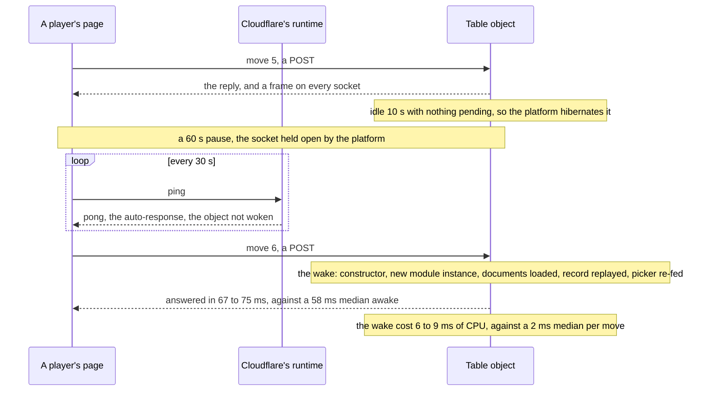

---

## 9. Testing, building and deploying

### 9.1 The tests, and where each runs

| Tier | Command | What it proves | Runs |
|---|---|---|---|
| Native Rust | `cargo test -p yokohama-worker` | every export's logic, through its `_inner` function: the recorded signal, the receipt archive and its `test/` root, the picker, the scrub, `create`'s and `events`' rules, `expire` | per edit; CI |
| Node | `npm run test:scripts` in `worker/` | the build scripts (the factory transform, the asset assembly, the deploy guard's checks over the committed configurations) and the shell's pure modules (routing, identity with crafted keys, the slot's orderings, the marker, the operator gate, the frames, the configuration). One cell runs `cargo metadata`, so it needs `cargo` on the `PATH` | per edit; CI |
| The pool | `npm test` in `worker/`, after `npm run build:module:debug` | Cloudflare's Workers Vitest integration (`@cloudflare/vitest-plugin`) runs the cells INSIDE workerd, with real SQLite, alarms, WebSockets and a local R2, over the built debug module: the Worker, the three objects, the slot, the archive, expiry, the operator, the sockets, the factory's isolation — and the whole committed corpus replayed through the objects (`test/corpus.test.ts`). Since M6.5c2 it is TWO projects, one per door: `worker` over `wrangler.test.jsonc`, every `test/**/*.test.ts` but `test/open/`, and `open` over `wrangler.open.test.jsonc`, `test/open/`. `npm test` runs both, and `npx vitest run --project open` one | per edit; CI |
| Types | `npm run typecheck` in `worker/` | the shell and the pool's cells | per edit; CI |
| The live replay | `node scripts/live-replay.mjs` in `worker/` | the same corpus through the DEPLOYED Worker, as the walk's `.test` identities | by the operator, over WARP; never CI |
| The live browser tier | `YOKOHAMA_WEB_E2E_TARGET=live npx playwright test two_browsers joins_by_link` in `web/` | real browsers through the live Worker: a table joined by its link, and a whole game played to a winner with a watcher, every console error but the known ones a failure | by the operator; never CI |
| The exit | `web/e2e/exit_game.spec.ts`, opt-in and headed (its header gives the invocation) | a paced game with pauses longer than an object's eviction, chat both ways and a watcher | the cycle's exit; never CI |

Workerd's clock cannot be advanced, so the pool's time-driven cells move the STORED times instead,
backdating a `written_at` or a marker's `at`. The spec's mutation battery, 39 named defects, was run
twice, at the whole-branch review's head and again after its fix wave: 38 are caught by named cells
(native, pool and the client's own), and row 4, a frame sent before its batch, is recorded as
uncatchable, because the platform's output gate makes it equivalent.

**A development note, for every code file of this lane:** every INVISIBLE non-ASCII code point in
code is a `\u` escape (an edit tool decodes a typed escape); a visible glyph may be raw. A no-break
space or a Kelvin sign typed raw is invisible in review, and an edit tool asked to write `\u00a0`
may write the character itself, so the escape is checked after the edit.

### 9.2 The build

Prerequisites: the pinned Rust toolchain with its `wasm32-unknown-unknown` target, `wasm-bindgen-cli
0.2.128` (exactly the crate's version), binaryen's `wasm-opt` (version 133 built every deployed
module), and `npm ci` in both `web/` and `worker/`.

```sh
cd web && npm run build          # the RELEASE browser module and web/dist — always first
cd ../worker && npm run build    # build:module → build:assets → smoke:release
```

- **`build:module`** (`scripts/build-module.mjs`) empties `gen/`, then stamps `gen/source.json` with
  a digest of everything the module is compiled from: the workspace's manifest, lock and toolchain
  file, and the five crates in the module's graph. Then it runs `cargo build --profile release-wasm`
  (size-optimized, fat LTO, one codegen unit) for `wasm32-unknown-unknown`, `wasm-bindgen --target
  web`, `wasm-opt -Oz --strip-debug --strip-producers` through `web/scripts/wasm-opt.mjs` (which
  refuses when `wasm-opt` is absent), and the factory transform LAST, so a build killed part way
  leaves no factory for anything to load. A release build whose optimizer changed nothing leaves
  `gen/.unoptimized`, which the deploy guard refuses. The first deployment's module went from
  1,854,072 B to 1,220,664 B through `wasm-opt`. Its current size is read in ONE place, the root
  `Cargo.toml`'s `release-wasm` comment (§6.3), by `node scripts/module-figures.mjs
  gen/yokohama_worker_bg.wasm` after a release build. *(Corrected 2026-09-28, M6.5c2: this line
  stated the fix wave's size as current.)*
- **`build:module:debug`** builds the pool's module: `--release --features debug`, no `wasm-opt`,
  and the `debug_trap` export the trap cells call. It is never deployed.
- **`build:assets`** (`scripts/assemble-assets.mjs`) rebuilds `worker/assets/` from nothing:
  `web/dist`, the art under `art/`, and `worker/static`'s two files, refusing a file two sources
  both provide. It refuses a DEBUG browser module, which `web/`'s `npm run e2e` leaves in
  `web/dist`. Then it reads the release's precache list out of the built `sw.js` and verifies every
  entry's SHA-256 against the assembled file, so the tree IS the release the service worker
  installs: 153 entries, in 156 files.
- **`smoke:release`** (`scripts/smoke-release.mjs`) instantiates the RELEASE module once in Node,
  runs `init` with the archive off, asks `GET /api/health`, and refuses anything but a 200, or a
  module that exports `debug_trap`. Nothing else runs the release module before a deploy, since the
  pool runs the debug one. Its LIVE mode, `node scripts/smoke-release.mjs --live <origin> --config
  <file>`, runs after a deploy instead: under the file's `YOKOHAMA_TURNSTILE` `on`, a cookie-less
  `GET /api/health` must answer 403 with `cf-mitigated: challenge`, the edge rule's answer (RUNBOOK
  §3), and the release's own `/sw.js` — and `/sitemap.xml`, where the local stamp says the build
  wrote one — must answer 200 with no `cf-mitigated` header; under `off` it makes no request. **Run
  it over WARP, or from any client Bot Fight Mode trusts:** off WARP, Bot Fight Mode answers a bare
  client's `/sitemap.xml` with its own 403 before the rule is consulted, and the smoke cannot tell the
  two apart (RUNBOOK §3 and §20, the window's W-1).

The order matters twice. `web/`'s build comes first, because its browser walk leaves a debug module
in `web/dist`. And after a release build, `npm run build:module:debug` comes before `npm test` in
`worker/`, because the pool needs the debug module.

### 9.3 The deploy guard

`npm run deploy` is `node scripts/deploy-guard.mjs --config wrangler.jsonc && node
scripts/secrets-guard.mjs --config wrangler.jsonc && wrangler deploy --config wrangler.jsonc`, and
`npm run deploy:open`, `npm run deploy:dev` and `npm run deploy:private` the same three steps over
`wrangler.open.jsonc`, `wrangler.dev.jsonc` and `wrangler.private.jsonc` — each step told its file, so wrangler deploys exactly what the guard judged
(security S2a, finding D18). Nothing ships unless all fourteen checks hold, and every failure is
named, not only the first:

1. **`gen/` holds the RELEASE module**, and no `gen/.unoptimized` marker: a debug or unoptimized
   module never ships.
2. **The assets tree verifies against its own `sw.js`** and holds no debug browser module, so what
   wrangler uploads is the release, however the tree was made.
3. **`wrangler.jsonc` names its door, and the door's rules hold** (M6.5c2). `YOKOHAMA_WEB_IDENTITY`
   in the top-level `vars` must be `worker` or `open`, and the guard prints the door it reads before
   its verdict: `wrangler.jsonc deploys the worker door — Cloudflare Access, verified by the shell`.
   `preview_urls` must be explicitly `false` under both doors, since a preview version is not the
   deployed code. Under `worker`, `workers_dev` must be explicitly `false` and both Access values set;
   under `open`, a `workers.dev` URL is allowed and `YOKOHAMA_DEV_DOOR=on` is refused. Absent is not
   false: with no route, an absent `workers_dev` is a public `workers.dev` URL, and an absent
   `preview_urls` leaves the Worker's version URLs as they were. *(Corrected 2026-09-28: until
   M6.5c2 this check asked both switches `false`, with no door to read.)* *(Corrected 2026-10-11,
   security S2a, finding C3: `workers_dev` must be explicitly `false` under EVERY door, so the clause
   allowing a `workers.dev` URL under `open` no longer holds — there it would go around the edge rule,
   the rate limit and Bot Fight Mode. And every configuration judged by `--config` whose door is
   `open` is held to production as `wrangler.open.jsonc` is.)* **And 3b** (security S2a, finding
   D18): no redirect file, `.wrangler/deploy/config.json`, in `worker/` or at the repository root —
   with no `--config`, wrangler can follow one to a configuration the guard never judged.
   *(Since security S2b, finding B6: under `worker`, `YOKOHAMA_DEV_DOOR` is `on` in
   `wrangler.dev.jsonc` alone, which must set it to exactly `on` and is held to production but for
   that one variable; and every other worker-door file judged by `--config` is held to production
   exactly, with no allowed difference — the S2a plan review's F-40.)* *(Since the auth cycle, Task 7:
   under `worker`, `YOKOHAMA_IDENTITY_SOURCE` must be `access`, `oidc` or `workos` with no default, and the
   door line names it — `wrangler.jsonc deploys the worker door, source access — Cloudflare Access,
   verified by the shell`; `ACCESS_TEAM_DOMAIN` and `ACCESS_AUD` are required at `access` and REFUSED
   at `oidc` and `workos`, `YOKOHAMA_OIDC_CLIENT_ID` is required at both arms, `YOKOHAMA_OIDC_ISSUER` at
   `oidc` and refused at `workos`, and the open files omit every arm variable. And each file in the
   guard's `DEPLOYMENTS` table is held to its own record — production's `yokohama-web`, bucket
   `yokohama-archive`, route `yokohama.moore.nyc`; the private Worker's `wrangler.private.jsonc`,
   `yokohama-web-private`, route `yokohama-test.moore.nyc` (security S3, Task 7), its own bucket and
   rate-limit namespaces, source `access` — and to production's `main`, `rules`, `compatibility_date`,
   `assets` and `observability`; the file is optional unless it is the one named.)*
4. **The test clock is named nowhere in `wrangler.jsonc`**, read as text, so no environment or
   comment can carry a frozen clock into production. **And 4b, its twin** (security S1a,
   R-SEC8(b)): `YOKOHAMA_DIAGNOSTIC_SEEDS` is named nowhere in the deployed configuration, read as
   text whichever file the deploy ships, so a creator's seed is honoured at a table that seats
   somebody else in the pool's two files and nowhere else.
5. **The `assets` block is exactly spec §2.3's in all five files**: production's, the open window's and
   the dev file's (the gate's until security S2b), and the pool's two, `wrangler.test.jsonc` and
   `wrangler.open.test.jsonc`. The pool reads only its own two files, so without this production's
   block could drift with every pool cell green,
   and an asset-layer fallback answers a missing file without ever invoking the Worker.
6. **The `durable_objects`, `migrations` and `r2_buckets` blocks of each pool file equal
   production's**, so the pool never tests a class, a binding, a migration or a bucket that
   production does not ship.
7. **No `vars` block in `wrangler.jsonc` names a secret**: `YOKOHAMA_WEB_ADMINS`, whose value would
   commit an address to the repository, or, since M6.5c2, `DEV_DOOR_CLIENT_ID`, or, since the auth
   cycle, `YOKOHAMA_OIDC_CLIENT_SECRET` and `YOKOHAMA_SESSION_SECRET`. All are set as
   secrets, which a deploy leaves alone, and the pool's `wrangler.test.jsonc` keeps its test client
   id. *(Checks 5–7 corrected 2026-09-28 for the pool's second configuration and the second secret.)*
8. **`gen/` is the build of the sources as they are now**: `gen/source.json` against the same digest
   taken again. `wrangler deploy` bundles `src/` fresh but ships `gen/` as it sits, so a crate
   changed without a rebuild would ship an old module whose exports the new shell may call and not
   find.
9. **The assets tree was assembled from the current `web/dist` and `worker/static`**: its `sw.js`
   against `web/dist/sw.js`, byte for byte. Check 2 alone passes a stale tree, which verifies
   against its own `sw.js`. Since security S2a its `_headers` is held to `worker/static/_headers`
   followed by the current `web/dist/headers.json`'s `/*` block, the header set as the assembly
   appends it, and a `web/dist` with no `headers.json` is refused, naming it.
10. **No `cache` block turns Workers Cache on, at any depth** (cycle F). A block whose `enabled` is
    not `false` is refused wherever it sits, found by walking the parsed configuration: with it on,
    requests served from the Worker's cache, static assets included, are billed like requests that
    invoke the Worker, and the door stops being free.
11. **The assets tree holds `404.html`**, the page `not_found_handling: "404-page"` answers a miss
    with; without it a miss is a blank again. It is read off the tree the deploy uploads, never
    `web/dist`.
12. **The Turnstile declaration agrees with the build it ships** (cycle F): the configuration's
    `vars.YOKOHAMA_TURNSTILE` (`on`, `off`, or absent, which is `off`) against the tree's
    `build-values.json`, whose `turnstile_sitekey` says whether the bundle carries a site key — `on`
    exactly when it does. And the identity rule: `on`, and a keyed build, stand only beside
    `YOKOHAMA_WEB_IDENTITY` `open`, or `worker` at source `oidc` or `workos` — a provider-signed door,
    where the Turnstile is the bot defence; under Access the edge is (RUNBOOK §3). The client no
    longer reads a site key as the open door: it reads the server's facts.
13. **Production's two Rate Limiting bindings are at their figures** (security S2b, finding C2):
    `wrangler.jsonc`'s `ratelimits` block is exactly `CREATE_LIMIT` 10 per 60 s and `WRITE_LIMIT`
    120 per 10 s, namespaces `7301` and `7302`, read as values, and each pool file binds exactly
    those two names, at a lenient figure of its own, since `test/worker.test.ts` sends more creates
    through `handle` than production allows. The open and dev files carry production's block by the
    sibling rule. A `namespace_id` is a string, unique to the account, and a shared id shares
    counters across Workers.
14. **Production's logs redact query strings and are not sampled** (security S2b, finding D23):
    `observability.redact_query_string` is `true`, since an open-door socket's `claimed=` rides the
    upgrade's URL and an invocation log keeps the URL, and `head_sampling_rate` is absent or `1`, at
    the top level and under `observability.logs`, whose `invocation_logs` is never `false`, and the logs
    are never switched off (`enabled`, `logs.enabled`, `logs.persist`): the live readings count
    invocations through these logs.

Checks 3 to 7, 10, 13 and 14 need no build, and `npm run test:scripts` runs them over the committed
files, which is how CI catches a drifted configuration. Checks 1, 2, 8 and 9 need a build, and 11 and
12 read the assembled tree and its stamp, so they run only on the workstation that deploys.

**Then the secrets guard** (security S2a, decision D-11) asks the account for the Worker's secret
NAMES, never a value, and refuses a secret named `YOKOHAMA_DIAGNOSTIC_SEEDS`,
`YOKOHAMA_WEB_TEST_CLOCK` or, since the S2 stack review, `YOKOHAMA_DEV_DOOR`: the guard refuses the
first two in a committed file and judges the third there, and a secret would carry any of them past
it. A listing that fails is a refusal, never a pass, so every deploy script is a network
step: a logged-out clone runs `npx wrangler login` once, and one with more than one account sets
`CLOUDFLARE_ACCOUNT_ID` (`npx wrangler whoami` lists them and caches nothing). A new Worker's first
deploy cannot pass it, since wrangler answers "Worker not found" (RUNBOOK §2). So a NEW Worker's first
deploy runs `wrangler deploy --config <file>` by hand with neither guard — a Worker that does not exist
holds no secret, and the deploy guard holds each file to its own deployment identity (production's
`yokohama-web` and the private Worker's `yokohama-web-private`, the auth cycle's Task 7) — and the secrets
guard from the second deploy on (security S2b, decision D-7 as corrected at Task 9's review; the owner's
R-6). **The secrets guard also REQUIRES an arm's secrets** (R-48): it reads the judged file's source and
refuses the deploy, naming the secret and its `wrangler secret put` line, when the listing lacks, under
`workos`, `YOKOHAMA_OIDC_CLIENT_SECRET` (the WorkOS API key) or `YOKOHAMA_SESSION_SECRET`, or, under `oidc`,
`YOKOHAMA_SESSION_SECRET` (the client secret is optional there: PKCE); under `access` and the open door it
asks for nothing.

### 9.4 Configuration and secrets

`wrangler.jsonc` is production's configuration, and `wrangler.test.jsonc` and
`wrangler.open.test.jsonc` are the pool's two, one per door: the Workers `yokohama-web-test` and
`yokohama-web-open-test`, which are never deployed. Production binds `ASSETS`; the three object
namespaces `TABLE`, `HOUSE` and `ARCHIVER`, in the one migration `v1`, which has been FROZEN since
the first deploy, so a class added later needs a tag of its own; and the private bucket
`yokohama-archive` as `ARCHIVE`, with no public URL and no custom domain.

`wrangler deploy` REPLACES the Worker's variables with the file's `vars`, so that file is the whole
list; secrets survive a deploy. RUNBOOK §3 gives every variable and what its absence means. In
brief: `YOKOHAMA_WEB_IDENTITY` names the door, `worker` here (§1.5); `ACCESS_TEAM_DOMAIN` and
`ACCESS_AUD` configure Access (§7.6) and are required at source `access` alone;
`YOKOHAMA_IDENTITY_SOURCE` names who vouches for an address under `worker` — `access` here, `workos` after
the window — with `YOKOHAMA_OIDC_ISSUER`, `YOKOHAMA_OIDC_CLIENT_ID` and `YOKOHAMA_SESSION_DAYS` its arms'
variables and `YOKOHAMA_OIDC_CLIENT_SECRET` and `YOKOHAMA_SESSION_SECRET` its two secrets (§1.5; RUNBOOK
§3); `YOKOHAMA_DEV_DOOR` is `off`, and `wrangler.dev.jsonc` sets it
`on` for the live tiers (security S2b);
`YOKOHAMA_WEB_ARCHIVE` is `r2`;
`YOKOHAMA_WEB_TABLE_TTL_DAYS` is `90` and `YOKOHAMA_WEB_OPEN_TABLE_TTL_DAYS` `7`; the NAS's three
chat variables keep the NAS's defaults;
`YOKOHAMA_WEB_COUNT_WAKES` is unset (§9.5); `YOKOHAMA_TURNSTILE` is `off`, a deploy declaration
the Worker only holds to a string, which the deploy guard holds to the client build's site key and
to the open door, and which `wrangler.open.jsonc` alone sets `on` (RUNBOOK §3); and
`YOKOHAMA_WEB_TEST_CLOCK` exists only in the pool's two files, as does `YOKOHAMA_DIAGNOSTIC_SEEDS`,
`on` there so the corpus walk's seeded tables with an open seat are honoured, and refused by the
deploy guard in any deployed file (check 4b). A bad value answers the API's
requests 500, naming the variable, and leaves the static release alone; RUNBOOK §3 lists the few
answers that come before the configuration is read, and the recipes "to deploy with no archive" and
"to keep every table".

**Nothing secret is in the repository:**

- **`YOKOHAMA_WEB_ADMINS`**, the operator list, is a Worker secret, put with `wrangler secret put`
  from standard input. Its refusals name an entry by position, never by value.
- **The Service Auth credential `yokohama-worker`** has a client id, its public half, put as the
  Worker secret `DEV_DOOR_CLIENT_ID` since the twenty-first deployment (2026-09-28, `RUNBOOK.md` §15; it was a
  committed variable before, and stays in the history). Its secret lives only in the repository
  root's gitignored `.dev.vars`, and no recipe puts it on a command line or a screen: curl reads it
  from a mode-600 header file.
  RUNBOOK §4 says how to rotate it.
- **A read-only R2 key**, scoped to this bucket, lives in `.dev.vars` for copying the bucket down.
- **The account** is reached through `wrangler`'s own OAuth login (`npx wrangler whoami`).

### 9.5 The exit window: counting wakes

`YOKOHAMA_WEB_COUNT_WAKES=on` makes every wake at a table that holds a table document add one to
`meta.wakes` in its request's batch and log `wake {id, wakes}`: the one way to read hibernation off
a live Worker (ruling I-84). It is off by default, because on a turn-based table it costs a row
written on almost every move. Two deploys open and close the window, with no file edited:

```sh
# open:
node scripts/deploy-guard.mjs --config wrangler.jsonc && node scripts/secrets-guard.mjs --config wrangler.jsonc && npx wrangler deploy --config wrangler.jsonc --var YOKOHAMA_WEB_COUNT_WAKES:on
# close:
npm run deploy
```

`--var` adds one variable beside the file's, and the plain deploy replaces the variables with the
file's again, which omit it. Every deploy restarts every object and closes every socket, so open it
between games. At the M6.5c exit the window read four `wake` lines, one on the first move after each
60 s pause.

### 9.6 Deploying, and rolling back

Every deploy runs `web/`'s release build, `worker/`'s build and `npm run deploy`, then reads the
result with the tail listening (RUNBOOK §5); RUNBOOK §8 on records each one, numbered on from
the NAS's deployments, so this host's first was the fourteenth. **A deploy restarts every object
and closes every socket** with 1006: the client probes once and reconnects, an open picker is
re-fed or dropped (§7.3), and no acknowledged move is lost, but everyone reconnects, so deploy
between games.

**Never `wrangler delete`.** It deletes the Worker "and all associated Cloudflare developer platform
resources", and the objects ARE the store. To take the Worker off its hostname, remove its custom
domain in the dashboard; the objects and their storage stay. `npx wrangler rollback <version-id>`
returns to an earlier version, but never across a Durable Object migration, nor to a version bound
to a bucket that no longer exists.

**A rollback across the M6.5c fix wave**, to the eighteenth deployment or earlier, has two known
consequences (`worker/RUNBOOK.md` §6). Rolling forward again needs nothing.

1. **Generation order.** The older code draws a table's generation in SECONDS, and every seconds
   generation orders before every retired MILLISECONDS one. So a table forced under the newer code
   and created again under the rolled-back code has every copy ignored by the house
   (`slot-ignored`): it plays by its link but stays off the lobby until the retired generation is
   pruned, 90 days after it was retired.
2. **Open pickers.** The newer code's picker rows carry a `code` key that the older module's strict
   read does not know. It reads such a row as no list and re-feeds nothing, so the player's next
   click on an open picker is a 409.

---

## 10. Operating it

### 10.1 Reading a live deployment

- **Health**, over WARP as the owner: `curl -s https://yokohama.moore.nyc/api/health` reads
  `identity: "cf-access"`, `signal: "ws"` and the archive's switch.
- **The tail**: `npx wrangler tail yokohama-web --format json > "$SCRATCH/tail.json"`. Each event
  is one invocation, PRETTY-PRINTED over many lines, so parse by whole JSON objects (`jq` reads a
  stream), never by line. The Worker's events read `executionModel: "stateless"`, an object's
  `"durableObject"` with its class as `entrypoint`, and each has its `cpuTime`. A run with no tail
  can be read later through the Workers Observability query API (RUNBOOK §7).
- **`node scripts/read-deploy.mjs assets|install|console <base-url>`** reads the static release:
  every precache entry of the DEPLOYED `sw.js` checked by status, type and SHA-256, the service
  worker's install in headless Chromium, and the console of a fresh and a controlled load.
- **The bucket**, through wrangler's login: `npx wrangler r2 object get "yokohama-archive/<key>"
  --remote --file <path>`.

### 10.2 The log lines

The shell logs what it observes, one JSON object per line, `{"event": …}`, kept by Workers Logs, and
since M6.5c2 the layer's own lines ride each reply to the shell's log under their own names (the log
seam). RUNBOOK §5 is the full vocabulary, with every field. *(Corrected 2026-09-28: this said the
layer's diagnostics printed nothing on this host, which was true until the log seam.)* The families:

- **The request path:** `object-failed` and, since security S2b, `limiter-failed` (both logged by
  the Worker), `trap` (with the `call` that
  trapped), `load-trap`, `poison`, `init-refused`, `identity-failed`, `frame-failed`,
  `restore-refused`, `picker-dropped`, and `wake` in the exit window.
- **The house:** `slot-pushed`, `slot-acked`, `slot-failed`, `slot-ignored`, `copy-refused`,
  `house-chat-dropped`, `alarm-failed`.
- **The archive:** `archive-landed`, `archive-identical`, `archive-conflict`, `archive-failed`, each
  naming its site; `archive-stamped`; `stamp-refused` (since M6.5c2); `archive-owed-kept`;
  `archive-owed-dropped`; `archive-count-failed` (since security S2b: a share that could not be
  listed, so its save is refused uncounted).
- **The endings:** `expired`, `expiry-failed`, `held`, `expiry-blocked`, `marker-ended`, `forced`,
  `removal-ended` (since M6.5c2), and `operator` for every operator action.
- **The layer's own** (since M6.5c2): `archive-over-unstamped`, `archive-over-table-gone`,
  `archive-kept-earlier-completion`, `listing-skipped`, and `archive-over-refused`, which the module
  drops where it is only its own deferral of a game-over put.

**The lines that carried an address, or a folder that spells one, no longer do since security S2b**
(finding D23): the `operator` line carries the first twelve hex of SHA-256 over the operator's
address, every record key is logged with its folder's digest alone (`browser/<12 hex>/`), and an
Archive object names itself `archive:<12 hex>`. An Archive object's `init-refused` names a claim
the key grammar refused by its digest (S2b's after review, `4814c999`), the echo's cut and escaped
forms included (security S2c, `291b9e35`), and keeps a configuration refusal's value as it is. Owed
to S2b's after review: `limiter-failed`'s `error` may carry the limit key, an IP under `open`, if
the platform's text echoes it.

Two lines carry a reading rule. A `slot-pushed` without its `slot-acked` is a delivery the alarm
will retry. An `expiry-failed` that repeats hourly is read by its `body`: one naming a stored
document that does not parse is a table only the operator's force will end, while the archive's own
refusal, with R2's reason inside it, means wait for R2, because a force there drops the game the
expiry was saving. A `stamp-refused` names no reason: a foreign bot's 409, the one a save owed
across an undo can meet, is on the wake's `restore-refused` line, whose `body` carries it. `forced`
is exactly an operator's force, which since M6.5c2 flags its own removal; a markerless removal that
older code left is logged `removal-ended`.

### 10.3 The quota guard

Before and after any live run, read the UTC day's figures from the account's GraphQL Analytics
API, one dataset per call (RUNBOOK §7 has the queries): Worker requests by script
(`workersInvocationsAdaptive`), and Durable Object rows written and read
(`durableObjectsPeriodicGroups`). The owner's HOLD line this cycle was 80,000 a UTC day for each of
the Worker requests and the rows written; a run that could cross it waits for the next UTC day.

### 10.4 The live tiers, and what they leave behind

Both live tiers are the operator's to run, from the owner's workstation over WARP, with the
credential in `.dev.vars` (RUNBOOK §7). Since security S2b each run sits between `npm run deploy:dev`,
which opens the dev door, and the plain `npm run deploy`, which closes it. Run one at a time, and
never the replay beside the Playwright tier: the two share the lobby chat's counter.

- **The live corpus replay** (`node scripts/live-replay.mjs` in `worker/`) forces its three fixed
  table ids (`wire`, `wire2`, `wire4`) before and after itself, as the operator, so it needs the
  owner's WARP login and no credential on those calls; it will not start unless each force answers
  a 204. Run it twice in a row: the second run is the evidence that it repeats.
- **Outside WARP**, a curl-shaped request meets the zone's Bot Fight Mode before Access: a 403
  with a `text/html` "Just a moment…" page of about 5,259 B. After a long stop, re-authenticate the
  WARP client before any operator reading: its login expired in the cycle's two-day pause while the
  client still read Connected.

What a run leaves on the account:

- two 90-day markers per Playwright run, at fresh `sim-` ids, because each spec abandons its table;
- saves under the bucket's `test/` root for every `.test` identity's finished and abandoned games,
  which the lifecycle rule `expire-test-after-30-days` removes 30 days after they were written
  (R-6.5c2.12; set at the M6.5c2 close, 2026-09-28, `RUNBOOK.md` §15);
- the replay's own first-send saves under `test/browser/red_at_wire.test-c91ad2a917f7/` (the
  segment carries a digest of the address since security S1c), which expire after 30
  days like every `.test` identity's archive (the `test/` prefix's lifecycle rule,
  `RUNBOOK.md` §15);
- no lobby chat post: each replay run deletes the house post it made ("anyone up for a second
  table?", from `red@wire.test`), and each exit run the two its players made, before it ends
  (M6.5c2 cycle D). A deleted post stays in the house chat as a "message removed" tombstone
  under its number until 500 newer messages trim it — the text is gone at once. A run that stops
  before its delete row leaves its post, as before;
- while a run lasts, its tables in the live lobby.

### 10.5 The `test/` root and the replay's reset

Every save a `.test` ADDRESS makes lands under `test/`, apart from the owner's paths; a plain name
never takes the `test/` root; the prefix's lifecycle rule `expire-test-after-30-days` expires its
objects after 30 days, set at the M6.5c2 close (R-6.5c2.12; 2026-09-28, `RUNBOOK.md` §15).
*(Corrected 2026-09-28, M6.5c2.)* The replay's
two first sends therefore meet their own earlier saves on every run after the first, and the
archive's once-rule answers `200` with `"identical": true`, which the replay accepts for those two
rows alone. A `wire` record whose bytes have changed since meets them as a 409 instead: a version
bump (every record carries `engine_version`), a walk that plays other moves, or a record format
change. The replay then STOPS, names the cause, and prints the reset: four `npx wrangler r2 object
delete "yokohama-archive/test/browser/red_at_wire.test-c91ad2a917f7/…" --remote` lines, run in `worker/` with
wrangler's login, since the owner's R2 key is read-only. RUNBOOK §7 ("The replay's reset") has
them in full.

### 10.6 The operator's playbook

RUNBOOK §3 is the playbook: setting, listing and deleting the `YOKOHAMA_WEB_ADMINS` secret, and
the three curl calls (the listing, an expire, a force), sent over WARP as the owner and never with
the credential, which is never an operator.

---

## 11. What it does not do

- **It is not public.** Access covers the whole hostname (R-6.5c.1). The path-scoped Access door
  that would open the single-player site to the public is built and proven locally but not
  deployed, the card art is not published, and the dev door is OFF in production's variables since
  security S2b, opened by `wrangler.dev.jsonc` around a live tier; the public door's preconditions
  are recorded in the M6.5c2 cycle C close (§6). *(Corrected 2026-09-28: `DEV_DOOR_CLIENT_ID` is a
  secret since M6.5c2, where this said it was committed.)*
  Going public is now this Worker's own switch from source `access` to `workos` (plan decision D-1, the
  owner's R-A12: `yokohama-web` itself becomes the public deployment, and the key space does not move since
  Access and WorkOS both vouch for verified addresses), in the window `RUNBOOK.md` §23 records as a plan —
  the later private Worker is the new file `wrangler.private.jsonc`, and the DOOR of a deployment still stays
  steady after the security process (R-SEC6 as the owner read it on 2026-10-12; RUNBOOK §3). The deploy
  guard holds each deployment file to its own identity (D-7 as corrected at S2b Task 9's review, extended
  by the auth cycle's Task 7); on a public door, a scanner's misses would each be a Worker invocation.
- **Rows read: a warm request asks `sqlite_master` nothing since M6.5c2** — the tables' existence is
  remembered per object (MEASURED in the pool: 32 → 2 rows a warm request); a warm request reads the
  documents once and a cold one twice, the wake and the batch, where M6.5c's read them up to three
  times (F-4, about 470 rows read per move in the three-page harness); the live figure per move read
  **about 56** at the cycle C close (101,236 rows over 1,795 moves, `RUNBOOK.md` §16), and §5.2's
  arithmetic carries it. *(Corrected 2026-09-28: this
  bullet said the cycle did not reduce rows read.)*
- **A poisoned or `held` table needs the operator.** Nothing sweeps either, and the operator's
  listing does not flag them; the log does (`poison`, `held`, `expiry-blocked`). The listing's
  `last_active` and `bytes` also lag any activity that changes no copy.
- **The first connection read "reconnecting…" until M6.5c2.** With no remembered health answer,
  every server-signal screen of the M6.5c client read "reconnecting…" until it connected: one health
  round trip, at most 5 s when health hangs. *(Corrected 2026-09-28: M6.5c2's client reads
  "connecting…" before its first connection, and "reconnecting…" only once one is lost.)*
- **The same-second re-create, before its fix.** At the fifteenth to eighteenth deployments, a force
  then a re-create of one id within one second left the new table off the lobby for 90 days about
  half the time. Millisecond generations fixed it from the nineteenth; a rollback across the fix
  wave brings back a relative of it (§9.6).
- **The refinish, closed in M6.5c2 for the same game.** An undo that lands during a game-over
  upload's I/O leaves the first completion in the bucket unstamped, and a replay to a DIFFERENT end
  then meets it as a `conflict`. Since M6.5c2 (R-6.5c2.11) the layer stamps such a conflict, because
  the record it met is an earlier completion of this same game: the archive keeps the first ending
  and the table is not stranded. A record of a DIFFERENT game at the key, reachable only through a
  caller-chosen id, stays final: the table is stranded until the operator's force. *(Corrected
  2026-09-28: at M6.5c this bullet said a same-game refinish stranded the table.)*
- **An expired unfinished game is lost while the archive is off**, and so is a game-over save still
  owed from before the switch went off. The marker says the first, and `archive-owed-dropped` the
  second.
- **Two guarantees rest on the platform's documentation, not on a test.** The frame-after-write
  property rests on the output gate's sentence (battery row 4 is recorded as uncatchable), and the
  alarm's atomicity with its batch on the platform's write coalescing; no cell can observe a
  production crash.
- **Some paths have never run live.** A trap, an alarm firing, production R2 refusing a
  create-if-absent, an expiry, an operator's plain expire and a force's 503 were read in the pool
  only, and a wake on a record of thousands of events was not measured at all.
- **The untrusted record on `POST /api/archive` is bounded, not closed**: at worst it traps one
  instance of one caller's archive object, behind Access and the 2 MiB bound.
- **CI never deploys**, and runs no live tier. The deploy guard's build-dependent checks run only on
  the workstation that deploys.
- **Push is not built.** R-6.5c.6 deferred it until measured counts bind the shared quotas, and at
  the owner's usage they do not.

---

## 12. Where to read next

- **The spec**,
  [`docs/plans/2026-09-22-web-frontend-m6.5c-objects-spec.md`](../docs/plans/2026-09-22-web-frontend-m6.5c-objects-spec.md):
  §1 the owner's rulings with their reasons, §2 the mechanism, §5 the tests and the mutation
  battery, §6 what it does not claim, §9 what each review changed.
- **The close**,
  [`docs/plans/2026-09-26-web-frontend-m6.5c-close.md`](../docs/plans/2026-09-26-web-frontend-m6.5c-close.md):
  what shipped task by task, every deployment and its readings, the live tiers and the exit, every
  ruling taken in execution with its cost, the corrections to the spec, and what the cycle does NOT
  claim.
- **The cleanup cycle's records**: the lane document's list of records of record,
  [`docs/web-lane.md` §11](../docs/web-lane.md#11-the-records-of-record), names each cycle's record of
  record, M6.5c2's five cycles included.
- **The plan**,
  [`docs/plans/2026-09-23-web-frontend-m6.5c-plan.md`](../docs/plans/2026-09-23-web-frontend-m6.5c-plan.md),
  and the hosting umbrella,
  [`docs/plans/2026-09-19-web-frontend-m6.5-hosting-spec.md`](../docs/plans/2026-09-19-web-frontend-m6.5-hosting-spec.md).
- **The operating manual**, [`RUNBOOK.md`](RUNBOOK.md) beside this file: §1 the build, §2 the
  deploy, §3 the variables and the operator's playbook, §4 the credential, §5 reading it and the log
  vocabulary, §6 rollback, §7 the live tiers and the quota guard, and every deployment's record from
  §8 on. It was the NAS runbook's sixth section until M6.5c2, and that runbook's map still resolves
  the older citations; [`deploy/RUNBOOK.md`](../deploy/RUNBOOK.md) is the NAS host's, beside the
  self-host guide, [`deploy/README.md`](../deploy/README.md).
- **[`docs/web-lane.md`](../docs/web-lane.md)**: the web lane's suites and gates, its standing rules,
  every variable, the API map and what is by design; [`CLAUDE.md`](../CLAUDE.md) points into it.
- **Cloudflare's own pages**, listed with their dates in §3.1.
- **The code's own documents**, which are written to be read: the module comment at the top of each
  file in `worker/src/` and `worker/scripts/`, and `crates/yokohama-worker/src/lib.rs`.
